# Lane-closure audit: gallery

Production `d6d9a14` (healthz `d6d9a148028eea97a15193b5f92b8b93d5623b15`), fetched 2026-10-22 through the gate with paced requests, one site scan per plan, its signed token reused for the downloads.
31 plans built, 10 refusal cases, 1 plan row refused.

- **Findings for review:** [findings.md](findings.md)
- **Plan and rulings:** [checkpoint.md](checkpoint.md), [rulings.md](rulings.md), [pins.md](pins.md)
- **Oracle:** [oracle-sources.md](oracle-sources.md) (L1–L20, quotes and pages), [oracle-check.md](oracle-check.md) (the independent page check), [oracle.py](oracle.py)
- **Harness:** [matrix.json](matrix.json), [fetch.py](fetch.py), [check.py](check.py), [results.json](results.json); each plan's request, audit JSON, crew sheet, spreadsheets and page-1 text are under `runs/<id>/`

PASS means the plan meets the source. FLAG means it doesn't, or two surfaces disagree. INFO is recorded, not scored (rulings R8).

## Counts per check

| Check | PASS | FLAG | INFO |
|---|---|---|---|
| C1 taper | 31 | 0 | 0 |
| C2 buffer | 31 | 0 | 0 |
| C3 downstream taper | 17 | 0 | 14 |
| C4 device spacing | 30 | 0 | 1 |
| C5 device type and size | 31 | 0 | 0 |
| C6 closed-approach sign series | 11 | 0 | 3 |
| C6 flagger sign series | 17 | 0 | 0 |
| C6b cross-street W20-1 | 14 | 0 | 0 |
| C6c Lakewood breakpoint | 0 | 0 | 2 |
| C7 flagger stations | 17 | 0 | 0 |
| C7b pilot car | 1 | 0 | 0 |
| C7c AFAD | 1 | 0 | 0 |
| C8 arrow board | 24 | 0 | 7 |
| C9 near or far side | 14 | 0 | 0 |
| C9b far side: R3-7R or continuous channelizers | 4 | 0 | 0 |
| C9c turn bay storage | 0 | 0 | 1 |
| C10 device counts agree | 9 | 22 | 0 |
| C10b notes match drawing | 31 | 0 | 0 |
| C11 containment | 31 | 0 | 0 |
| C11b edition | 0 | 31 | 0 |
| C12 limited sight distance | 2 | 0 | 0 |
| C13 pedestrian access | 23 | 0 | 0 |
| C14 cone height (45+ mph) | 0 | 0 | 8 |
| C14 night cone height | 7 | 0 | 0 |
| C14b flagger station lighting | 6 | 0 | 0 |
| Refusals (C15) | 9 | 0 | 1 |

## Refusals

| Row | Pin | Why it should refuse | Result | HTTP | Message | Note |
|---|---|---|---|---|---|---|
| `R1` | N Broadway at E 11th Ave, Denver (one-way) | one-way road (#158) | **INFO** | 400 | "This road appears to carry more lanes than a flagger operation covers. TA-10 applies where one through lane runs in each direction. If detection is wrong, confirm 'Road has one through lane in each direction' in the for | message doesn't name /one.?way/; refused for a reason that is also true of this road |
| `R2` | Gamble Gulch Rd, Gilpin County | single-lane road | **PASS** | 400 | "This looks like a single-lane road, which isn't supported yet. A flagger operation (TA-10) needs a lane in each direction. If the detection is wrong, confirm “Road has one lane in each direction” in the form and regener |  |
| `R3` | W Colfax Ave, Denver | four-lane two-way road | **PASS** | 400 | "This road appears to carry more lanes than a flagger operation covers. TA-10 applies where one through lane runs in each direction. If detection is wrong, confirm 'Road has one through lane in each direction' in the for |  |
| `R4` | CO 119, Boulder Canyon | 60 mph | **PASS** | 400 | "speed: Input should be less than or equal to 55" |  |
| `R5` | Ogden St between 6th and 7th Ave, Denver | 8 ft lane | **PASS** | 400 | "laneWidth: Input should be greater than or equal to 9" |  |
| `R6` | Colorado Blvd at Exposition Ave, Denver | divided=true | **PASS** | 400 | "divided intersections aren't supported yet. Cases 18/19 are undivided/arterial plates; a divided mainline adds the median-opening question (deferred)." |  |
| `R7` | Ogden St between 6th and 7th Ave, Denver | one lane per direction | **PASS** | 400 | {"error": "generator_rejected", "message": "near_intersection needs num_lanes >= 2 on the mainline (got 1): Cases 18/19 merge the closed lane into an adjacent same-direction lane.  A 1-lane-per-direction mainline is the  |  |
| `R8` | W Colfax Ave, Denver | cross street inside the work zone | **PASS** | 400 | {"error": "generator_rejected", "message": "the marked cross street crosses inside the work zone (station 300 ft, work zone spans 0..500).  Work within the intersection (MUTCD Figures 6P-26/27) is not supported."} |  |
| `R9` | N Broadway at E 11th Ave, Denver (one-way) | left lane far side without turnBayStorageFt | **PASS** | 400 | {"error": "turn_bay_storage_missing", "message": "Enter the left-turn bay storage length under Cross street. This cross street comes before the work, so the left lane ahead of it becomes a left-turn bay (MUTCD TA-23), an |  |
| `R10` | W Colfax Ave, Denver | approach lane tags that don't add up (#120) | **PASS** | 400 | "The map data's lane counts for the cross street contradict each other (the total doesn't match the per-direction counts), so the detected lane count can't be trusted this close to an intersection. Check the through-lane |  |

## Rows that expected a plan and were refused

- `F17` (Ogden St between 6th and 7th Ave, Denver): expected a plan; audit answered 400: {"detail":{"error":"geometry_validation_failed","message":"Work zone length (50 ft) is shorter than the required merging taper (L) of 100 ft at 25 mph. Increase the work zone to at least 100 ft, or reduce the speed limit.","violations":[{"rule_id":"WORK_ZONE_SHORTER_THAN_TAPER","severity":"error","message":"Work zone length (50 ft) is shorter than the required 

## Plans

### `F1`: Ogden St between 6th and 7th Ave, Denver

flagger_lane_closure · Ogden Street (residential) · urban_arterial, undivided, 2 lanes × 12.0 ft · 25 mph (work zone 25) · right lane · 200 ft · day · denver · urban_low · TA-10, MUTCD TA-10: Flagger one-lane two-way

**2 FLAG** · pin 39.7265, -104.97525

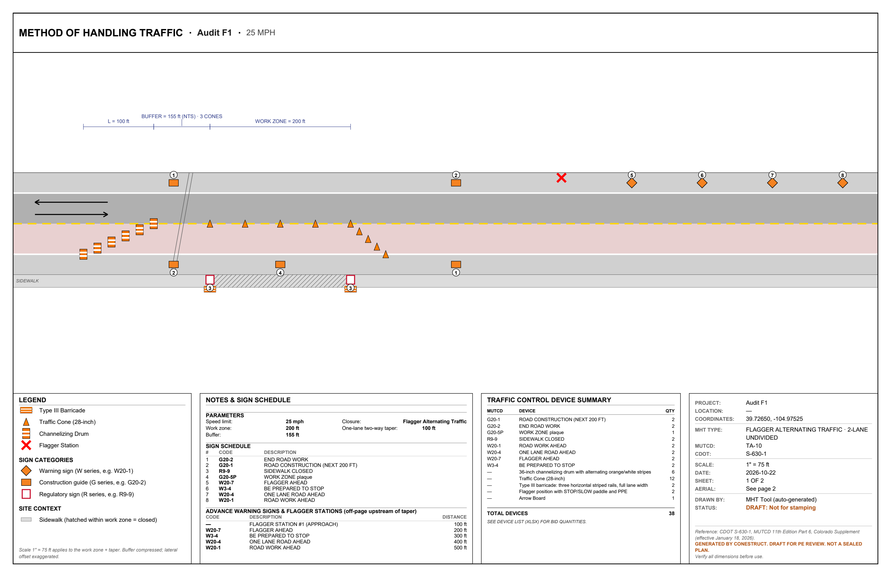

| Check | Result | Oracle | Plan | Source | Note |
|---|---|---|---|---|---|
| C1 taper | PASS | 50–100 ft one-lane two-way taper | page 1 label 100, page 1 notes 100, audit 100, audit summary 100, crew sheet 100 | MUTCD Table 6B-3, p. 775; §6B.08 ¶14, p. 776 (L3) |  |
| C2 buffer | PASS | ≥ 155 ft at 25 mph | page 1 label 155, page 1 notes 155, audit 155, crew sheet 155 | MUTCD Table 6B-2, p. 775; §6B.06 ¶11, p. 773 (L9) |  |
| C3 downstream taper | PASS | 50–100 ft, not per lane | 4 cones over 50 ft | MUTCD Table 6B-3, p. 775; §6B.08 ¶12, p. 776 (L4) |  |
| C4 device spacing | PASS | taper ≤ 25 ft, tangent (buffer + work area) ≤ 50 ft | taper 20 ft ≤ 25; cone runs at 50, 39 ft ≤ 50? | MUTCD §6K.01 ¶04, p. 815; S-630-1 Note 18 (L10) |  |
| C5 device type and size | PASS | drums or vertical panels on the taper, drums ≥ 36 in; no Type 1 barricade at 55+ mph | 6 drums on the one-lane two-way taper; drums 36-inch | S-630-1 Sheet 4 legend; MUTCD §6K.06 ¶01, p. 820; S-630-1 Note 16 (L11, L13) |  |
| C6 flagger sign series | PASS | W20-1 → W20-4 → (W3-4) → W20-7 on both approaches, gaps ≥ 100 ft (urban_low) | W20-1 500 → W20-4 400 → W3-4 300 → W20-7 200; summary W20-1/W20-4/W20-7 = [2, 2, 2] | MUTCD Fig 6P-10, p. 879; S-630-1 Sheet 9 Case 17; Table 6B-1, p. 773 (L5, L6) |  |
| C7 flagger stations | PASS | a flagger at each end; the upstream one at the taper after W20-7, A to W20-7; the opposite one 200–300 ft past the work | 2 stations at 555, -300; upstream flagger 100 ft before the taper (INFO: Fig 6P-10 draws it at the taper's upstream end); opposite flagger 300 ft past the work area | MUTCD Fig 6P-10, p. 879; §6D.06, p. 786; §6E.02 ¶01, p. 787; S-630-1 Case 17 (L7) |  |
| C8 arrow board | INFO | none, or caution mode only | present; mode not stated; page 1 1, crew 0 | MUTCD §6L.06 ¶17-¶18, p. 833; S-630-1 Note 26 (L14) |  |
| C10 device counts agree | **FLAG** | same quantity of every device on every surface | arrow_board: page 1 summary 1, device XLSX 1, quote XLSX 1, crew sheet 0, audit 1 | Rule 10 / P2 one voice per fact |  |
| C10b notes match drawing | PASS | every value in NOTES equals its drawn label and the request | match | Rule 10 |  |
| C11 containment | PASS | 0/0/0 | 0/0/0 | tests/test_pdf_containment.py measure |  |
| C11b edition | **FLAG** | MUTCD 11th Edition throughout; S-630-1 July 2026 (26 sheets) | MUTCD 11th Edition; audit links S-630-01%20(19-Page%20Set).pdf | Rule 9; CLAUDE.md staleness note | edition finding: goes to #265 |
| C13 pedestrian access | PASS | the closure shown (TA-28) or the limit stated | pedestrianAccess=False, scan sidewalk=True; R9-9 | MUTCD TA-28, pp. 914-915; §6N.04 ¶06, p. 843 (L20) |  |

### `F2`: Ogden St between 6th and 7th Ave, Denver

flagger_lane_closure · Ogden Street (residential) · urban_arterial, undivided, 2 lanes × 12.0 ft · 25 mph (work zone 25) · right lane · 200 ft · night · denver · urban_low · TA-10, MUTCD TA-10: Flagger one-lane two-way

**2 FLAG** · pin 39.7265, -104.97525

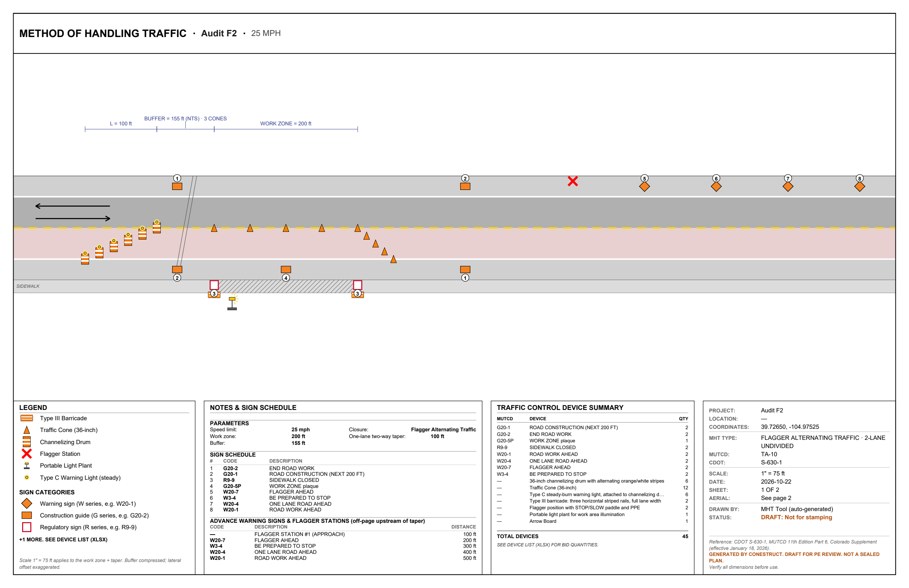

| Check | Result | Oracle | Plan | Source | Note |
|---|---|---|---|---|---|
| C1 taper | PASS | 50–100 ft one-lane two-way taper | page 1 label 100, page 1 notes 100, audit 100, audit summary 100, crew sheet 100 | MUTCD Table 6B-3, p. 775; §6B.08 ¶14, p. 776 (L3) |  |
| C2 buffer | PASS | ≥ 155 ft at 25 mph | page 1 label 155, page 1 notes 155, audit 155, crew sheet 155 | MUTCD Table 6B-2, p. 775; §6B.06 ¶11, p. 773 (L9) |  |
| C3 downstream taper | PASS | 50–100 ft, not per lane | 4 cones over 50 ft | MUTCD Table 6B-3, p. 775; §6B.08 ¶12, p. 776 (L4) |  |
| C4 device spacing | PASS | taper ≤ 25 ft, tangent (buffer + work area) ≤ 50 ft | taper 20 ft ≤ 25; cone runs at 50, 39 ft ≤ 50? | MUTCD §6K.01 ¶04, p. 815; S-630-1 Note 18 (L10) |  |
| C5 device type and size | PASS | drums or vertical panels on the taper, drums ≥ 36 in; no Type 1 barricade at 55+ mph | 6 drums on the one-lane two-way taper; drums 36-inch | S-630-1 Sheet 4 legend; MUTCD §6K.06 ¶01, p. 820; S-630-1 Note 16 (L11, L13) |  |
| C6 flagger sign series | PASS | W20-1 → W20-4 → (W3-4) → W20-7 on both approaches, gaps ≥ 100 ft (urban_low) | W20-1 500 → W20-4 400 → W3-4 300 → W20-7 200; summary W20-1/W20-4/W20-7 = [2, 2, 2] | MUTCD Fig 6P-10, p. 879; S-630-1 Sheet 9 Case 17; Table 6B-1, p. 773 (L5, L6) |  |
| C7 flagger stations | PASS | a flagger at each end; the upstream one at the taper after W20-7, A to W20-7; the opposite one 200–300 ft past the work | 2 stations at 555, -300; upstream flagger 100 ft before the taper (INFO: Fig 6P-10 draws it at the taper's upstream end); opposite flagger 300 ft past the work area | MUTCD Fig 6P-10, p. 879; §6D.06, p. 786; §6E.02 ¶01, p. 787; S-630-1 Case 17 (L7) |  |
| C8 arrow board | INFO | none, or caution mode only | present; mode not stated; page 1 1, crew 0 | MUTCD §6L.06 ¶17-¶18, p. 833; S-630-1 Note 26 (L14) |  |
| C10 device counts agree | **FLAG** | same quantity of every device on every surface | arrow_board: page 1 summary 1, device XLSX 1, quote XLSX 1, crew sheet 0, audit 1 | Rule 10 / P2 one voice per fact |  |
| C10b notes match drawing | PASS | every value in NOTES equals its drawn label and the request | match | Rule 10 |  |
| C11 containment | PASS | 0/0/0 | 0/0/0 | tests/test_pdf_containment.py measure |  |
| C11b edition | **FLAG** | MUTCD 11th Edition throughout; S-630-1 July 2026 (26 sheets) | MUTCD 11th Edition; audit links S-630-01%20(19-Page%20Set).pdf | Rule 9; CLAUDE.md staleness note | edition finding: goes to #265 |
| C13 pedestrian access | PASS | the closure shown (TA-28) or the limit stated | pedestrianAccess=False, scan sidewalk=True; R9-9 | MUTCD TA-28, pp. 914-915; §6N.04 ¶06, p. 843 (L20) |  |
| C14 night cone height | PASS | ≥ 36 in at night | 36-inch | S-630-1 Sheet 2 Note 15 (L12) |  |
| C14b flagger station lighting | PASS | flagger stations illuminated at night | - 1× Portable Light Plant | MUTCD §6D.06 ¶05, p. 786; S-630-1 Note 22 (L8) |  |

### `F3`: E Louisiana Ave at South High School, Denver

flagger_lane_closure · East Louisiana Avenue (tertiary) · urban_arterial, undivided, 2 lanes × 12.0 ft · 30 mph (work zone 30) · right lane · 300 ft · day · denver · urban_low · TA-10, MUTCD TA-10: Flagger one-lane two-way

**2 FLAG** · pin 39.6928, -104.96595

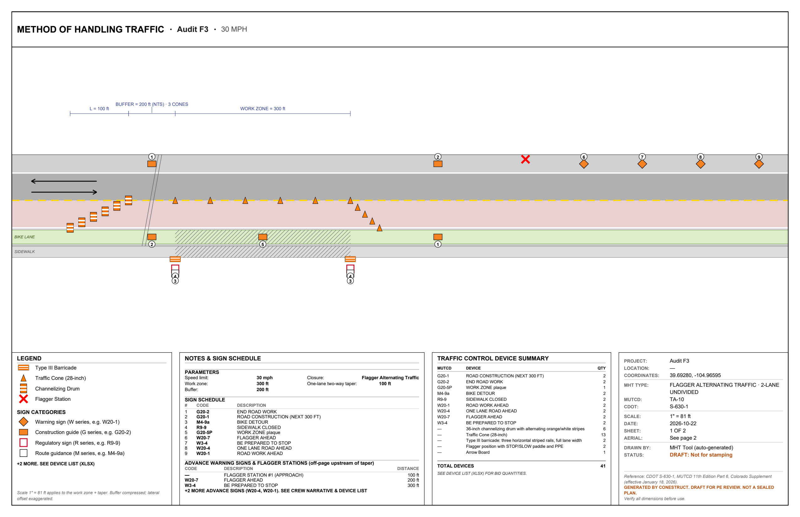

| Check | Result | Oracle | Plan | Source | Note |
|---|---|---|---|---|---|
| C1 taper | PASS | 50–100 ft one-lane two-way taper | page 1 label 100, page 1 notes 100, audit 100, audit summary 100, crew sheet 100 | MUTCD Table 6B-3, p. 775; §6B.08 ¶14, p. 776 (L3) |  |
| C2 buffer | PASS | ≥ 200 ft at 30 mph | page 1 label 200, page 1 notes 200, audit 200, crew sheet 200 | MUTCD Table 6B-2, p. 775; §6B.06 ¶11, p. 773 (L9) |  |
| C3 downstream taper | PASS | 50–100 ft, not per lane | 4 cones over 50 ft | MUTCD Table 6B-3, p. 775; §6B.08 ¶12, p. 776 (L4) |  |
| C4 device spacing | PASS | taper ≤ 30 ft, tangent (buffer + work area) ≤ 60 ft | taper 20 ft ≤ 30; cone runs at 60, 50 ft ≤ 60? | MUTCD §6K.01 ¶04, p. 815; S-630-1 Note 18 (L10) |  |
| C5 device type and size | PASS | drums or vertical panels on the taper, drums ≥ 36 in; no Type 1 barricade at 55+ mph | 6 drums on the one-lane two-way taper; drums 36-inch | S-630-1 Sheet 4 legend; MUTCD §6K.06 ¶01, p. 820; S-630-1 Note 16 (L11, L13) |  |
| C6 flagger sign series | PASS | W20-1 → W20-4 → (W3-4) → W20-7 on both approaches, gaps ≥ 100 ft (urban_low) | W20-1 500 → W20-4 400 → W3-4 300 → W20-7 200; summary W20-1/W20-4/W20-7 = [2, 2, 2] | MUTCD Fig 6P-10, p. 879; S-630-1 Sheet 9 Case 17; Table 6B-1, p. 773 (L5, L6) |  |
| C7 flagger stations | PASS | a flagger at each end; the upstream one at the taper after W20-7, A to W20-7; the opposite one 200–300 ft past the work | 2 stations at 700, -300; upstream flagger 100 ft before the taper (INFO: Fig 6P-10 draws it at the taper's upstream end); opposite flagger 300 ft past the work area | MUTCD Fig 6P-10, p. 879; §6D.06, p. 786; §6E.02 ¶01, p. 787; S-630-1 Case 17 (L7) |  |
| C8 arrow board | INFO | none, or caution mode only | present; mode not stated; page 1 1, crew 0 | MUTCD §6L.06 ¶17-¶18, p. 833; S-630-1 Note 26 (L14) |  |
| C10 device counts agree | **FLAG** | same quantity of every device on every surface | arrow_board: page 1 summary 1, device XLSX 1, quote XLSX 1, crew sheet 0, audit 1 | Rule 10 / P2 one voice per fact |  |
| C10b notes match drawing | PASS | every value in NOTES equals its drawn label and the request | match | Rule 10 |  |
| C11 containment | PASS | 0/0/0 | 0/0/0 | tests/test_pdf_containment.py measure |  |
| C11b edition | **FLAG** | MUTCD 11th Edition throughout; S-630-1 July 2026 (26 sheets) | MUTCD 11th Edition; audit links S-630-01%20(19-Page%20Set).pdf | Rule 9; CLAUDE.md staleness note | edition finding: goes to #265 |
| C13 pedestrian access | PASS | the closure shown (TA-28) or the limit stated | pedestrianAccess=False, scan sidewalk=True; R9-9 | MUTCD TA-28, pp. 914-915; §6N.04 ¶06, p. 843 (L20) |  |

### `F4`: E Louisiana Ave at South High School, Denver

flagger_lane_closure · East Louisiana Avenue (tertiary) · urban_arterial, undivided, 2 lanes × 12.0 ft · 30 mph (work zone 30) · right lane · 300 ft · night · denver · urban_low · TA-10, MUTCD TA-10: Flagger one-lane two-way

**2 FLAG** · pin 39.6928, -104.96595

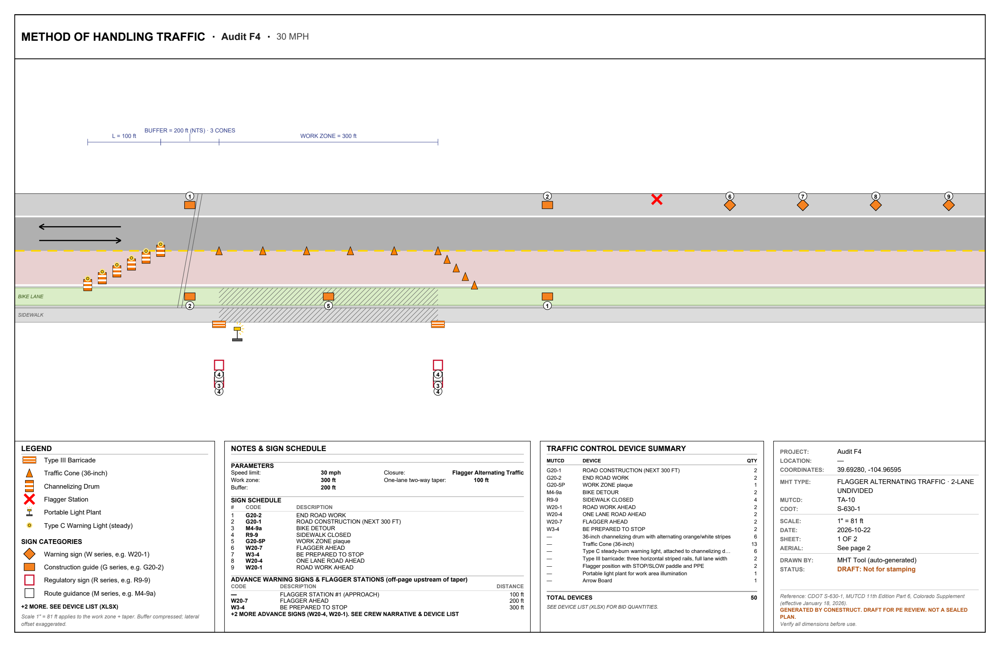

| Check | Result | Oracle | Plan | Source | Note |
|---|---|---|---|---|---|
| C1 taper | PASS | 50–100 ft one-lane two-way taper | page 1 label 100, page 1 notes 100, audit 100, audit summary 100, crew sheet 100 | MUTCD Table 6B-3, p. 775; §6B.08 ¶14, p. 776 (L3) |  |
| C2 buffer | PASS | ≥ 200 ft at 30 mph | page 1 label 200, page 1 notes 200, audit 200, crew sheet 200 | MUTCD Table 6B-2, p. 775; §6B.06 ¶11, p. 773 (L9) |  |
| C3 downstream taper | PASS | 50–100 ft, not per lane | 4 cones over 50 ft | MUTCD Table 6B-3, p. 775; §6B.08 ¶12, p. 776 (L4) |  |
| C4 device spacing | PASS | taper ≤ 30 ft, tangent (buffer + work area) ≤ 60 ft | taper 20 ft ≤ 30; cone runs at 60, 50 ft ≤ 60? | MUTCD §6K.01 ¶04, p. 815; S-630-1 Note 18 (L10) |  |
| C5 device type and size | PASS | drums or vertical panels on the taper, drums ≥ 36 in; no Type 1 barricade at 55+ mph | 6 drums on the one-lane two-way taper; drums 36-inch | S-630-1 Sheet 4 legend; MUTCD §6K.06 ¶01, p. 820; S-630-1 Note 16 (L11, L13) |  |
| C6 flagger sign series | PASS | W20-1 → W20-4 → (W3-4) → W20-7 on both approaches, gaps ≥ 100 ft (urban_low) | W20-1 500 → W20-4 400 → W3-4 300 → W20-7 200; summary W20-1/W20-4/W20-7 = [2, 2, 2] | MUTCD Fig 6P-10, p. 879; S-630-1 Sheet 9 Case 17; Table 6B-1, p. 773 (L5, L6) |  |
| C7 flagger stations | PASS | a flagger at each end; the upstream one at the taper after W20-7, A to W20-7; the opposite one 200–300 ft past the work | 2 stations at 700, -300; upstream flagger 100 ft before the taper (INFO: Fig 6P-10 draws it at the taper's upstream end); opposite flagger 300 ft past the work area | MUTCD Fig 6P-10, p. 879; §6D.06, p. 786; §6E.02 ¶01, p. 787; S-630-1 Case 17 (L7) |  |
| C8 arrow board | INFO | none, or caution mode only | present; mode not stated; page 1 1, crew 0 | MUTCD §6L.06 ¶17-¶18, p. 833; S-630-1 Note 26 (L14) |  |
| C10 device counts agree | **FLAG** | same quantity of every device on every surface | arrow_board: page 1 summary 1, device XLSX 1, quote XLSX 1, crew sheet 0, audit 1 | Rule 10 / P2 one voice per fact |  |
| C10b notes match drawing | PASS | every value in NOTES equals its drawn label and the request | match | Rule 10 |  |
| C11 containment | PASS | 0/0/0 | 0/0/0 | tests/test_pdf_containment.py measure |  |
| C11b edition | **FLAG** | MUTCD 11th Edition throughout; S-630-1 July 2026 (26 sheets) | MUTCD 11th Edition; audit links S-630-01%20(19-Page%20Set).pdf | Rule 9; CLAUDE.md staleness note | edition finding: goes to #265 |
| C13 pedestrian access | PASS | the closure shown (TA-28) or the limit stated | pedestrianAccess=True, scan sidewalk=True; R9-9 | MUTCD TA-28, pp. 914-915; §6N.04 ¶06, p. 843 (L20) |  |
| C14 night cone height | PASS | ≥ 36 in at night | 36-inch | S-630-1 Sheet 2 Note 15 (L12) |  |
| C14b flagger station lighting | PASS | flagger stations illuminated at night | - 1× Portable Light Plant | MUTCD §6D.06 ¶05, p. 786; S-630-1 Note 22 (L8) |  |

### `F5`: W 9th Ave, Lakewood

flagger_lane_closure · West 9th Avenue (residential) · urban_arterial, undivided, None lanes × 12.0 ft · 30 mph (work zone 30) · right lane · 300 ft · day · lakewood · urban_low · TA-10, MUTCD TA-10: Flagger one-lane two-way

**1 FLAG** · pin 39.73105, -105.10397

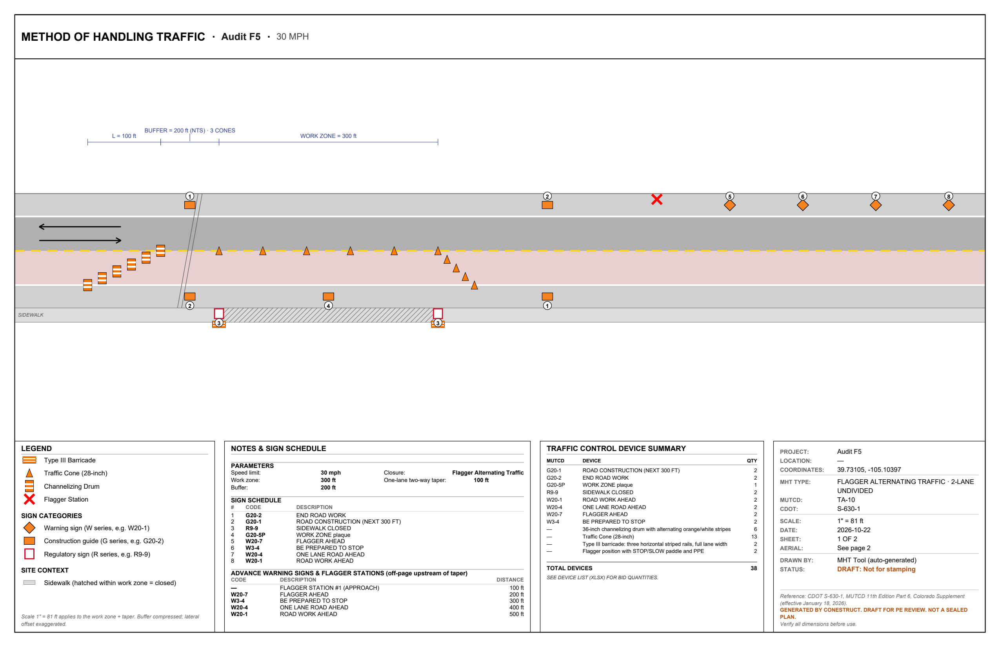

| Check | Result | Oracle | Plan | Source | Note |
|---|---|---|---|---|---|
| C1 taper | PASS | 50–100 ft one-lane two-way taper | page 1 label 100, page 1 notes 100, audit 100, audit summary 100, crew sheet 100 | MUTCD Table 6B-3, p. 775; §6B.08 ¶14, p. 776 (L3) |  |
| C2 buffer | PASS | ≥ 200 ft at 30 mph | page 1 label 200, page 1 notes 200, audit 200, crew sheet 200 | MUTCD Table 6B-2, p. 775; §6B.06 ¶11, p. 773 (L9) |  |
| C3 downstream taper | PASS | 50–100 ft, not per lane | 4 cones over 50 ft | MUTCD Table 6B-3, p. 775; §6B.08 ¶12, p. 776 (L4) |  |
| C4 device spacing | PASS | taper ≤ 30 ft, tangent (buffer + work area) ≤ 60 ft | taper 20 ft ≤ 30; cone runs at 60, 50 ft ≤ 60? | MUTCD §6K.01 ¶04, p. 815; S-630-1 Note 18 (L10) |  |
| C5 device type and size | PASS | drums or vertical panels on the taper, drums ≥ 36 in; no Type 1 barricade at 55+ mph | 6 drums on the one-lane two-way taper; drums 36-inch | S-630-1 Sheet 4 legend; MUTCD §6K.06 ¶01, p. 820; S-630-1 Note 16 (L11, L13) |  |
| C6 flagger sign series | PASS | W20-1 → W20-4 → (W3-4) → W20-7 on both approaches, gaps ≥ 100 ft (urban_low) | W20-1 500 → W20-4 400 → W3-4 300 → W20-7 200; summary W20-1/W20-4/W20-7 = [2, 2, 2] | MUTCD Fig 6P-10, p. 879; S-630-1 Sheet 9 Case 17; Table 6B-1, p. 773 (L5, L6) |  |
| C6c Lakewood breakpoint | INFO | Lakewood's 35 mph split makes this road urban_low | plan uses urban_low | data/jurisdictions/lakewood.json | INFO while 02-JURISDICTION-DATA.md is missing (Ryan, 2026-10-22) |
| C7 flagger stations | PASS | a flagger at each end; the upstream one at the taper after W20-7, A to W20-7; the opposite one 200–300 ft past the work | 2 stations at 700, -300; upstream flagger 100 ft before the taper (INFO: Fig 6P-10 draws it at the taper's upstream end); opposite flagger 300 ft past the work area | MUTCD Fig 6P-10, p. 879; §6D.06, p. 786; §6E.02 ¶01, p. 787; S-630-1 Case 17 (L7) |  |
| C8 arrow board | PASS | none, or caution mode only | none; mode not stated; page 1 0, crew 0 | MUTCD §6L.06 ¶17-¶18, p. 833; S-630-1 Note 26 (L14) |  |
| C10 device counts agree | PASS | same quantity of every device on every surface | 38 devices, equal on 5 surfaces | Rule 10 / P2 one voice per fact |  |
| C10b notes match drawing | PASS | every value in NOTES equals its drawn label and the request | match | Rule 10 |  |
| C11 containment | PASS | 0/0/0 | 0/0/0 | tests/test_pdf_containment.py measure |  |
| C11b edition | **FLAG** | MUTCD 11th Edition throughout; S-630-1 July 2026 (26 sheets) | MUTCD 11th Edition; audit links S-630-01%20(19-Page%20Set).pdf | Rule 9; CLAUDE.md staleness note | edition finding: goes to #265 |
| C13 pedestrian access | PASS | the closure shown (TA-28) or the limit stated | pedestrianAccess=False, scan sidewalk=True; R9-9 | MUTCD TA-28, pp. 914-915; §6N.04 ¶06, p. 843 (L20) |  |

### `F6`: Lafayette St, Denver

flagger_lane_closure · Lafayette Street (residential) · urban_arterial, undivided, 2 lanes × 12.0 ft · 35 mph (work zone 35) · right lane · 500 ft · day · denver · urban_low · TA-10, MUTCD TA-10: Flagger one-lane two-way

**2 FLAG** · pin 39.73447, -104.97067

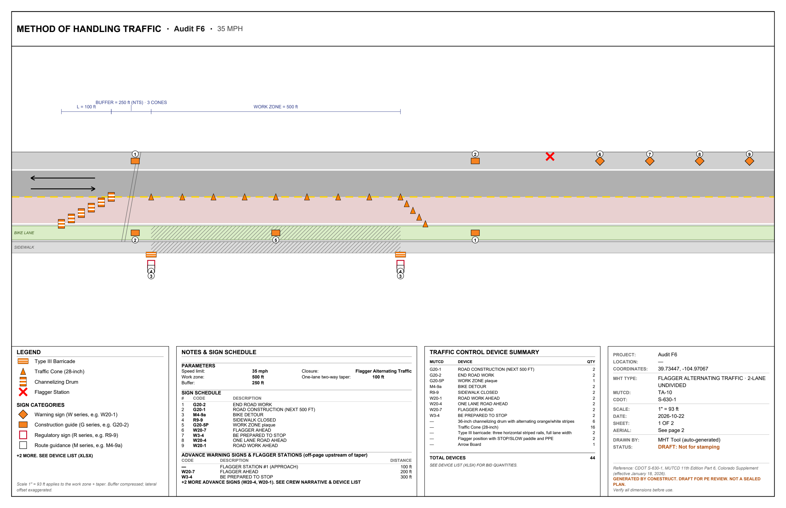

| Check | Result | Oracle | Plan | Source | Note |
|---|---|---|---|---|---|
| C1 taper | PASS | 50–100 ft one-lane two-way taper | page 1 label 100, page 1 notes 100, audit 100, audit summary 100, crew sheet 100 | MUTCD Table 6B-3, p. 775; §6B.08 ¶14, p. 776 (L3) |  |
| C2 buffer | PASS | ≥ 250 ft at 35 mph | page 1 label 250, page 1 notes 250, audit 250, crew sheet 250 | MUTCD Table 6B-2, p. 775; §6B.06 ¶11, p. 773 (L9) |  |
| C3 downstream taper | PASS | 50–100 ft, not per lane | 4 cones over 50 ft | MUTCD Table 6B-3, p. 775; §6B.08 ¶12, p. 776 (L4) |  |
| C4 device spacing | PASS | taper ≤ 35 ft, tangent (buffer + work area) ≤ 70 ft | taper 20 ft ≤ 35; cone runs at 62, 62 ft ≤ 70? | MUTCD §6K.01 ¶04, p. 815; S-630-1 Note 18 (L10) |  |
| C5 device type and size | PASS | drums or vertical panels on the taper, drums ≥ 36 in; no Type 1 barricade at 55+ mph | 6 drums on the one-lane two-way taper; drums 36-inch | S-630-1 Sheet 4 legend; MUTCD §6K.06 ¶01, p. 820; S-630-1 Note 16 (L11, L13) |  |
| C6 flagger sign series | PASS | W20-1 → W20-4 → (W3-4) → W20-7 on both approaches, gaps ≥ 100 ft (urban_low) | W20-1 500 → W20-4 400 → W3-4 300 → W20-7 200; summary W20-1/W20-4/W20-7 = [2, 2, 2] | MUTCD Fig 6P-10, p. 879; S-630-1 Sheet 9 Case 17; Table 6B-1, p. 773 (L5, L6) |  |
| C7 flagger stations | PASS | a flagger at each end; the upstream one at the taper after W20-7, A to W20-7; the opposite one 200–300 ft past the work | 2 stations at 950, -300; upstream flagger 100 ft before the taper (INFO: Fig 6P-10 draws it at the taper's upstream end); opposite flagger 300 ft past the work area | MUTCD Fig 6P-10, p. 879; §6D.06, p. 786; §6E.02 ¶01, p. 787; S-630-1 Case 17 (L7) |  |
| C8 arrow board | INFO | none, or caution mode only | present; mode not stated; page 1 1, crew 0 | MUTCD §6L.06 ¶17-¶18, p. 833; S-630-1 Note 26 (L14) |  |
| C10 device counts agree | **FLAG** | same quantity of every device on every surface | arrow_board: page 1 summary 1, device XLSX 1, quote XLSX 1, crew sheet 0, audit 1 | Rule 10 / P2 one voice per fact |  |
| C10b notes match drawing | PASS | every value in NOTES equals its drawn label and the request | match | Rule 10 |  |
| C11 containment | PASS | 0/0/0 | 0/0/0 | tests/test_pdf_containment.py measure |  |
| C11b edition | **FLAG** | MUTCD 11th Edition throughout; S-630-1 July 2026 (26 sheets) | MUTCD 11th Edition; audit links S-630-01%20(19-Page%20Set).pdf | Rule 9; CLAUDE.md staleness note | edition finding: goes to #265 |
| C13 pedestrian access | PASS | the closure shown (TA-28) or the limit stated | pedestrianAccess=False, scan sidewalk=True; R9-9 | MUTCD TA-28, pp. 914-915; §6N.04 ¶06, p. 843 (L20) |  |

### `F7`: Lookout Mountain Rd, way 1432422179

flagger_lane_closure · Lookout Mountain Road CR 68 (tertiary) · urban_arterial, undivided, 2 lanes × 12.0 ft · 20 mph (work zone 20) · right lane · 300 ft · day · None · urban_low · TA-10, MUTCD TA-10: Flagger one-lane two-way

**1 FLAG** · pin 39.733, -105.24

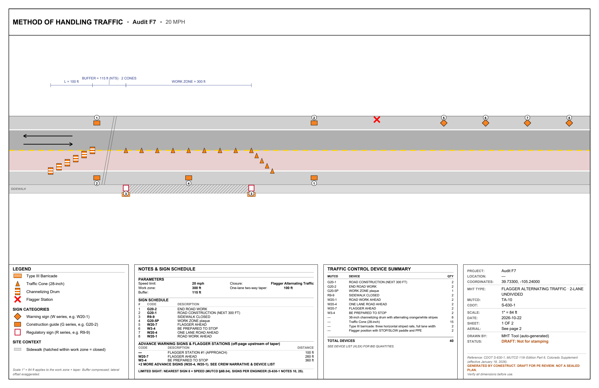

| Check | Result | Oracle | Plan | Source | Note |
|---|---|---|---|---|---|
| C1 taper | PASS | 50–100 ft one-lane two-way taper | page 1 label 100, page 1 notes 100, audit 100, audit summary 100, crew sheet 100 | MUTCD Table 6B-3, p. 775; §6B.08 ¶14, p. 776 (L3) |  |
| C2 buffer | PASS | ≥ 115 ft at 20 mph | page 1 label 115, page 1 notes 115, audit 115, crew sheet 115 | MUTCD Table 6B-2, p. 775; §6B.06 ¶11, p. 773 (L9) |  |
| C3 downstream taper | PASS | 50–100 ft, not per lane | 4 cones over 50 ft | MUTCD Table 6B-3, p. 775; §6B.08 ¶12, p. 776 (L4) |  |
| C4 device spacing | PASS | taper ≤ 20 ft, tangent (buffer + work area) ≤ 40 ft | taper 20 ft ≤ 20; cone runs at 38, 38 ft ≤ 40? | MUTCD §6K.01 ¶04, p. 815; S-630-1 Note 18 (L10) |  |
| C5 device type and size | PASS | drums or vertical panels on the taper, drums ≥ 36 in; no Type 1 barricade at 55+ mph | 6 drums on the one-lane two-way taper; drums 36-inch | S-630-1 Sheet 4 legend; MUTCD §6K.06 ¶01, p. 820; S-630-1 Note 16 (L11, L13) |  |
| C6 flagger sign series | PASS | W20-1 → W20-4 → (W3-4) → W20-7 on both approaches, gaps ≥ 100 ft (urban_low) | W20-1 560 → W20-4 460 → W3-4 360 → W20-7 260; summary W20-1/W20-4/W20-7 = [2, 2, 2] | MUTCD Fig 6P-10, p. 879; S-630-1 Sheet 9 Case 17; Table 6B-1, p. 773 (L5, L6) |  |
| C7 flagger stations | PASS | a flagger at each end; the upstream one at the taper after W20-7, A to W20-7; the opposite one 200–300 ft past the work | 2 stations at 615, -300; upstream flagger 100 ft before the taper (INFO: Fig 6P-10 draws it at the taper's upstream end); opposite flagger 300 ft past the work area | MUTCD Fig 6P-10, p. 879; §6D.06, p. 786; §6E.02 ¶01, p. 787; S-630-1 Case 17 (L7) |  |
| C8 arrow board | PASS | none, or caution mode only | none; mode not stated; page 1 0, crew 0 | MUTCD §6L.06 ¶17-¶18, p. 833; S-630-1 Note 26 (L14) |  |
| C10 device counts agree | PASS | same quantity of every device on every surface | 40 devices, equal on 5 surfaces | Rule 10 / P2 one voice per fact |  |
| C10b notes match drawing | PASS | every value in NOTES equals its drawn label and the request | match | Rule 10 |  |
| C11 containment | PASS | 0/0/0 | 0/0/0 | tests/test_pdf_containment.py measure |  |
| C11b edition | **FLAG** | MUTCD 11th Edition throughout; S-630-1 July 2026 (26 sheets) | MUTCD 11th Edition; audit links S-630-01%20(19-Page%20Set).pdf | Rule 9; CLAUDE.md staleness note | edition finding: goes to #265 |
| C12 limited sight distance | PASS | each sign farther upstream than without the flag; a fixed factor cited or marked chosen | signs at 560, 460, 360, 260; without the flag [500.0, 400.0, 300.0, 200.0]; audit: "MUTCD §6B.04: limited sight distance puts the nearest warning sign at the top of ¶04's urban or ¶06's rural range (p. 771) Moved 8 advance warning sign(s) 60 ft farther upstream. The nearest sign now " | MUTCD §6B.04 ¶04-¶08, p. 771 (L19) | INFO: the cited ¶04/¶06 ranges aren't quoted in oracle-sources.md, so the distance itself isn't scored |
| C13 pedestrian access | PASS | the closure shown (TA-28) or the limit stated | pedestrianAccess=False, scan sidewalk=True; R9-9 | MUTCD TA-28, pp. 914-915; §6N.04 ¶06, p. 843 (L20) |  |

### `F8`: Lookout Mountain Rd, way 1432422179

flagger_lane_closure · Lookout Mountain Road CR 68 (tertiary) · urban_arterial, undivided, 2 lanes × 12.0 ft · 20 mph (work zone 20) · right lane · 300 ft · night · None · urban_low · TA-10, MUTCD TA-10: Flagger one-lane two-way

**1 FLAG** · pin 39.733, -105.24

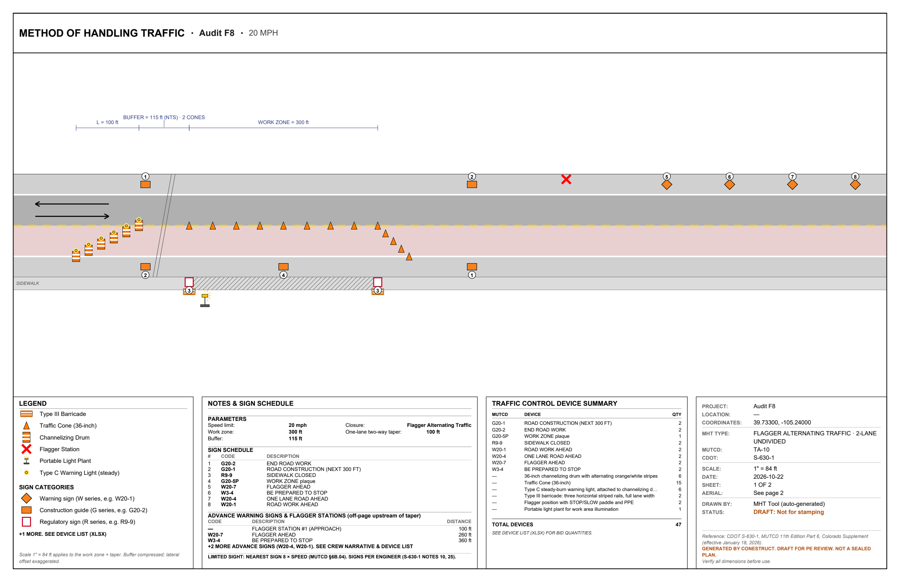

| Check | Result | Oracle | Plan | Source | Note |
|---|---|---|---|---|---|
| C1 taper | PASS | 50–100 ft one-lane two-way taper | page 1 label 100, page 1 notes 100, audit 100, audit summary 100, crew sheet 100 | MUTCD Table 6B-3, p. 775; §6B.08 ¶14, p. 776 (L3) |  |
| C2 buffer | PASS | ≥ 115 ft at 20 mph | page 1 label 115, page 1 notes 115, audit 115, crew sheet 115 | MUTCD Table 6B-2, p. 775; §6B.06 ¶11, p. 773 (L9) |  |
| C3 downstream taper | PASS | 50–100 ft, not per lane | 4 cones over 50 ft | MUTCD Table 6B-3, p. 775; §6B.08 ¶12, p. 776 (L4) |  |
| C4 device spacing | PASS | taper ≤ 20 ft, tangent (buffer + work area) ≤ 40 ft | taper 20 ft ≤ 20; cone runs at 38, 38 ft ≤ 40? | MUTCD §6K.01 ¶04, p. 815; S-630-1 Note 18 (L10) |  |
| C5 device type and size | PASS | drums or vertical panels on the taper, drums ≥ 36 in; no Type 1 barricade at 55+ mph | 6 drums on the one-lane two-way taper; drums 36-inch | S-630-1 Sheet 4 legend; MUTCD §6K.06 ¶01, p. 820; S-630-1 Note 16 (L11, L13) |  |
| C6 flagger sign series | PASS | W20-1 → W20-4 → (W3-4) → W20-7 on both approaches, gaps ≥ 100 ft (urban_low) | W20-1 560 → W20-4 460 → W3-4 360 → W20-7 260; summary W20-1/W20-4/W20-7 = [2, 2, 2] | MUTCD Fig 6P-10, p. 879; S-630-1 Sheet 9 Case 17; Table 6B-1, p. 773 (L5, L6) |  |
| C7 flagger stations | PASS | a flagger at each end; the upstream one at the taper after W20-7, A to W20-7; the opposite one 200–300 ft past the work | 2 stations at 615, -300; upstream flagger 100 ft before the taper (INFO: Fig 6P-10 draws it at the taper's upstream end); opposite flagger 300 ft past the work area | MUTCD Fig 6P-10, p. 879; §6D.06, p. 786; §6E.02 ¶01, p. 787; S-630-1 Case 17 (L7) |  |
| C8 arrow board | PASS | none, or caution mode only | none; mode not stated; page 1 0, crew 0 | MUTCD §6L.06 ¶17-¶18, p. 833; S-630-1 Note 26 (L14) |  |
| C10 device counts agree | PASS | same quantity of every device on every surface | 47 devices, equal on 5 surfaces | Rule 10 / P2 one voice per fact |  |
| C10b notes match drawing | PASS | every value in NOTES equals its drawn label and the request | match | Rule 10 |  |
| C11 containment | PASS | 0/0/0 | 0/0/0 | tests/test_pdf_containment.py measure |  |
| C11b edition | **FLAG** | MUTCD 11th Edition throughout; S-630-1 July 2026 (26 sheets) | MUTCD 11th Edition; audit links S-630-01%20(19-Page%20Set).pdf | Rule 9; CLAUDE.md staleness note | edition finding: goes to #265 |
| C12 limited sight distance | PASS | each sign farther upstream than without the flag; a fixed factor cited or marked chosen | signs at 560, 460, 360, 260; without the flag [500.0, 400.0, 300.0, 200.0]; audit: "MUTCD §6B.04: limited sight distance puts the nearest warning sign at the top of ¶04's urban or ¶06's rural range (p. 771) Moved 8 advance warning sign(s) 60 ft farther upstream. The nearest sign now " | MUTCD §6B.04 ¶04-¶08, p. 771 (L19) | INFO: the cited ¶04/¶06 ranges aren't quoted in oracle-sources.md, so the distance itself isn't scored |
| C13 pedestrian access | PASS | the closure shown (TA-28) or the limit stated | pedestrianAccess=False, scan sidewalk=True; R9-9 | MUTCD TA-28, pp. 914-915; §6N.04 ¶06, p. 843 (L20) |  |
| C14 night cone height | PASS | ≥ 36 in at night | 36-inch | S-630-1 Sheet 2 Note 15 (L12) |  |
| C14b flagger station lighting | PASS | flagger stations illuminated at night | - 1× Portable Light Plant | MUTCD §6D.06 ¶05, p. 786; S-630-1 Note 22 (L8) |  |

### `F9`: CO 119, Boulder Canyon

flagger_lane_closure · Boulder Canyon Drive CO 119 (primary) · rural_undivided, undivided, 2 lanes × 12.0 ft · 45 mph (work zone 45) · right lane · 500 ft · day · None · rural · TA-10, MUTCD TA-10: Flagger one-lane two-way

**1 FLAG** · pin 40.00185, -105.41289

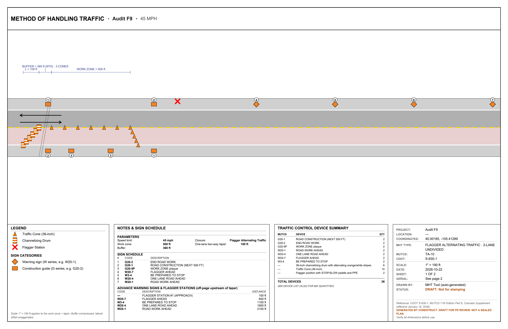

| Check | Result | Oracle | Plan | Source | Note |
|---|---|---|---|---|---|
| C1 taper | PASS | 50–100 ft one-lane two-way taper | page 1 label 100, page 1 notes 100, audit 100, audit summary 100, crew sheet 100 | MUTCD Table 6B-3, p. 775; §6B.08 ¶14, p. 776 (L3) |  |
| C2 buffer | PASS | ≥ 360 ft at 45 mph | page 1 label 360, page 1 notes 360, audit 360, crew sheet 360 | MUTCD Table 6B-2, p. 775; §6B.06 ¶11, p. 773 (L9) |  |
| C3 downstream taper | PASS | 50–100 ft, not per lane | 4 cones over 50 ft | MUTCD Table 6B-3, p. 775; §6B.08 ¶12, p. 776 (L4) |  |
| C4 device spacing | PASS | taper ≤ 45 ft, tangent (buffer + work area) ≤ 90 ft | taper 20 ft ≤ 45; cone runs at 83, 90 ft ≤ 90? | MUTCD §6K.01 ¶04, p. 815; S-630-1 Note 18 (L10) |  |
| C5 device type and size | PASS | drums or vertical panels on the taper, drums ≥ 36 in; no Type 1 barricade at 55+ mph | 6 drums on the one-lane two-way taper; drums 36-inch | S-630-1 Sheet 4 legend; MUTCD §6K.06 ¶01, p. 820; S-630-1 Note 16 (L11, L13) |  |
| C6 flagger sign series | PASS | W20-1 → W20-4 → (W3-4) → W20-7 on both approaches, gaps ≥ 500 ft (rural) | W20-1 2100 → W20-4 1600 → W3-4 1100 → W20-7 600; summary W20-1/W20-4/W20-7 = [2, 2, 2] | MUTCD Fig 6P-10, p. 879; S-630-1 Sheet 9 Case 17; Table 6B-1, p. 773 (L5, L6) |  |
| C7 flagger stations | PASS | a flagger at each end; the upstream one at the taper after W20-7, A to W20-7; the opposite one 200–300 ft past the work | 2 stations at 1060, -300; upstream flagger 100 ft before the taper (INFO: Fig 6P-10 draws it at the taper's upstream end); opposite flagger 300 ft past the work area | MUTCD Fig 6P-10, p. 879; §6D.06, p. 786; §6E.02 ¶01, p. 787; S-630-1 Case 17 (L7) |  |
| C8 arrow board | PASS | none, or caution mode only | none; mode not stated; page 1 0, crew 0 | MUTCD §6L.06 ¶17-¶18, p. 833; S-630-1 Note 26 (L14) |  |
| C10 device counts agree | PASS | same quantity of every device on every surface | 36 devices, equal on 5 surfaces | Rule 10 / P2 one voice per fact |  |
| C10b notes match drawing | PASS | every value in NOTES equals its drawn label and the request | match | Rule 10 |  |
| C11 containment | PASS | 0/0/0 | 0/0/0 | tests/test_pdf_containment.py measure |  |
| C11b edition | **FLAG** | MUTCD 11th Edition throughout; S-630-1 July 2026 (26 sheets) | MUTCD 11th Edition; audit links S-630-01%20(19-Page%20Set).pdf | Rule 9; CLAUDE.md staleness note | edition finding: goes to #265 |
| C14 cone height (45+ mph) | INFO | 36 in where ADT ≥ 2,000 (no ADT input) | 36-inch | S-630-1 Sheet 2 Note 15 (L12) |  |

### `F10`: CO 119, Boulder Canyon

flagger_lane_closure · Boulder Canyon Drive CO 119 (primary) · rural_undivided, undivided, 2 lanes × 12.0 ft · 55 mph (work zone 55) · right lane · 1000 ft · night · None · rural · TA-10, MUTCD TA-10: Flagger one-lane two-way

**1 FLAG** · pin 40.00185, -105.41289

| Check | Result | Oracle | Plan | Source | Note |
|---|---|---|---|---|---|
| C1 taper | PASS | 50–100 ft one-lane two-way taper | page 1 label 100, page 1 notes 100, audit 100, audit summary 100, crew sheet 100 | MUTCD Table 6B-3, p. 775; §6B.08 ¶14, p. 776 (L3) |  |
| C2 buffer | PASS | ≥ 495 ft at 55 mph | page 1 label 495, page 1 notes 495, audit 495, crew sheet 495 | MUTCD Table 6B-2, p. 775; §6B.06 ¶11, p. 773 (L9) |  |
| C3 downstream taper | PASS | 50–100 ft, not per lane | 4 cones over 50 ft | MUTCD Table 6B-3, p. 775; §6B.08 ¶12, p. 776 (L4) |  |
| C4 device spacing | PASS | taper ≤ 55 ft, tangent (buffer + work area) ≤ 110 ft | taper 20 ft ≤ 55; cone runs at 100, 99 ft ≤ 110? | MUTCD §6K.01 ¶04, p. 815; S-630-1 Note 18 (L10) |  |
| C5 device type and size | PASS | drums or vertical panels on the taper, drums ≥ 36 in; no Type 1 barricade at 55+ mph | 6 drums on the one-lane two-way taper; drums 36-inch; Type 1 barricade: none | S-630-1 Sheet 4 legend; MUTCD §6K.06 ¶01, p. 820; S-630-1 Note 16 (L11, L13) |  |
| C6 flagger sign series | PASS | W20-1 → W20-4 → (W3-4) → W20-7 on both approaches, gaps ≥ 500 ft (rural) | W20-1 2100 → W20-4 1600 → W3-4 1100 → W20-7 600; summary W20-1/W20-4/W20-7 = [2, 2, 2] | MUTCD Fig 6P-10, p. 879; S-630-1 Sheet 9 Case 17; Table 6B-1, p. 773 (L5, L6) |  |
| C7 flagger stations | PASS | a flagger at each end; the upstream one at the taper after W20-7, A to W20-7; the opposite one 200–300 ft past the work | 2 stations at 1695, -300; upstream flagger 100 ft before the taper (INFO: Fig 6P-10 draws it at the taper's upstream end); opposite flagger 300 ft past the work area | MUTCD Fig 6P-10, p. 879; §6D.06, p. 786; §6E.02 ¶01, p. 787; S-630-1 Case 17 (L7) |  |
| C8 arrow board | PASS | none, or caution mode only | none; mode not stated; page 1 0, crew 0 | MUTCD §6L.06 ¶17-¶18, p. 833; S-630-1 Note 26 (L14) |  |
| C10 device counts agree | PASS | same quantity of every device on every surface | 48 devices, equal on 5 surfaces | Rule 10 / P2 one voice per fact |  |
| C10b notes match drawing | PASS | every value in NOTES equals its drawn label and the request | match | Rule 10 |  |
| C11 containment | PASS | 0/0/0 | 0/0/0 | tests/test_pdf_containment.py measure |  |
| C11b edition | **FLAG** | MUTCD 11th Edition throughout; S-630-1 July 2026 (26 sheets) | MUTCD 11th Edition; audit links S-630-01%20(19-Page%20Set).pdf | Rule 9; CLAUDE.md staleness note | edition finding: goes to #265 |
| C14 night cone height | PASS | ≥ 36 in at night | 36-inch | S-630-1 Sheet 2 Note 15 (L12) |  |
| C14b flagger station lighting | PASS | flagger stations illuminated at night | - 1× Portable Light Plant | MUTCD §6D.06 ¶05, p. 786; S-630-1 Note 22 (L8) |  |

### `F11`: US 24 at Hartsel

flagger_lane_closure · US 24 (trunk) · rural_undivided, undivided, 2 lanes × 12.0 ft · 55 mph (work zone 55) · right lane · 1500 ft · day · None · rural · TA-10, MUTCD TA-10: Flagger one-lane two-way

**1 FLAG** · pin 39.02175, -105.79286

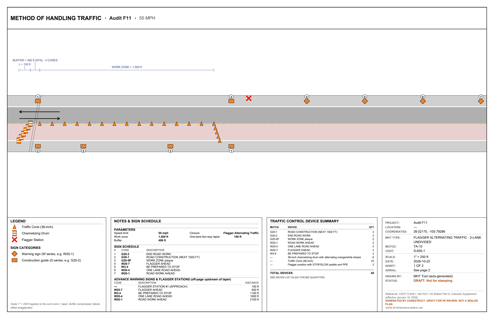

| Check | Result | Oracle | Plan | Source | Note |
|---|---|---|---|---|---|
| C1 taper | PASS | 50–100 ft one-lane two-way taper | page 1 label 100, page 1 notes 100, audit 100, audit summary 100, crew sheet 100 | MUTCD Table 6B-3, p. 775; §6B.08 ¶14, p. 776 (L3) |  |
| C2 buffer | PASS | ≥ 495 ft at 55 mph | page 1 label 495, page 1 notes 495, audit 495, crew sheet 495 | MUTCD Table 6B-2, p. 775; §6B.06 ¶11, p. 773 (L9) |  |
| C3 downstream taper | PASS | 50–100 ft, not per lane | 4 cones over 50 ft | MUTCD Table 6B-3, p. 775; §6B.08 ¶12, p. 776 (L4) |  |
| C4 device spacing | PASS | taper ≤ 55 ft, tangent (buffer + work area) ≤ 110 ft | taper 20 ft ≤ 55; cone runs at 107, 99 ft ≤ 110? | MUTCD §6K.01 ¶04, p. 815; S-630-1 Note 18 (L10) |  |
| C5 device type and size | PASS | drums or vertical panels on the taper, drums ≥ 36 in; no Type 1 barricade at 55+ mph | 6 drums on the one-lane two-way taper; drums 36-inch; Type 1 barricade: none | S-630-1 Sheet 4 legend; MUTCD §6K.06 ¶01, p. 820; S-630-1 Note 16 (L11, L13) |  |
| C6 flagger sign series | PASS | W20-1 → W20-4 → (W3-4) → W20-7 on both approaches, gaps ≥ 500 ft (rural) | W20-1 2100 → W20-4 1600 → W3-4 1100 → W20-7 600; summary W20-1/W20-4/W20-7 = [2, 2, 2] | MUTCD Fig 6P-10, p. 879; S-630-1 Sheet 9 Case 17; Table 6B-1, p. 773 (L5, L6) |  |
| C7 flagger stations | PASS | a flagger at each end; the upstream one at the taper after W20-7, A to W20-7; the opposite one 200–300 ft past the work | 2 stations at 2195, -300; upstream flagger 100 ft before the taper (INFO: Fig 6P-10 draws it at the taper's upstream end); opposite flagger 300 ft past the work area | MUTCD Fig 6P-10, p. 879; §6D.06, p. 786; §6E.02 ¶01, p. 787; S-630-1 Case 17 (L7) |  |
| C8 arrow board | PASS | none, or caution mode only | none; mode not stated; page 1 0, crew 0 | MUTCD §6L.06 ¶17-¶18, p. 833; S-630-1 Note 26 (L14) |  |
| C10 device counts agree | PASS | same quantity of every device on every surface | 45 devices, equal on 5 surfaces | Rule 10 / P2 one voice per fact |  |
| C10b notes match drawing | PASS | every value in NOTES equals its drawn label and the request | match | Rule 10 |  |
| C11 containment | PASS | 0/0/0 | 0/0/0 | tests/test_pdf_containment.py measure |  |
| C11b edition | **FLAG** | MUTCD 11th Edition throughout; S-630-1 July 2026 (26 sheets) | MUTCD 11th Edition; audit links S-630-01%20(19-Page%20Set).pdf | Rule 9; CLAUDE.md staleness note | edition finding: goes to #265 |
| C14 cone height (45+ mph) | INFO | 36 in where ADT ≥ 2,000 (no ADT input) | 36-inch | S-630-1 Sheet 2 Note 15 (L12) |  |

### `F12`: US 24 at Hartsel

flagger_lane_closure · US 24 (trunk) · rural_undivided, undivided, 2 lanes × 12.0 ft · 55 mph (work zone 55) · right lane · 1500 ft · night · None · rural · TA-10, MUTCD TA-10: Flagger one-lane two-way

**2 FLAG** · pin 39.02175, -105.79286

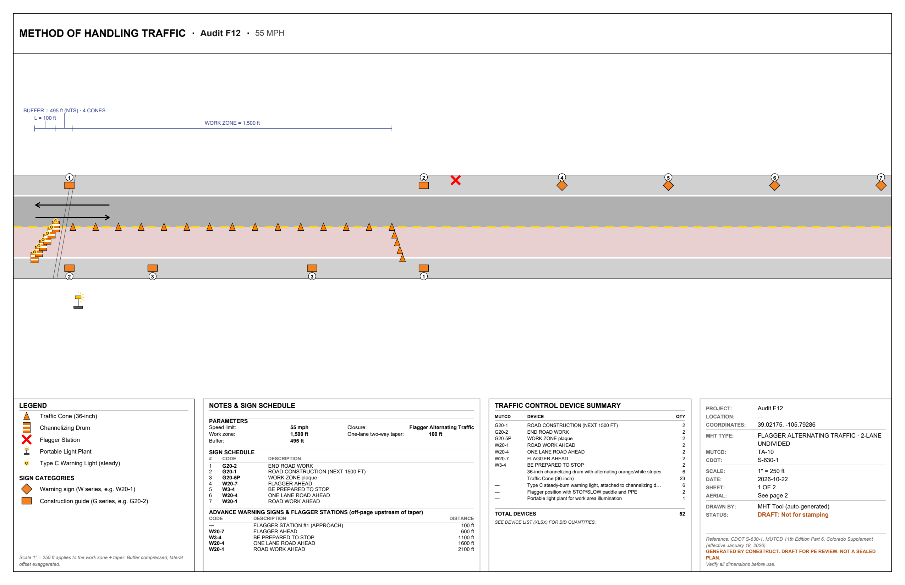

| Check | Result | Oracle | Plan | Source | Note |
|---|---|---|---|---|---|
| C1 taper | PASS | 50–100 ft one-lane two-way taper | page 1 label 100, page 1 notes 100, audit 100, audit summary 100, crew sheet 100 | MUTCD Table 6B-3, p. 775; §6B.08 ¶14, p. 776 (L3) |  |
| C2 buffer | PASS | ≥ 495 ft at 55 mph | page 1 label 495, page 1 notes 495, audit 495, crew sheet 495 | MUTCD Table 6B-2, p. 775; §6B.06 ¶11, p. 773 (L9) |  |
| C3 downstream taper | PASS | 50–100 ft, not per lane | 4 cones over 50 ft | MUTCD Table 6B-3, p. 775; §6B.08 ¶12, p. 776 (L4) |  |
| C4 device spacing | PASS | taper ≤ 55 ft, tangent (buffer + work area) ≤ 110 ft | taper 20 ft ≤ 55; cone runs at 107, 99 ft ≤ 110? | MUTCD §6K.01 ¶04, p. 815; S-630-1 Note 18 (L10) |  |
| C5 device type and size | PASS | drums or vertical panels on the taper, drums ≥ 36 in; no Type 1 barricade at 55+ mph | 6 drums on the one-lane two-way taper; drums 36-inch; Type 1 barricade: none | S-630-1 Sheet 4 legend; MUTCD §6K.06 ¶01, p. 820; S-630-1 Note 16 (L11, L13) |  |
| C6 flagger sign series | PASS | W20-1 → W20-4 → (W3-4) → W20-7 on both approaches, gaps ≥ 500 ft (rural) | W20-1 2100 → W20-4 1600 → W3-4 1100 → W20-7 600; summary W20-1/W20-4/W20-7 = [2, 2, 2] | MUTCD Fig 6P-10, p. 879; S-630-1 Sheet 9 Case 17; Table 6B-1, p. 773 (L5, L6) |  |
| C7 flagger stations | PASS | a flagger at each end; the upstream one at the taper after W20-7, A to W20-7; the opposite one 200–300 ft past the work | 2 stations at 2195, -300; upstream flagger 100 ft before the taper (INFO: Fig 6P-10 draws it at the taper's upstream end); opposite flagger 300 ft past the work area | MUTCD Fig 6P-10, p. 879; §6D.06, p. 786; §6E.02 ¶01, p. 787; S-630-1 Case 17 (L7) |  |
| C7b pilot car | PASS | G20-4 on the pilot vehicle; a flagger at each end | G20-4 named; R4-20 absent; 2 flaggers | MUTCD §6E.04 ¶03-¶04, p. 787; S-630-1 Sheet 25 Case 42 (L17) |  |
| C8 arrow board | PASS | none, or caution mode only | none; mode not stated; page 1 0, crew 0 | MUTCD §6L.06 ¶17-¶18, p. 833; S-630-1 Note 26 (L14) |  |
| C10 device counts agree | **FLAG** | same quantity of every device on every surface | pilot_car: page 1 summary 0, device XLSX 0, quote XLSX 0, crew sheet 1, audit 0 | Rule 10 / P2 one voice per fact |  |
| C10b notes match drawing | PASS | every value in NOTES equals its drawn label and the request | match | Rule 10 |  |
| C11 containment | PASS | 0/0/0 | 0/0/0 | tests/test_pdf_containment.py measure |  |
| C11b edition | **FLAG** | MUTCD 11th Edition throughout; S-630-1 July 2026 (26 sheets) | MUTCD 11th Edition; audit links S-630-01%20(19-Page%20Set).pdf | Rule 9; CLAUDE.md staleness note | edition finding: goes to #265 |
| C14 night cone height | PASS | ≥ 36 in at night | 36-inch | S-630-1 Sheet 2 Note 15 (L12) |  |
| C14b flagger station lighting | PASS | flagger stations illuminated at night | - 1× Portable Light Plant | MUTCD §6D.06 ¶05, p. 786; S-630-1 Note 22 (L8) |  |

### `F13`: US 285 north of Fairplay

flagger_lane_closure · US 285 (trunk) · rural_undivided, undivided, 2 lanes × 12.0 ft · 55 mph (work zone 55) · right lane · 2640 ft · day · None · rural · TA-10, MUTCD TA-10: Flagger one-lane two-way

**1 FLAG** · pin 39.26455, -105.95722

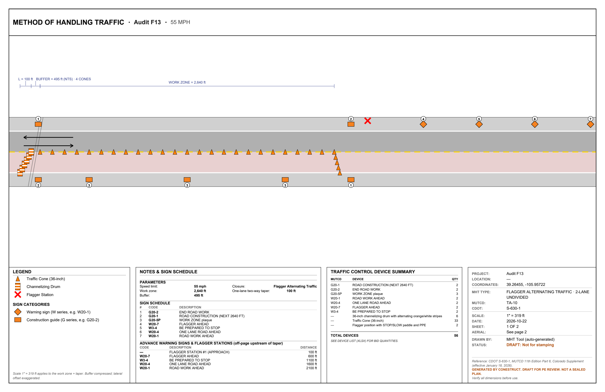

| Check | Result | Oracle | Plan | Source | Note |
|---|---|---|---|---|---|
| C1 taper | PASS | 50–100 ft one-lane two-way taper | page 1 label 100, page 1 notes 100, audit 100, audit summary 100, crew sheet 100 | MUTCD Table 6B-3, p. 775; §6B.08 ¶14, p. 776 (L3) |  |
| C2 buffer | PASS | ≥ 495 ft at 55 mph | page 1 label 495, page 1 notes 495, audit 495, crew sheet 495 | MUTCD Table 6B-2, p. 775; §6B.06 ¶11, p. 773 (L9) |  |
| C3 downstream taper | PASS | 50–100 ft, not per lane | 4 cones over 50 ft | MUTCD Table 6B-3, p. 775; §6B.08 ¶12, p. 776 (L4) |  |
| C4 device spacing | PASS | taper ≤ 55 ft, tangent (buffer + work area) ≤ 110 ft | taper 20 ft ≤ 55; cone runs at 110, 99 ft ≤ 110? | MUTCD §6K.01 ¶04, p. 815; S-630-1 Note 18 (L10) |  |
| C5 device type and size | PASS | drums or vertical panels on the taper, drums ≥ 36 in; no Type 1 barricade at 55+ mph | 6 drums on the one-lane two-way taper; drums 36-inch; Type 1 barricade: none | S-630-1 Sheet 4 legend; MUTCD §6K.06 ¶01, p. 820; S-630-1 Note 16 (L11, L13) |  |
| C6 flagger sign series | PASS | W20-1 → W20-4 → (W3-4) → W20-7 on both approaches, gaps ≥ 500 ft (rural) | W20-1 2100 → W20-4 1600 → W3-4 1100 → W20-7 600; summary W20-1/W20-4/W20-7 = [2, 2, 2] | MUTCD Fig 6P-10, p. 879; S-630-1 Sheet 9 Case 17; Table 6B-1, p. 773 (L5, L6) |  |
| C7 flagger stations | PASS | a flagger at each end; the upstream one at the taper after W20-7, A to W20-7; the opposite one 200–300 ft past the work | 2 stations at 3335, -300; upstream flagger 100 ft before the taper (INFO: Fig 6P-10 draws it at the taper's upstream end); opposite flagger 300 ft past the work area | MUTCD Fig 6P-10, p. 879; §6D.06, p. 786; §6E.02 ¶01, p. 787; S-630-1 Case 17 (L7) |  |
| C8 arrow board | PASS | none, or caution mode only | none; mode not stated; page 1 0, crew 0 | MUTCD §6L.06 ¶17-¶18, p. 833; S-630-1 Note 26 (L14) |  |
| C10 device counts agree | PASS | same quantity of every device on every surface | 56 devices, equal on 5 surfaces | Rule 10 / P2 one voice per fact |  |
| C10b notes match drawing | PASS | every value in NOTES equals its drawn label and the request | match | Rule 10 |  |
| C11 containment | PASS | 0/0/0 | 0/0/0 | tests/test_pdf_containment.py measure |  |
| C11b edition | **FLAG** | MUTCD 11th Edition throughout; S-630-1 July 2026 (26 sheets) | MUTCD 11th Edition; audit links S-630-01%20(19-Page%20Set).pdf | Rule 9; CLAUDE.md staleness note | edition finding: goes to #265 |
| C14 cone height (45+ mph) | INFO | 36 in where ADT ≥ 2,000 (no ADT input) | 36-inch | S-630-1 Sheet 2 Note 15 (L12) |  |

### `F14`: Black Forest Rd, El Paso County

flagger_lane_closure · Black Forest Road (tertiary) · rural_undivided, undivided, 2 lanes × 12.0 ft · 45 mph (work zone 45) · right lane · 500 ft · day · None · rural · TA-10, MUTCD TA-10: Flagger one-lane two-way

**1 FLAG** · pin 39.08849, -104.69514

| Check | Result | Oracle | Plan | Source | Note |
|---|---|---|---|---|---|
| C1 taper | PASS | 50–100 ft one-lane two-way taper | page 1 label 100, page 1 notes 100, audit 100, audit summary 100, crew sheet 100 | MUTCD Table 6B-3, p. 775; §6B.08 ¶14, p. 776 (L3) |  |
| C2 buffer | PASS | ≥ 360 ft at 45 mph | page 1 label 360, page 1 notes 360, audit 360, crew sheet 360 | MUTCD Table 6B-2, p. 775; §6B.06 ¶11, p. 773 (L9) |  |
| C3 downstream taper | PASS | 50–100 ft, not per lane | 4 cones over 50 ft | MUTCD Table 6B-3, p. 775; §6B.08 ¶12, p. 776 (L4) |  |
| C4 device spacing | PASS | taper ≤ 45 ft, tangent (buffer + work area) ≤ 90 ft | taper 20 ft ≤ 45; cone runs at 83, 90 ft ≤ 90? | MUTCD §6K.01 ¶04, p. 815; S-630-1 Note 18 (L10) |  |
| C5 device type and size | PASS | drums or vertical panels on the taper, drums ≥ 36 in; no Type 1 barricade at 55+ mph | 6 drums on the one-lane two-way taper; drums 36-inch | S-630-1 Sheet 4 legend; MUTCD §6K.06 ¶01, p. 820; S-630-1 Note 16 (L11, L13) |  |
| C6 flagger sign series | PASS | W20-1 → W20-4 → (W3-4) → W20-7 on both approaches, gaps ≥ 500 ft (rural) | W20-1 2100 → W20-4 1600 → W3-4 1100 → W20-7 600; summary W20-1/W20-4/W20-7 = [2, 2, 2] | MUTCD Fig 6P-10, p. 879; S-630-1 Sheet 9 Case 17; Table 6B-1, p. 773 (L5, L6) |  |
| C7 flagger stations | PASS | a flagger at each end; the upstream one at the taper after W20-7, A to W20-7; the opposite one 200–300 ft past the work | 2 stations at 1060, -300; upstream flagger 100 ft before the taper (INFO: Fig 6P-10 draws it at the taper's upstream end); opposite flagger 300 ft past the work area | MUTCD Fig 6P-10, p. 879; §6D.06, p. 786; §6E.02 ¶01, p. 787; S-630-1 Case 17 (L7) |  |
| C8 arrow board | PASS | none, or caution mode only | none; mode not stated; page 1 0, crew 0 | MUTCD §6L.06 ¶17-¶18, p. 833; S-630-1 Note 26 (L14) |  |
| C10 device counts agree | PASS | same quantity of every device on every surface | 36 devices, equal on 5 surfaces | Rule 10 / P2 one voice per fact |  |
| C10b notes match drawing | PASS | every value in NOTES equals its drawn label and the request | match | Rule 10 |  |
| C11 containment | PASS | 0/0/0 | 0/0/0 | tests/test_pdf_containment.py measure |  |
| C11b edition | **FLAG** | MUTCD 11th Edition throughout; S-630-1 July 2026 (26 sheets) | MUTCD 11th Edition; audit links S-630-01%20(19-Page%20Set).pdf | Rule 9; CLAUDE.md staleness note | edition finding: goes to #265 |
| C14 cone height (45+ mph) | INFO | 36 in where ADT ≥ 2,000 (no ADT input) | 36-inch | S-630-1 Sheet 2 Note 15 (L12) |  |

### `F15`: W 8th St, Loveland

flagger_lane_closure · West 8th Street (tertiary) · urban_arterial, undivided, 2 lanes × 12.0 ft · 30 mph (work zone 30) · right lane · 300 ft · night · None · urban_low · TA-10, MUTCD TA-10: Flagger one-lane two-way

**1 FLAG** · pin 40.39999, -105.08671

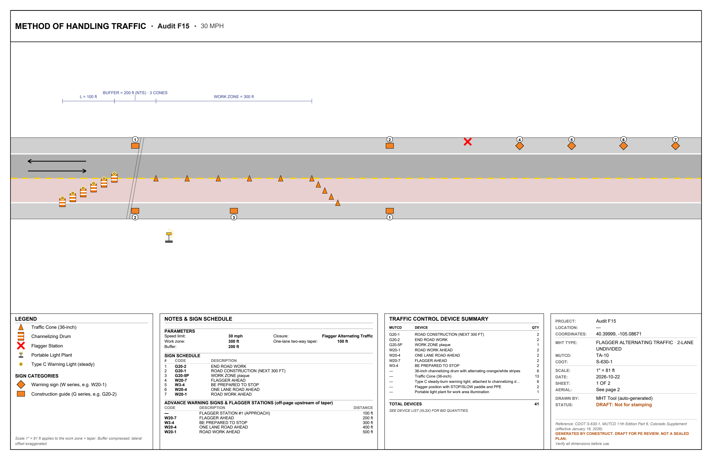

| Check | Result | Oracle | Plan | Source | Note |
|---|---|---|---|---|---|
| C1 taper | PASS | 50–100 ft one-lane two-way taper | page 1 label 100, page 1 notes 100, audit 100, audit summary 100, crew sheet 100 | MUTCD Table 6B-3, p. 775; §6B.08 ¶14, p. 776 (L3) |  |
| C2 buffer | PASS | ≥ 200 ft at 30 mph | page 1 label 200, page 1 notes 200, audit 200, crew sheet 200 | MUTCD Table 6B-2, p. 775; §6B.06 ¶11, p. 773 (L9) |  |
| C3 downstream taper | PASS | 50–100 ft, not per lane | 4 cones over 50 ft | MUTCD Table 6B-3, p. 775; §6B.08 ¶12, p. 776 (L4) |  |
| C4 device spacing | PASS | taper ≤ 30 ft, tangent (buffer + work area) ≤ 60 ft | taper 20 ft ≤ 30; cone runs at 60, 50 ft ≤ 60? | MUTCD §6K.01 ¶04, p. 815; S-630-1 Note 18 (L10) |  |
| C5 device type and size | PASS | drums or vertical panels on the taper, drums ≥ 36 in; no Type 1 barricade at 55+ mph | 6 drums on the one-lane two-way taper; drums 36-inch | S-630-1 Sheet 4 legend; MUTCD §6K.06 ¶01, p. 820; S-630-1 Note 16 (L11, L13) |  |
| C6 flagger sign series | PASS | W20-1 → W20-4 → (W3-4) → W20-7 on both approaches, gaps ≥ 100 ft (urban_low) | W20-1 500 → W20-4 400 → W3-4 300 → W20-7 200; summary W20-1/W20-4/W20-7 = [2, 2, 2] | MUTCD Fig 6P-10, p. 879; S-630-1 Sheet 9 Case 17; Table 6B-1, p. 773 (L5, L6) |  |
| C7 flagger stations | PASS | a flagger at each end; the upstream one at the taper after W20-7, A to W20-7; the opposite one 200–300 ft past the work | 2 stations at 700, -300; upstream flagger 100 ft before the taper (INFO: Fig 6P-10 draws it at the taper's upstream end); opposite flagger 300 ft past the work area | MUTCD Fig 6P-10, p. 879; §6D.06, p. 786; §6E.02 ¶01, p. 787; S-630-1 Case 17 (L7) |  |
| C8 arrow board | PASS | none, or caution mode only | none; mode not stated; page 1 0, crew 0 | MUTCD §6L.06 ¶17-¶18, p. 833; S-630-1 Note 26 (L14) |  |
| C10 device counts agree | PASS | same quantity of every device on every surface | 41 devices, equal on 5 surfaces | Rule 10 / P2 one voice per fact |  |
| C10b notes match drawing | PASS | every value in NOTES equals its drawn label and the request | match | Rule 10 |  |
| C11 containment | PASS | 0/0/0 | 0/0/0 | tests/test_pdf_containment.py measure |  |
| C11b edition | **FLAG** | MUTCD 11th Edition throughout; S-630-1 July 2026 (26 sheets) | MUTCD 11th Edition; audit links S-630-01%20(19-Page%20Set).pdf | Rule 9; CLAUDE.md staleness note | edition finding: goes to #265 |
| C14 night cone height | PASS | ≥ 36 in at night | 36-inch | S-630-1 Sheet 2 Note 15 (L12) |  |
| C14b flagger station lighting | PASS | flagger stations illuminated at night | - 1× Portable Light Plant | MUTCD §6D.06 ¶05, p. 786; S-630-1 Note 22 (L8) |  |

### `F16`: CO 119, Boulder Canyon

flagger_lane_closure · Boulder Canyon Drive CO 119 (primary) · rural_undivided, undivided, 2 lanes × 12.0 ft · 45 mph (work zone 45) · right lane · 500 ft · day · None · rural · TA-10, MUTCD TA-10: Flagger one-lane two-way

**2 FLAG** · pin 40.00185, -105.41289

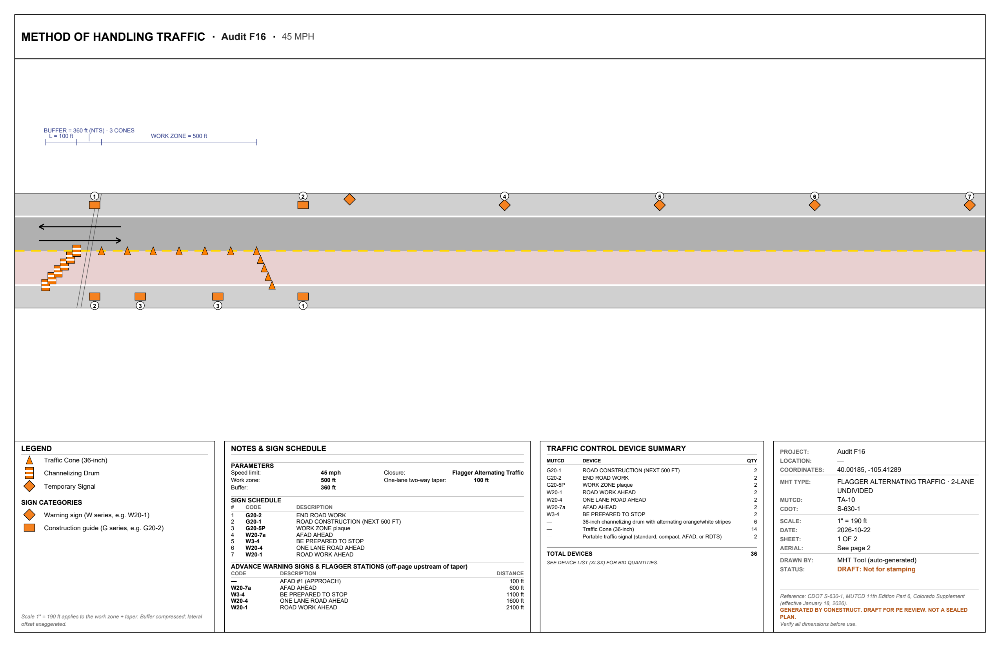

| Check | Result | Oracle | Plan | Source | Note |
|---|---|---|---|---|---|
| C1 taper | PASS | 50–100 ft one-lane two-way taper | page 1 label 100, page 1 notes 100, audit 100, audit summary 100, crew sheet 100 | MUTCD Table 6B-3, p. 775; §6B.08 ¶14, p. 776 (L3) |  |
| C2 buffer | PASS | ≥ 360 ft at 45 mph | page 1 label 360, page 1 notes 360, audit 360, crew sheet 360 | MUTCD Table 6B-2, p. 775; §6B.06 ¶11, p. 773 (L9) |  |
| C3 downstream taper | PASS | 50–100 ft, not per lane | 4 cones over 50 ft | MUTCD Table 6B-3, p. 775; §6B.08 ¶12, p. 776 (L4) |  |
| C4 device spacing | PASS | taper ≤ 45 ft, tangent (buffer + work area) ≤ 90 ft | taper 20 ft ≤ 45; cone runs at 83, 90 ft ≤ 90? | MUTCD §6K.01 ¶04, p. 815; S-630-1 Note 18 (L10) |  |
| C5 device type and size | PASS | drums or vertical panels on the taper, drums ≥ 36 in; no Type 1 barricade at 55+ mph | 6 drums on the one-lane two-way taper; drums 36-inch | S-630-1 Sheet 4 legend; MUTCD §6K.06 ¶01, p. 820; S-630-1 Note 16 (L11, L13) |  |
| C6 flagger sign series | PASS | W20-1 → W20-4 → (W3-4) → W20-7 on both approaches, gaps ≥ 500 ft (rural) | W20-1 2100 → W20-4 1600 → W3-4 1100 → W20-7 600; summary W20-1/W20-4/W20-7 = [2, 2, 2] | MUTCD Fig 6P-10, p. 879; S-630-1 Sheet 9 Case 17; Table 6B-1, p. 773 (L5, L6) | INFO: W20-7a AFAD AHEAD stands in the W20-7 slot (no AFAD sign is quoted, L18) |
| C7 flagger stations | PASS | a flagger at each end; the upstream one at the taper after W20-7, A to W20-7; the opposite one 200–300 ft past the work | 2 stations at 1060, -300; AFAD stations from the crew sheet (the audit's flagger table is empty); upstream flagger 100 ft before the taper (INFO: Fig 6P-10 draws it at the taper's upstream end); opposite flagger 300 ft past the work area | MUTCD Fig 6P-10, p. 879; §6D.06, p. 786; §6E.02 ¶01, p. 787; S-630-1 Case 17 (L7) |  |
| C7c AFAD | PASS | the AFAD shown at the flagger station | - 2× W20-7a AFAD AHEAD | MUTCD §6E.05 (L18) |  |
| C8 arrow board | PASS | none, or caution mode only | none; mode not stated; page 1 0, crew 0 | MUTCD §6L.06 ¶17-¶18, p. 833; S-630-1 Note 26 (L14) |  |
| C10 device counts agree | **FLAG** | same quantity of every device on every surface | afad: page 1 summary 2, device XLSX 2, quote XLSX 2, crew sheet 0, audit 0; temporary signal: page 1 summary 0, device XLSX 0, quote XLSX 0, crew sheet 0, audit 2; temporary traffic signal: page 1 summary 0, device XLSX 0, quote XLSX 0, crew sheet 2, audit 0 | Rule 10 / P2 one voice per fact |  |
| C10b notes match drawing | PASS | every value in NOTES equals its drawn label and the request | match | Rule 10 |  |
| C11 containment | PASS | 0/0/0 | 0/0/0 | tests/test_pdf_containment.py measure |  |
| C11b edition | **FLAG** | MUTCD 11th Edition throughout; S-630-1 July 2026 (26 sheets) | MUTCD 11th Edition; audit links S-630-01%20(19-Page%20Set).pdf | Rule 9; CLAUDE.md staleness note | edition finding: goes to #265 |
| C14 cone height (45+ mph) | INFO | 36 in where ADT ≥ 2,000 (no ADT input) | 36-inch | S-630-1 Sheet 2 Note 15 (L12) |  |

### `F18`: E 40th Ave, Denver

flagger_lane_closure · East 40th Avenue (tertiary) · urban_arterial, undivided, 3 lanes × 12.0 ft · 35 mph (work zone 35) · right lane · 300 ft · day · denver · urban_low · TA-10, MUTCD TA-10: Flagger one-lane two-way

**2 FLAG** · pin 39.7729, -104.94783

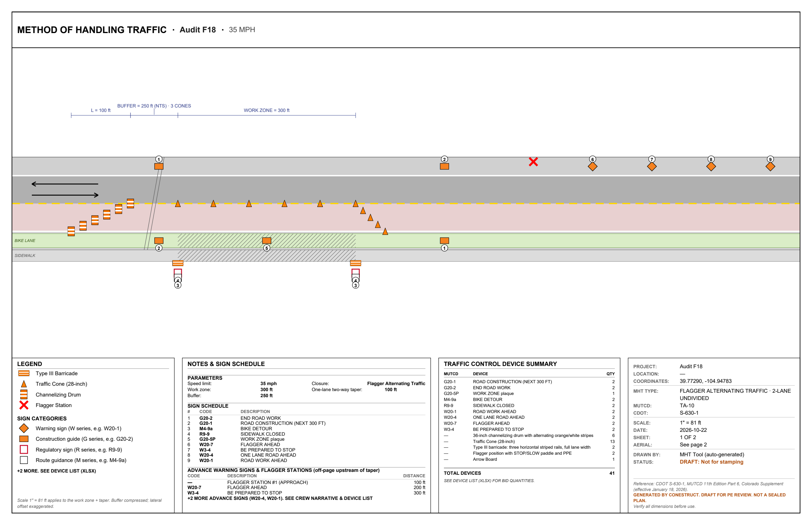

| Check | Result | Oracle | Plan | Source | Note |
|---|---|---|---|---|---|
| C1 taper | PASS | 50–100 ft one-lane two-way taper | page 1 label 100, page 1 notes 100, audit 100, audit summary 100, crew sheet 100 | MUTCD Table 6B-3, p. 775; §6B.08 ¶14, p. 776 (L3) |  |
| C2 buffer | PASS | ≥ 250 ft at 35 mph | page 1 label 250, page 1 notes 250, audit 250, crew sheet 250 | MUTCD Table 6B-2, p. 775; §6B.06 ¶11, p. 773 (L9) |  |
| C3 downstream taper | PASS | 50–100 ft, not per lane | 4 cones over 50 ft | MUTCD Table 6B-3, p. 775; §6B.08 ¶12, p. 776 (L4) |  |
| C4 device spacing | PASS | taper ≤ 35 ft, tangent (buffer + work area) ≤ 70 ft | taper 20 ft ≤ 35; cone runs at 60, 62 ft ≤ 70? | MUTCD §6K.01 ¶04, p. 815; S-630-1 Note 18 (L10) |  |
| C5 device type and size | PASS | drums or vertical panels on the taper, drums ≥ 36 in; no Type 1 barricade at 55+ mph | 6 drums on the one-lane two-way taper; drums 36-inch | S-630-1 Sheet 4 legend; MUTCD §6K.06 ¶01, p. 820; S-630-1 Note 16 (L11, L13) |  |
| C6 flagger sign series | PASS | W20-1 → W20-4 → (W3-4) → W20-7 on both approaches, gaps ≥ 100 ft (urban_low) | W20-1 500 → W20-4 400 → W3-4 300 → W20-7 200; summary W20-1/W20-4/W20-7 = [2, 2, 2] | MUTCD Fig 6P-10, p. 879; S-630-1 Sheet 9 Case 17; Table 6B-1, p. 773 (L5, L6) |  |
| C7 flagger stations | PASS | a flagger at each end; the upstream one at the taper after W20-7, A to W20-7; the opposite one 200–300 ft past the work | 2 stations at 750, -300; upstream flagger 100 ft before the taper (INFO: Fig 6P-10 draws it at the taper's upstream end); opposite flagger 300 ft past the work area | MUTCD Fig 6P-10, p. 879; §6D.06, p. 786; §6E.02 ¶01, p. 787; S-630-1 Case 17 (L7) |  |
| C8 arrow board | INFO | none, or caution mode only | present; mode not stated; page 1 1, crew 0 | MUTCD §6L.06 ¶17-¶18, p. 833; S-630-1 Note 26 (L14) |  |
| C10 device counts agree | **FLAG** | same quantity of every device on every surface | arrow_board: page 1 summary 1, device XLSX 1, quote XLSX 1, crew sheet 0, audit 1 | Rule 10 / P2 one voice per fact |  |
| C10b notes match drawing | PASS | every value in NOTES equals its drawn label and the request | match | Rule 10 |  |
| C11 containment | PASS | 0/0/0 | 0/0/0 | tests/test_pdf_containment.py measure |  |
| C11b edition | **FLAG** | MUTCD 11th Edition throughout; S-630-1 July 2026 (26 sheets) | MUTCD 11th Edition; audit links S-630-01%20(19-Page%20Set).pdf | Rule 9; CLAUDE.md staleness note | edition finding: goes to #265 |
| C13 pedestrian access | PASS | the closure shown (TA-28) or the limit stated | pedestrianAccess=False, scan sidewalk=True; R9-9 | MUTCD TA-28, pp. 914-915; §6N.04 ¶06, p. 843 (L20) |  |

### `N1`: W Colfax Ave, Denver

near_intersection · West Colfax Avenue I 70 BUS;US 40 (primary) · urban_arterial, undivided, 3 lanes × 12.0 ft · 30 mph (work zone 30) · right lane · 500 ft · day · denver · urban_low · TA-21, Case 18: Traffic control around a work area near an intersection, one lane closed

**2 FLAG** · pin 39.74035, -105.04014

| Check | Result | Oracle | Plan | Source | Note |
|---|---|---|---|---|---|
| C1 taper | PASS | merging taper ≥ L = 180 ft (W=12, S=30) | page 1 label 180, page 1 notes 180, audit 180, audit summary 180, crew sheet 180 | MUTCD Table 6B-4 and 6B-3, p. 775 (L1, L2) |  |
| C2 buffer | PASS | ≥ 200 ft at 30 mph | page 1 label 200, page 1 notes 200, audit 200, crew sheet 200 | MUTCD Table 6B-2, p. 775; §6B.06 ¶11, p. 773 (L9) |  |
| C3 downstream taper | INFO | flagger: ¶14 "should be used"; near-intersection: ¶12 "If used" | no downstream taper in the crew sheet | MUTCD §6B.08 ¶12, ¶14, p. 776 (L4) | Case 18 runs the closed lane to the corner |
| C4 device spacing | PASS | taper ≤ 30 ft, tangent (buffer + work area) ≤ 60 ft | taper 30 ft ≤ 30; cone runs at 56, 50 ft ≤ 60? | MUTCD §6K.01 ¶04, p. 815; S-630-1 Note 18 (L10) |  |
| C5 device type and size | PASS | drums or vertical panels on the taper, drums ≥ 36 in; no Type 1 barricade at 55+ mph | 7 drums on the merging taper; drums 36-inch | S-630-1 Sheet 4 legend; MUTCD §6K.06 ¶01, p. 820; S-630-1 Note 16 (L11, L13) |  |
| C6 closed-approach sign series | PASS | W20-1 → W20-5R → W4-2R, gaps ≥ 100 ft (urban_low) | W20-1 300 → W20-5R 200 → W4-2R 100 | S-630-1 Sheet 10 Case 18; MUTCD Figs 6P-21/22, pp. 901/903; Table 6B-1 (L5, L15) |  |
| C6b cross-street W20-1 | PASS | W20-1 on each drawn cross-street approach | 2 approaches; all carry W20-1 | MUTCD Fig 6P-22, p. 903; S-630-1 Sheet 10 Case 18 (L15) |  |
| C8 arrow board | PASS | if drawn, at the start of the merging taper | the upstream start of the merging taper station 880; taper starts at 880.0; mode left arrow | MUTCD §6L.06 ¶19, p. 833 (L14) |  |
| C9 near or far side | PASS | cross street at station -100.0 → near side (Fig 6P-21: closure before the intersection; Fig 6P-22: past it) | audit near; page 1 / crew say neither; row asked near | MUTCD Figs 6P-21, 6P-22, pp. 901/903 (L16; rulings R7) |  |
| C10 device counts agree | **FLAG** | same quantity of every device on every surface | R2-10: page 1 summary 1, device XLSX 3, quote XLSX 3, crew sheet 3, audit 3; R2-11: page 1 summary 1, device XLSX 3, quote XLSX 3, crew sheet 3, audit 3; W20-1: page 1 summary 1, device XLSX 3, quote XLSX 3, crew sheet 3, audit 3 | Rule 10 / P2 one voice per fact |  |
| C10b notes match drawing | PASS | every value in NOTES equals its drawn label and the request | match | Rule 10 |  |
| C11 containment | PASS | 0/0/0 | 0/0/0 | tests/test_pdf_containment.py measure |  |
| C11b edition | **FLAG** | MUTCD 11th Edition throughout; S-630-1 July 2026 (26 sheets) | MUTCD 11th Edition; audit links S-630-01%20(19-Page%20Set).pdf | Rule 9; CLAUDE.md staleness note | edition finding: goes to #265 |
| C13 pedestrian access | PASS | the closure shown (TA-28) or the limit stated | pedestrianAccess=False, scan sidewalk=True; R9-9 | MUTCD TA-28, pp. 914-915; §6N.04 ¶06, p. 843 (L20) |  |

### `N2`: W Colfax Ave, Denver

near_intersection · West Colfax Avenue I 70 BUS;US 40 (primary) · urban_arterial, undivided, 2 lanes × 12.0 ft · 30 mph (work zone 30) · right lane · 500 ft · day · denver · urban_low · TA-22, Case 18: Traffic control around a work area near an intersection, one lane closed

**2 FLAG** · pin 39.74035, -105.04014

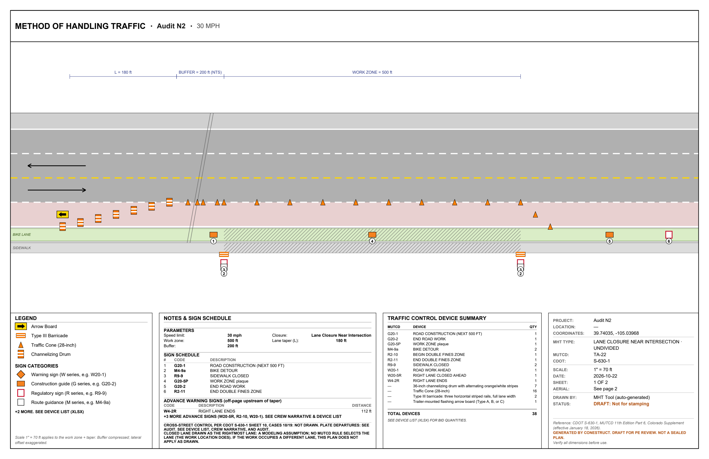

| Check | Result | Oracle | Plan | Source | Note |
|---|---|---|---|---|---|
| C1 taper | PASS | merging taper ≥ L = 180 ft (W=12, S=30) | page 1 label 180, page 1 notes 180, audit 180, audit summary 180, crew sheet 180 | MUTCD Table 6B-4 and 6B-3, p. 775 (L1, L2) |  |
| C2 buffer | PASS | ≥ 200 ft at 30 mph | page 1 label 200, page 1 notes 200, audit 200, crew sheet 200 | MUTCD Table 6B-2, p. 775; §6B.06 ¶11, p. 773 (L9) |  |
| C3 downstream taper | INFO | flagger: ¶14 "should be used"; near-intersection: ¶12 "If used" | no downstream taper in the crew sheet | MUTCD §6B.08 ¶12, ¶14, p. 776 (L4) | Case 18 runs the closed lane to the corner |
| C4 device spacing | PASS | taper ≤ 30 ft, tangent (buffer + work area) ≤ 60 ft | taper 30 ft ≤ 30; 4 cones carry the line past the cross street to the taper; cone runs at 56 ft ≤ 60? | MUTCD §6K.01 ¶04, p. 815; S-630-1 Note 18 (L10) |  |
| C5 device type and size | PASS | drums or vertical panels on the taper, drums ≥ 36 in; no Type 1 barricade at 55+ mph | 7 drums on the merging taper; drums 36-inch | S-630-1 Sheet 4 legend; MUTCD §6K.06 ¶01, p. 820; S-630-1 Note 16 (L11, L13) |  |
| C6 closed-approach sign series | INFO | W20-1 → W20-5R → W4-2R, gaps ≥ 100 ft (urban_low) | W20-1 300 → W20-5R 200 → W4-2R 112 | S-630-1 Sheet 10 Case 18; MUTCD Figs 6P-21/22, pp. 901/903; Table 6B-1 (L5, L15) | gaps under A=100: W20-5R 88 (urban: INFO per Sheet 10 Note 1) |
| C6b cross-street W20-1 | PASS | W20-1 on each drawn cross-street approach | 2 approaches; all carry W20-1 | MUTCD Fig 6P-22, p. 903; S-630-1 Sheet 10 Case 18 (L15) |  |
| C8 arrow board | PASS | if drawn, at the start of the merging taper | the upstream start of the merging taper station 892; taper starts at 892.0; mode left arrow | MUTCD §6L.06 ¶19, p. 833 (L14) |  |
| C9 near or far side | PASS | cross street at station 600.0 → far side (Fig 6P-21: closure before the intersection; Fig 6P-22: past it) | audit far; page 1 / crew say neither; row asked far | MUTCD Figs 6P-21, 6P-22, pp. 901/903 (L16; rulings R7) |  |
| C9b far side: R3-7R or continuous channelizers | PASS | R3-7R RIGHT LANE MUST TURN RIGHT, or note 7's continuous channelizers | 4 cones continue the closed-lane line from the taper to the cross street | MUTCD Fig 6P-22 and note 7, pp. 902-903 (L15) |  |
| C10 device counts agree | **FLAG** | same quantity of every device on every surface | R2-10: page 1 summary 1, device XLSX 3, quote XLSX 3, crew sheet 3, audit 3; R2-11: page 1 summary 1, device XLSX 3, quote XLSX 3, crew sheet 3, audit 3; W20-1: page 1 summary 1, device XLSX 3, quote XLSX 3, crew sheet 3, audit 3 | Rule 10 / P2 one voice per fact |  |
| C10b notes match drawing | PASS | every value in NOTES equals its drawn label and the request | match | Rule 10 |  |
| C11 containment | PASS | 0/0/0 | 0/0/0 | tests/test_pdf_containment.py measure |  |
| C11b edition | **FLAG** | MUTCD 11th Edition throughout; S-630-1 July 2026 (26 sheets) | MUTCD 11th Edition; audit links S-630-01%20(19-Page%20Set).pdf | Rule 9; CLAUDE.md staleness note | edition finding: goes to #265 |
| C13 pedestrian access | PASS | the closure shown (TA-28) or the limit stated | pedestrianAccess=False, scan sidewalk=True; R9-9 | MUTCD TA-28, pp. 914-915; §6N.04 ¶06, p. 843 (L20) |  |

### `N3`: W Colfax Ave, Denver

near_intersection · West Colfax Avenue I 70 BUS;US 40 (primary) · urban_arterial, undivided, 3 lanes × 12.0 ft · 30 mph (work zone 30) · right lane · 500 ft · night · denver · urban_low · TA-21, Case 18: Traffic control around a work area near an intersection, one lane closed

**2 FLAG** · pin 39.74035, -105.04014

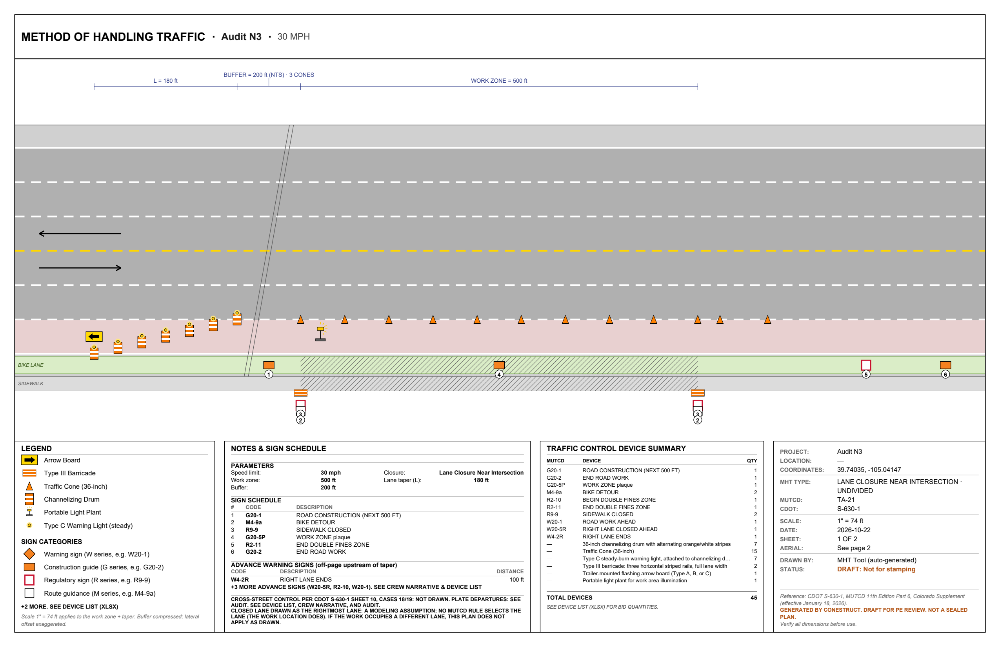

| Check | Result | Oracle | Plan | Source | Note |
|---|---|---|---|---|---|
| C1 taper | PASS | merging taper ≥ L = 180 ft (W=12, S=30) | page 1 label 180, page 1 notes 180, audit 180, audit summary 180, crew sheet 180 | MUTCD Table 6B-4 and 6B-3, p. 775 (L1, L2) |  |
| C2 buffer | PASS | ≥ 200 ft at 30 mph | page 1 label 200, page 1 notes 200, audit 200, crew sheet 200 | MUTCD Table 6B-2, p. 775; §6B.06 ¶11, p. 773 (L9) |  |
| C3 downstream taper | INFO | flagger: ¶14 "should be used"; near-intersection: ¶12 "If used" | no downstream taper in the crew sheet | MUTCD §6B.08 ¶12, ¶14, p. 776 (L4) | Case 18 runs the closed lane to the corner |
| C4 device spacing | PASS | taper ≤ 30 ft, tangent (buffer + work area) ≤ 60 ft | taper 30 ft ≤ 30; cone runs at 56, 50 ft ≤ 60? | MUTCD §6K.01 ¶04, p. 815; S-630-1 Note 18 (L10) |  |
| C5 device type and size | PASS | drums or vertical panels on the taper, drums ≥ 36 in; no Type 1 barricade at 55+ mph | 7 drums on the merging taper; drums 36-inch | S-630-1 Sheet 4 legend; MUTCD §6K.06 ¶01, p. 820; S-630-1 Note 16 (L11, L13) |  |
| C6 closed-approach sign series | PASS | W20-1 → W20-5R → W4-2R, gaps ≥ 100 ft (urban_low) | W20-1 300 → W20-5R 200 → W4-2R 100 | S-630-1 Sheet 10 Case 18; MUTCD Figs 6P-21/22, pp. 901/903; Table 6B-1 (L5, L15) |  |
| C6b cross-street W20-1 | PASS | W20-1 on each drawn cross-street approach | 2 approaches; all carry W20-1 | MUTCD Fig 6P-22, p. 903; S-630-1 Sheet 10 Case 18 (L15) |  |
| C8 arrow board | PASS | if drawn, at the start of the merging taper | the upstream start of the merging taper station 880; taper starts at 880.0; mode left arrow | MUTCD §6L.06 ¶19, p. 833 (L14) |  |
| C9 near or far side | PASS | cross street at station -100.0 → near side (Fig 6P-21: closure before the intersection; Fig 6P-22: past it) | audit near; page 1 / crew say neither; row asked near | MUTCD Figs 6P-21, 6P-22, pp. 901/903 (L16; rulings R7) |  |
| C10 device counts agree | **FLAG** | same quantity of every device on every surface | R2-10: page 1 summary 1, device XLSX 3, quote XLSX 3, crew sheet 3, audit 3; R2-11: page 1 summary 1, device XLSX 3, quote XLSX 3, crew sheet 3, audit 3; W20-1: page 1 summary 1, device XLSX 3, quote XLSX 3, crew sheet 3, audit 3 | Rule 10 / P2 one voice per fact |  |
| C10b notes match drawing | PASS | every value in NOTES equals its drawn label and the request | match | Rule 10 |  |
| C11 containment | PASS | 0/0/0 | 0/0/0 | tests/test_pdf_containment.py measure |  |
| C11b edition | **FLAG** | MUTCD 11th Edition throughout; S-630-1 July 2026 (26 sheets) | MUTCD 11th Edition; audit links S-630-01%20(19-Page%20Set).pdf | Rule 9; CLAUDE.md staleness note | edition finding: goes to #265 |
| C13 pedestrian access | PASS | the closure shown (TA-28) or the limit stated | pedestrianAccess=False, scan sidewalk=True; R9-9 | MUTCD TA-28, pp. 914-915; §6N.04 ¶06, p. 843 (L20) |  |
| C14 night cone height | PASS | ≥ 36 in at night | 36-inch | S-630-1 Sheet 2 Note 15 (L12) |  |

### `N4`: W Colfax Ave, Denver

near_intersection · West Colfax Avenue I 70 BUS;US 40 (primary) · urban_arterial, undivided, 3 lanes × 12.0 ft · 30 mph (work zone 30) · right lane · 500 ft · day · denver · urban_low · TA-21, Case 18: Traffic control around a work area near an intersection, one lane closed

**2 FLAG** · pin 39.74035, -105.04014

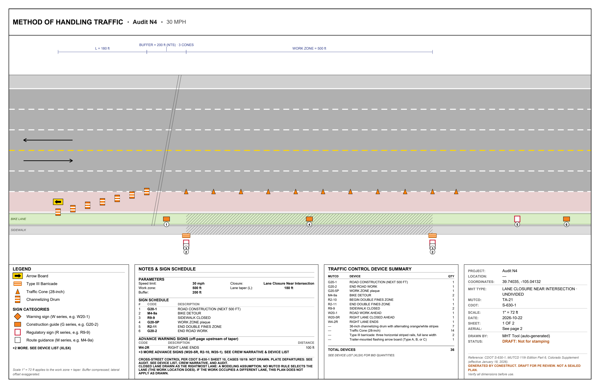

| Check | Result | Oracle | Plan | Source | Note |
|---|---|---|---|---|---|
| C1 taper | PASS | merging taper ≥ L = 180 ft (W=12, S=30) | page 1 label 180, page 1 notes 180, audit 180, audit summary 180, crew sheet 180 | MUTCD Table 6B-4 and 6B-3, p. 775 (L1, L2) |  |
| C2 buffer | PASS | ≥ 200 ft at 30 mph | page 1 label 200, page 1 notes 200, audit 200, crew sheet 200 | MUTCD Table 6B-2, p. 775; §6B.06 ¶11, p. 773 (L9) |  |
| C3 downstream taper | INFO | flagger: ¶14 "should be used"; near-intersection: ¶12 "If used" | no downstream taper in the crew sheet | MUTCD §6B.08 ¶12, ¶14, p. 776 (L4) | Case 18 runs the closed lane to the corner |
| C4 device spacing | PASS | taper ≤ 30 ft, tangent (buffer + work area) ≤ 60 ft | taper 30 ft ≤ 30; cone runs at 56, 50 ft ≤ 60? | MUTCD §6K.01 ¶04, p. 815; S-630-1 Note 18 (L10) |  |
| C5 device type and size | PASS | drums or vertical panels on the taper, drums ≥ 36 in; no Type 1 barricade at 55+ mph | 7 drums on the merging taper; drums 36-inch | S-630-1 Sheet 4 legend; MUTCD §6K.06 ¶01, p. 820; S-630-1 Note 16 (L11, L13) |  |
| C6 closed-approach sign series | PASS | W20-1 → W20-5R → W4-2R, gaps ≥ 100 ft (urban_low) | W20-1 300 → W20-5R 200 → W4-2R 100 | S-630-1 Sheet 10 Case 18; MUTCD Figs 6P-21/22, pp. 901/903; Table 6B-1 (L5, L15) |  |
| C6b cross-street W20-1 | PASS | W20-1 on each drawn cross-street approach | 2 approaches; all carry W20-1 | MUTCD Fig 6P-22, p. 903; S-630-1 Sheet 10 Case 18 (L15) |  |
| C8 arrow board | PASS | if drawn, at the start of the merging taper | the upstream start of the merging taper station 880; taper starts at 880.0; mode left arrow | MUTCD §6L.06 ¶19, p. 833 (L14) |  |
| C9 near or far side | PASS | cross street at station -60.0 → near side (Fig 6P-21: closure before the intersection; Fig 6P-22: past it) | audit near; page 1 / crew say neither; row asked near | MUTCD Figs 6P-21, 6P-22, pp. 901/903 (L16; rulings R7) |  |
| C10 device counts agree | **FLAG** | same quantity of every device on every surface | R2-10: page 1 summary 1, device XLSX 3, quote XLSX 3, crew sheet 3, audit 3; R2-11: page 1 summary 1, device XLSX 3, quote XLSX 3, crew sheet 3, audit 3; W20-1: page 1 summary 1, device XLSX 3, quote XLSX 3, crew sheet 3, audit 3 | Rule 10 / P2 one voice per fact |  |
| C10b notes match drawing | PASS | every value in NOTES equals its drawn label and the request | match | Rule 10 |  |
| C11 containment | PASS | 0/0/0 | 0/0/0 | tests/test_pdf_containment.py measure |  |
| C11b edition | **FLAG** | MUTCD 11th Edition throughout; S-630-1 July 2026 (26 sheets) | MUTCD 11th Edition; audit links S-630-01%20(19-Page%20Set).pdf | Rule 9; CLAUDE.md staleness note | edition finding: goes to #265 |
| C13 pedestrian access | PASS | the closure shown (TA-28) or the limit stated | pedestrianAccess=False, scan sidewalk=True; R9-9 | MUTCD TA-28, pp. 914-915; §6N.04 ¶06, p. 843 (L20) |  |

### `N5`: W Colfax Ave, Denver

near_intersection · West Colfax Avenue I 70 BUS;US 40 (primary) · urban_arterial, undivided, 3 lanes × 12.0 ft · 30 mph (work zone 30) · right lane · 500 ft · day · denver · urban_low · TA-21, Case 18: Traffic control around a work area near an intersection, one lane closed

**2 FLAG** · pin 39.74035, -105.04014

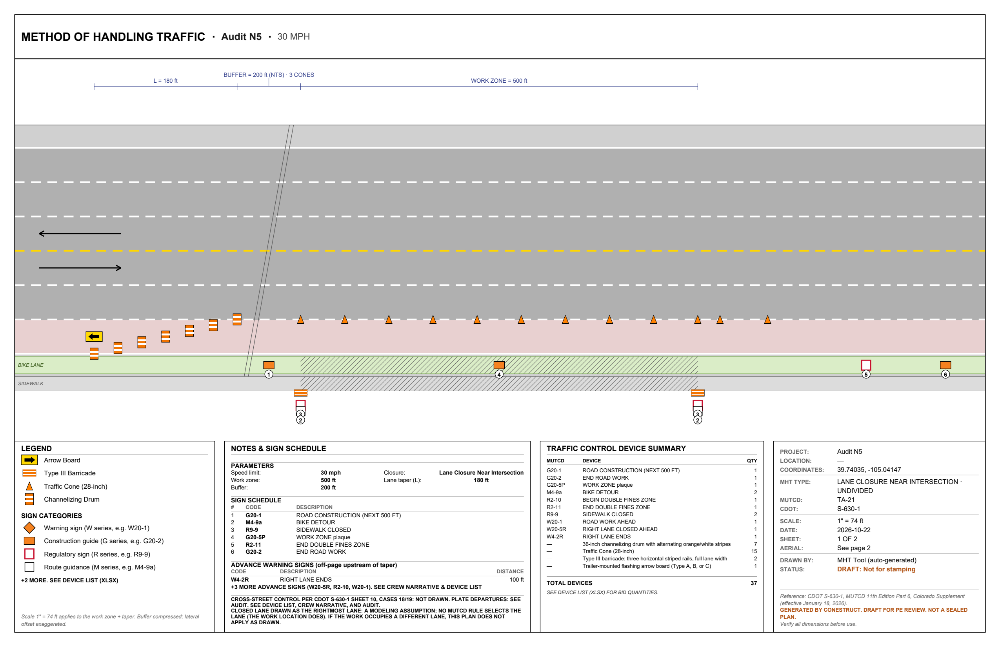

| Check | Result | Oracle | Plan | Source | Note |
|---|---|---|---|---|---|
| C1 taper | PASS | merging taper ≥ L = 180 ft (W=12, S=30) | page 1 label 180, page 1 notes 180, audit 180, audit summary 180, crew sheet 180 | MUTCD Table 6B-4 and 6B-3, p. 775 (L1, L2) |  |
| C2 buffer | PASS | ≥ 200 ft at 30 mph | page 1 label 200, page 1 notes 200, audit 200, crew sheet 200 | MUTCD Table 6B-2, p. 775; §6B.06 ¶11, p. 773 (L9) |  |
| C3 downstream taper | INFO | flagger: ¶14 "should be used"; near-intersection: ¶12 "If used" | no downstream taper in the crew sheet | MUTCD §6B.08 ¶12, ¶14, p. 776 (L4) | Case 18 runs the closed lane to the corner |
| C4 device spacing | PASS | taper ≤ 30 ft, tangent (buffer + work area) ≤ 60 ft | taper 30 ft ≤ 30; cone runs at 56, 50 ft ≤ 60? | MUTCD §6K.01 ¶04, p. 815; S-630-1 Note 18 (L10) |  |
| C5 device type and size | PASS | drums or vertical panels on the taper, drums ≥ 36 in; no Type 1 barricade at 55+ mph | 7 drums on the merging taper; drums 36-inch | S-630-1 Sheet 4 legend; MUTCD §6K.06 ¶01, p. 820; S-630-1 Note 16 (L11, L13) |  |
| C6 closed-approach sign series | PASS | W20-1 → W20-5R → W4-2R, gaps ≥ 100 ft (urban_low) | W20-1 300 → W20-5R 200 → W4-2R 100 | S-630-1 Sheet 10 Case 18; MUTCD Figs 6P-21/22, pp. 901/903; Table 6B-1 (L5, L15) |  |
| C6b cross-street W20-1 | PASS | W20-1 on each drawn cross-street approach | 2 approaches; all carry W20-1 | MUTCD Fig 6P-22, p. 903; S-630-1 Sheet 10 Case 18 (L15) |  |
| C8 arrow board | PASS | if drawn, at the start of the merging taper | the upstream start of the merging taper station 880; taper starts at 880.0; mode left arrow | MUTCD §6L.06 ¶19, p. 833 (L14) |  |
| C9 near or far side | PASS | cross street at station -100.0 → near side (Fig 6P-21: closure before the intersection; Fig 6P-22: past it) | audit near; page 1 / crew say neither; row asked near | MUTCD Figs 6P-21, 6P-22, pp. 901/903 (L16; rulings R7) |  |
| C10 device counts agree | **FLAG** | same quantity of every device on every surface | R2-10: page 1 summary 1, device XLSX 3, quote XLSX 3, crew sheet 3, audit 3; R2-11: page 1 summary 1, device XLSX 3, quote XLSX 3, crew sheet 3, audit 3; W20-1: page 1 summary 1, device XLSX 3, quote XLSX 3, crew sheet 3, audit 3 | Rule 10 / P2 one voice per fact |  |
| C10b notes match drawing | PASS | every value in NOTES equals its drawn label and the request | match | Rule 10 |  |
| C11 containment | PASS | 0/0/0 | 0/0/0 | tests/test_pdf_containment.py measure |  |
| C11b edition | **FLAG** | MUTCD 11th Edition throughout; S-630-1 July 2026 (26 sheets) | MUTCD 11th Edition; audit links S-630-01%20(19-Page%20Set).pdf | Rule 9; CLAUDE.md staleness note | edition finding: goes to #265 |
| C13 pedestrian access | PASS | the closure shown (TA-28) or the limit stated | pedestrianAccess=False, scan sidewalk=True; R9-9 | MUTCD TA-28, pp. 914-915; §6N.04 ¶06, p. 843 (L20) |  |

### `N6`: N Broadway at E 11th Ave, Denver (one-way)

near_intersection · North Broadway (primary) · urban_arterial, undivided, 4 lanes × 11.0 ft · 30 mph (work zone 30) · right lane · 500 ft · day · denver · urban_low · TA-22, Case 18: Traffic control around a work area near an intersection, one lane closed

**2 FLAG** · pin 39.7337, -104.98753

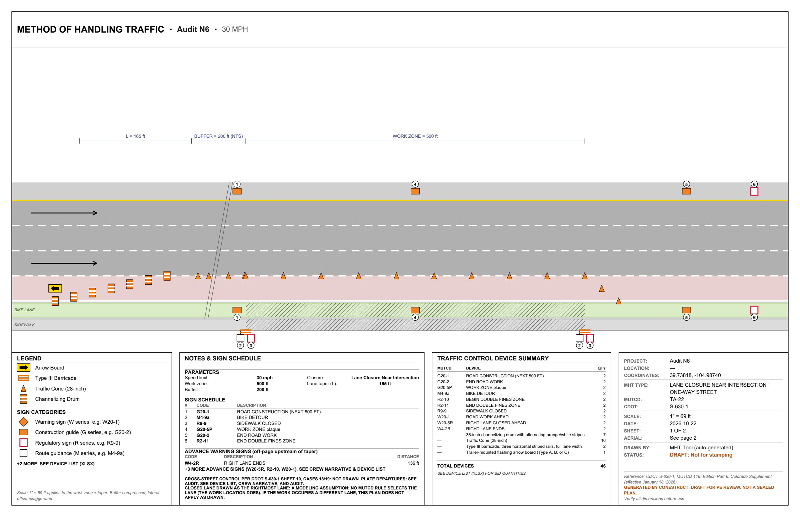

| Check | Result | Oracle | Plan | Source | Note |
|---|---|---|---|---|---|
| C1 taper | PASS | merging taper ≥ L = 165 ft (W=11, S=30) | page 1 label 165, page 1 notes 165, audit 165, audit summary 165, crew sheet 165 | MUTCD Table 6B-4 and 6B-3, p. 775 (L1, L2) |  |
| C2 buffer | PASS | ≥ 200 ft at 30 mph | page 1 label 200, page 1 notes 200, audit 200, crew sheet 200 | MUTCD Table 6B-2, p. 775; §6B.06 ¶11, p. 773 (L9) |  |
| C3 downstream taper | INFO | flagger: ¶14 "should be used"; near-intersection: ¶12 "If used" | no downstream taper in the crew sheet | MUTCD §6B.08 ¶12, ¶14, p. 776 (L4) | Case 18 runs the closed lane to the corner |
| C4 device spacing | PASS | taper ≤ 30 ft, tangent (buffer + work area) ≤ 60 ft | taper 28 ft ≤ 30; 4 cones carry the line past the cross street to the taper; cone runs at 56 ft ≤ 60? | MUTCD §6K.01 ¶04, p. 815; S-630-1 Note 18 (L10) |  |
| C5 device type and size | PASS | drums or vertical panels on the taper, drums ≥ 36 in; no Type 1 barricade at 55+ mph | 7 drums on the merging taper; drums 36-inch | S-630-1 Sheet 4 legend; MUTCD §6K.06 ¶01, p. 820; S-630-1 Note 16 (L11, L13) |  |
| C6 closed-approach sign series | INFO | W20-1 → W20-5R → W4-2R, gaps ≥ 100 ft (urban_low) | W20-1 300 → W20-5R 200 → W4-2R 136 | S-630-1 Sheet 10 Case 18; MUTCD Figs 6P-21/22, pp. 901/903; Table 6B-1 (L5, L15) | gaps under A=100: W20-5R 64 (urban: INFO per Sheet 10 Note 1) |
| C6b cross-street W20-1 | PASS | W20-1 on each drawn cross-street approach | 1 approaches; all carry W20-1 | MUTCD Fig 6P-22, p. 903; S-630-1 Sheet 10 Case 18 (L15) |  |
| C8 arrow board | PASS | if drawn, at the start of the merging taper | the upstream start of the merging taper station 901; taper starts at 901.0; mode left arrow | MUTCD §6L.06 ¶19, p. 833 (L14) |  |
| C9 near or far side | PASS | cross street at station 600.0 → far side (Fig 6P-21: closure before the intersection; Fig 6P-22: past it) | audit far; page 1 / crew say neither; row asked far | MUTCD Figs 6P-21, 6P-22, pp. 901/903 (L16; rulings R7) |  |
| C9b far side: R3-7R or continuous channelizers | PASS | R3-7R RIGHT LANE MUST TURN RIGHT, or note 7's continuous channelizers | 4 cones continue the closed-lane line from the taper to the cross street | MUTCD Fig 6P-22 and note 7, pp. 902-903 (L15) |  |
| C10 device counts agree | **FLAG** | same quantity of every device on every surface | R2-10: page 1 summary 2, device XLSX 3, quote XLSX 3, crew sheet 3, audit 3; R2-11: page 1 summary 2, device XLSX 3, quote XLSX 3, crew sheet 3, audit 3; W20-1: page 1 summary 2, device XLSX 3, quote XLSX 3, crew sheet 3, audit 3 | Rule 10 / P2 one voice per fact |  |
| C10b notes match drawing | PASS | every value in NOTES equals its drawn label and the request | match | Rule 10 |  |
| C11 containment | PASS | 0/0/0 | 0/0/0 | tests/test_pdf_containment.py measure |  |
| C11b edition | **FLAG** | MUTCD 11th Edition throughout; S-630-1 July 2026 (26 sheets) | MUTCD 11th Edition; audit links S-630-01%20(19-Page%20Set).pdf | Rule 9; CLAUDE.md staleness note | edition finding: goes to #265 |
| C13 pedestrian access | PASS | the closure shown (TA-28) or the limit stated | pedestrianAccess=False, scan sidewalk=True; R9-9 | MUTCD TA-28, pp. 914-915; §6N.04 ¶06, p. 843 (L20) |  |

### `N7`: N Broadway at E 11th Ave, Denver (one-way)

near_intersection · North Broadway (primary) · urban_arterial, undivided, 4 lanes × 11.0 ft · 30 mph (work zone 30) · right lane · 500 ft · day · denver · urban_low · TA-21, Case 18: Traffic control around a work area near an intersection, one lane closed

**2 FLAG** · pin 39.7337, -104.98753

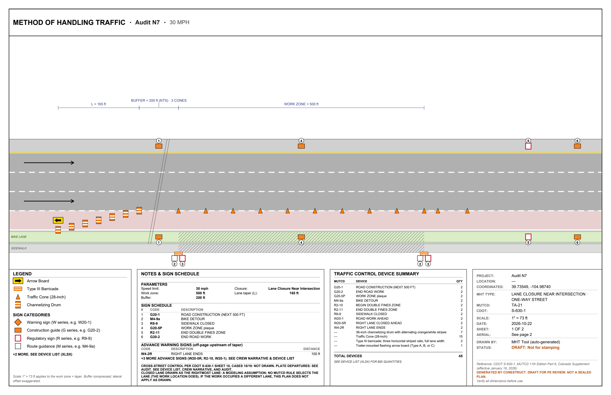

| Check | Result | Oracle | Plan | Source | Note |
|---|---|---|---|---|---|
| C1 taper | PASS | merging taper ≥ L = 165 ft (W=11, S=30) | page 1 label 165, page 1 notes 165, audit 165, audit summary 165, crew sheet 165 | MUTCD Table 6B-4 and 6B-3, p. 775 (L1, L2) |  |
| C2 buffer | PASS | ≥ 200 ft at 30 mph | page 1 label 200, page 1 notes 200, audit 200, crew sheet 200 | MUTCD Table 6B-2, p. 775; §6B.06 ¶11, p. 773 (L9) |  |
| C3 downstream taper | INFO | flagger: ¶14 "should be used"; near-intersection: ¶12 "If used" | no downstream taper in the crew sheet | MUTCD §6B.08 ¶12, ¶14, p. 776 (L4) | Case 18 runs the closed lane to the corner |
| C4 device spacing | PASS | taper ≤ 30 ft, tangent (buffer + work area) ≤ 60 ft | taper 28 ft ≤ 30; cone runs at 56, 50 ft ≤ 60? | MUTCD §6K.01 ¶04, p. 815; S-630-1 Note 18 (L10) |  |
| C5 device type and size | PASS | drums or vertical panels on the taper, drums ≥ 36 in; no Type 1 barricade at 55+ mph | 7 drums on the merging taper; drums 36-inch | S-630-1 Sheet 4 legend; MUTCD §6K.06 ¶01, p. 820; S-630-1 Note 16 (L11, L13) |  |
| C6 closed-approach sign series | PASS | W20-1 → W20-5R → W4-2R, gaps ≥ 100 ft (urban_low) | W20-1 300 → W20-5R 200 → W4-2R 100 | S-630-1 Sheet 10 Case 18; MUTCD Figs 6P-21/22, pp. 901/903; Table 6B-1 (L5, L15) |  |
| C6b cross-street W20-1 | PASS | W20-1 on each drawn cross-street approach | 2 approaches; all carry W20-1 | MUTCD Fig 6P-22, p. 903; S-630-1 Sheet 10 Case 18 (L15) |  |
| C8 arrow board | PASS | if drawn, at the start of the merging taper | the upstream start of the merging taper station 865; taper starts at 865.0; mode left arrow | MUTCD §6L.06 ¶19, p. 833 (L14) |  |
| C9 near or far side | PASS | cross street at station -100.0 → near side (Fig 6P-21: closure before the intersection; Fig 6P-22: past it) | audit near; page 1 / crew say neither; row asked near | MUTCD Figs 6P-21, 6P-22, pp. 901/903 (L16; rulings R7) |  |
| C10 device counts agree | **FLAG** | same quantity of every device on every surface | R2-10: page 1 summary 2, device XLSX 4, quote XLSX 4, crew sheet 4, audit 4; R2-11: page 1 summary 2, device XLSX 4, quote XLSX 4, crew sheet 4, audit 4; W20-1: page 1 summary 2, device XLSX 4, quote XLSX 4, crew sheet 4, audit 4 | Rule 10 / P2 one voice per fact |  |
| C10b notes match drawing | PASS | every value in NOTES equals its drawn label and the request | match | Rule 10 |  |
| C11 containment | PASS | 0/0/0 | 0/0/0 | tests/test_pdf_containment.py measure |  |
| C11b edition | **FLAG** | MUTCD 11th Edition throughout; S-630-1 July 2026 (26 sheets) | MUTCD 11th Edition; audit links S-630-01%20(19-Page%20Set).pdf | Rule 9; CLAUDE.md staleness note | edition finding: goes to #265 |
| C13 pedestrian access | PASS | the closure shown (TA-28) or the limit stated | pedestrianAccess=False, scan sidewalk=True; R9-9 | MUTCD TA-28, pp. 914-915; §6N.04 ¶06, p. 843 (L20) |  |

### `N8`: N Broadway at E 11th Ave, Denver (one-way)

near_intersection · North Broadway (primary) · urban_arterial, undivided, 4 lanes × 11.0 ft · 30 mph (work zone 30) · left lane · 500 ft · day · denver · urban_low · TA-21, Case 18: Traffic control around a work area near an intersection, one lane closed

**2 FLAG** · pin 39.7337, -104.98753

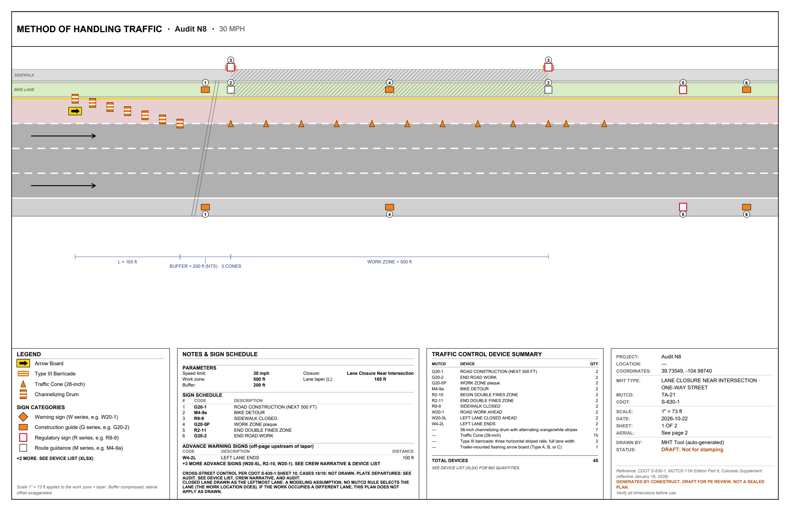

| Check | Result | Oracle | Plan | Source | Note |
|---|---|---|---|---|---|
| C1 taper | PASS | merging taper ≥ L = 165 ft (W=11, S=30) | page 1 label 165, page 1 notes 165, audit 165, audit summary 165, crew sheet 165 | MUTCD Table 6B-4 and 6B-3, p. 775 (L1, L2) |  |
| C2 buffer | PASS | ≥ 200 ft at 30 mph | page 1 label 200, page 1 notes 200, audit 200, crew sheet 200 | MUTCD Table 6B-2, p. 775; §6B.06 ¶11, p. 773 (L9) |  |
| C3 downstream taper | INFO | flagger: ¶14 "should be used"; near-intersection: ¶12 "If used" | no downstream taper in the crew sheet | MUTCD §6B.08 ¶12, ¶14, p. 776 (L4) | Case 18 runs the closed lane to the corner |
| C4 device spacing | PASS | taper ≤ 30 ft, tangent (buffer + work area) ≤ 60 ft | taper 28 ft ≤ 30; cone runs at 56, 50 ft ≤ 60? | MUTCD §6K.01 ¶04, p. 815; S-630-1 Note 18 (L10) |  |
| C5 device type and size | PASS | drums or vertical panels on the taper, drums ≥ 36 in; no Type 1 barricade at 55+ mph | 7 drums on the merging taper; drums 36-inch | S-630-1 Sheet 4 legend; MUTCD §6K.06 ¶01, p. 820; S-630-1 Note 16 (L11, L13) |  |
| C6 closed-approach sign series | PASS | W20-1 → W20-5L → W4-2L, gaps ≥ 100 ft (urban_low) | W20-1 300 → W20-5L 200 → W4-2L 100 | S-630-1 Sheet 10 Case 18; MUTCD Figs 6P-21/22, pp. 901/903; Table 6B-1 (L5, L15) |  |
| C6b cross-street W20-1 | PASS | W20-1 on each drawn cross-street approach | 2 approaches; all carry W20-1 | MUTCD Fig 6P-22, p. 903; S-630-1 Sheet 10 Case 18 (L15) |  |
| C8 arrow board | PASS | if drawn, at the start of the merging taper | the upstream start of the merging taper station 865; taper starts at 865.0; mode right arrow | MUTCD §6L.06 ¶19, p. 833 (L14) |  |
| C9 near or far side | PASS | cross street at station -100.0 → near side (Fig 6P-21: closure before the intersection; Fig 6P-22: past it) | audit near; page 1 / crew say neither; row asked near | MUTCD Figs 6P-21, 6P-22, pp. 901/903 (L16; rulings R7) |  |
| C10 device counts agree | **FLAG** | same quantity of every device on every surface | R2-10: page 1 summary 2, device XLSX 4, quote XLSX 4, crew sheet 4, audit 4; R2-11: page 1 summary 2, device XLSX 4, quote XLSX 4, crew sheet 4, audit 4; W20-1: page 1 summary 2, device XLSX 4, quote XLSX 4, crew sheet 4, audit 4 | Rule 10 / P2 one voice per fact |  |
| C10b notes match drawing | PASS | every value in NOTES equals its drawn label and the request | match | Rule 10 |  |
| C11 containment | PASS | 0/0/0 | 0/0/0 | tests/test_pdf_containment.py measure |  |
| C11b edition | **FLAG** | MUTCD 11th Edition throughout; S-630-1 July 2026 (26 sheets) | MUTCD 11th Edition; audit links S-630-01%20(19-Page%20Set).pdf | Rule 9; CLAUDE.md staleness note | edition finding: goes to #265 |
| C13 pedestrian access | PASS | the closure shown (TA-28) or the limit stated | pedestrianAccess=False, scan sidewalk=True; R9-9 | MUTCD TA-28, pp. 914-915; §6N.04 ¶06, p. 843 (L20) |  |

### `N9`: N Broadway at E 11th Ave, Denver (one-way)

near_intersection · North Broadway (primary) · urban_arterial, undivided, 4 lanes × 11.0 ft · 30 mph (work zone 30) · right lane · 500 ft · day · denver · urban_low · TA-22, Case 18: Traffic control around a work area near an intersection, one lane closed

**2 FLAG** · pin 39.7337, -104.98753

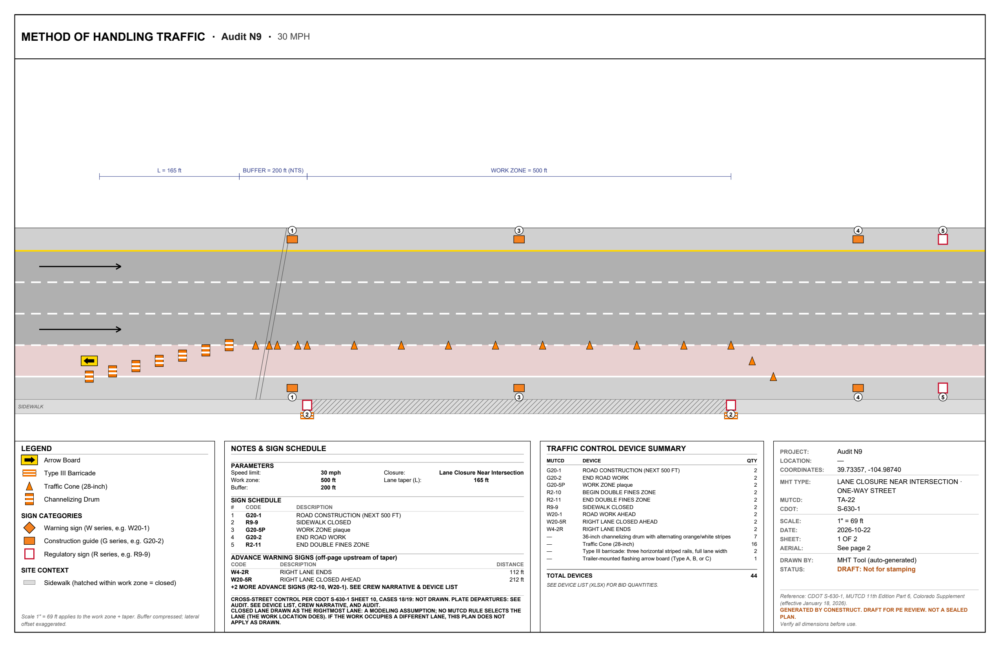

| Check | Result | Oracle | Plan | Source | Note |
|---|---|---|---|---|---|
| C1 taper | PASS | merging taper ≥ L = 165 ft (W=11, S=30) | page 1 label 165, page 1 notes 165, audit 165, audit summary 165, crew sheet 165 | MUTCD Table 6B-4 and 6B-3, p. 775 (L1, L2) |  |
| C2 buffer | PASS | ≥ 200 ft at 30 mph | page 1 label 200, page 1 notes 200, audit 200, crew sheet 200 | MUTCD Table 6B-2, p. 775; §6B.06 ¶11, p. 773 (L9) |  |
| C3 downstream taper | INFO | flagger: ¶14 "should be used"; near-intersection: ¶12 "If used" | no downstream taper in the crew sheet | MUTCD §6B.08 ¶12, ¶14, p. 776 (L4) | Case 18 runs the closed lane to the corner |
| C4 device spacing | PASS | taper ≤ 30 ft, tangent (buffer + work area) ≤ 60 ft | taper 28 ft ≤ 30; 4 cones carry the line past the cross street to the taper; cone runs at 56 ft ≤ 60? | MUTCD §6K.01 ¶04, p. 815; S-630-1 Note 18 (L10) |  |
| C5 device type and size | PASS | drums or vertical panels on the taper, drums ≥ 36 in; no Type 1 barricade at 55+ mph | 7 drums on the merging taper; drums 36-inch | S-630-1 Sheet 4 legend; MUTCD §6K.06 ¶01, p. 820; S-630-1 Note 16 (L11, L13) |  |
| C6 closed-approach sign series | INFO | W20-1 → W20-5R → W4-2R, gaps ≥ 100 ft (urban_low) | W20-1 300 → W20-5R 212 → W4-2R 112 | S-630-1 Sheet 10 Case 18; MUTCD Figs 6P-21/22, pp. 901/903; Table 6B-1 (L5, L15) | gaps under A=100: W20-1 88 (urban: INFO per Sheet 10 Note 1) |
| C6b cross-street W20-1 | PASS | W20-1 on each drawn cross-street approach | 2 approaches; all carry W20-1 | MUTCD Fig 6P-22, p. 903; S-630-1 Sheet 10 Case 18 (L15) |  |
| C8 arrow board | PASS | if drawn, at the start of the merging taper | the upstream start of the merging taper station 877; taper starts at 877.0; mode left arrow | MUTCD §6L.06 ¶19, p. 833 (L14) |  |
| C9 near or far side | PASS | cross street at station 600.0 → far side (Fig 6P-21: closure before the intersection; Fig 6P-22: past it) | audit far; page 1 / crew say neither; row asked far | MUTCD Figs 6P-21, 6P-22, pp. 901/903 (L16; rulings R7) |  |
| C9b far side: R3-7R or continuous channelizers | PASS | R3-7R RIGHT LANE MUST TURN RIGHT, or note 7's continuous channelizers | 4 cones continue the closed-lane line from the taper to the cross street | MUTCD Fig 6P-22 and note 7, pp. 902-903 (L15) |  |
| C10 device counts agree | **FLAG** | same quantity of every device on every surface | R2-10: page 1 summary 2, device XLSX 4, quote XLSX 4, crew sheet 4, audit 4; R2-11: page 1 summary 2, device XLSX 4, quote XLSX 4, crew sheet 4, audit 4; W20-1: page 1 summary 2, device XLSX 4, quote XLSX 4, crew sheet 4, audit 4 | Rule 10 / P2 one voice per fact |  |
| C10b notes match drawing | PASS | every value in NOTES equals its drawn label and the request | match | Rule 10 |  |
| C11 containment | PASS | 0/0/0 | 0/0/0 | tests/test_pdf_containment.py measure |  |
| C11b edition | **FLAG** | MUTCD 11th Edition throughout; S-630-1 July 2026 (26 sheets) | MUTCD 11th Edition; audit links S-630-01%20(19-Page%20Set).pdf | Rule 9; CLAUDE.md staleness note | edition finding: goes to #265 |
| C13 pedestrian access | PASS | the closure shown (TA-28) or the limit stated | pedestrianAccess=False, scan sidewalk=True; R9-9 | MUTCD TA-28, pp. 914-915; §6N.04 ¶06, p. 843 (L20) |  |

### `N10`: N Broadway at E 11th Ave, Denver (one-way)

near_intersection · North Broadway (primary) · urban_arterial, undivided, 4 lanes × 11.0 ft · 30 mph (work zone 30) · left lane · 500 ft · day · denver · urban_low · TA-23, Case 18: Traffic control around a work area near an intersection, one lane closed

**2 FLAG** · pin 39.7337, -104.98753

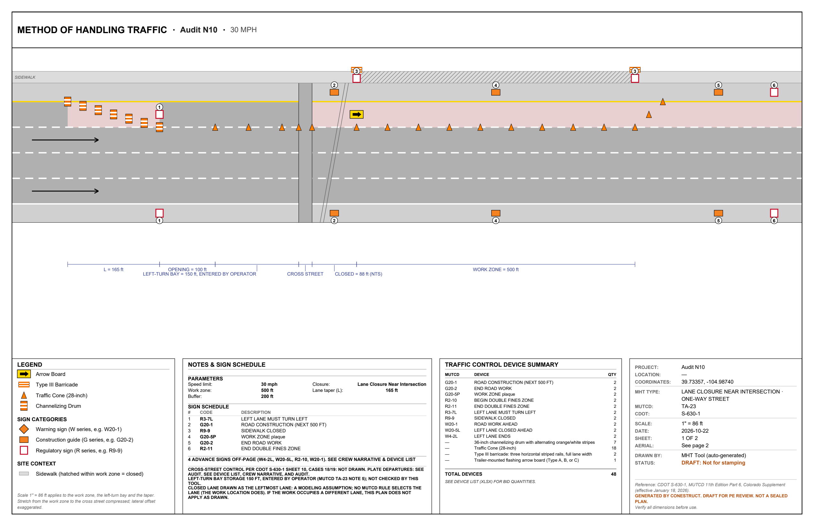

| Check | Result | Oracle | Plan | Source | Note |
|---|---|---|---|---|---|
| C1 taper | PASS | merging taper ≥ L = 165 ft (W=11, S=30) | page 1 label 165, page 1 notes 165, audit 165, audit summary 165, crew sheet 165 | MUTCD Table 6B-4 and 6B-3, p. 775 (L1, L2) |  |
| C2 buffer | PASS | ≥ 200 ft at 30 mph | page 1 notes 200, audit 200, crew sheet 200 | MUTCD Table 6B-2, p. 775; §6B.06 ¶11, p. 773 (L9) |  |
| C3 downstream taper | INFO | flagger: ¶14 "should be used"; near-intersection: ¶12 "If used" | no downstream taper in the crew sheet | MUTCD §6B.08 ¶12, ¶14, p. 776 (L4) | Case 18 runs the closed lane to the corner |
| C4 device spacing | INFO | taper ≤ 30 ft, tangent (buffer + work area) ≤ 60 ft | taper 28 ft ≤ 30; cone runs at 56 ft ≤ 60?; turn bay coned to station 762; 100 ft left open as the bay entry (INFO: no page sets it) | MUTCD §6K.01 ¶04, p. 815; S-630-1 Note 18 (L10) |  |
| C5 device type and size | PASS | drums or vertical panels on the taper, drums ≥ 36 in; no Type 1 barricade at 55+ mph | 7 drums on the merging taper; drums 36-inch | S-630-1 Sheet 4 legend; MUTCD §6K.06 ¶01, p. 820; S-630-1 Note 16 (L11, L13) |  |
| C6 closed-approach sign series | PASS | W20-1 → W20-5L → W4-2L, gaps ≥ 100 ft (urban_low) | W20-1 300 → W20-5L 200 → W4-2L 100 | S-630-1 Sheet 10 Case 18; MUTCD Figs 6P-21/22, pp. 901/903; Table 6B-1 (L5, L15) |  |
| C6b cross-street W20-1 | PASS | W20-1 on each drawn cross-street approach | 2 approaches; all carry W20-1 | MUTCD Fig 6P-22, p. 903; S-630-1 Sheet 10 Case 18 (L15) |  |
| C8 arrow board | INFO | if drawn, at the start of the merging taper | the upstream end of the work zone station 500; taper starts at 1027.0; mode right arrow | MUTCD §6L.06 ¶19, p. 833 (L14) |  |
| C9 near or far side | PASS | cross street at station 600.0 → far side (Fig 6P-21: closure before the intersection; Fig 6P-22: past it) | audit far; page 1 / crew say neither; row asked far | MUTCD Figs 6P-21, 6P-22, pp. 901/903 (L16; rulings R7) |  |
| C9c turn bay storage | INFO | no page sets the storage length | 150 ft sent | oracle-sources.md 'Not sourced' |  |
| C10 device counts agree | **FLAG** | same quantity of every device on every surface | R2-10: page 1 summary 2, device XLSX 4, quote XLSX 4, crew sheet 4, audit 4; R2-11: page 1 summary 2, device XLSX 4, quote XLSX 4, crew sheet 4, audit 4; W20-1: page 1 summary 2, device XLSX 4, quote XLSX 4, crew sheet 4, audit 4 | Rule 10 / P2 one voice per fact |  |
| C10b notes match drawing | PASS | every value in NOTES equals its drawn label and the request | match | Rule 10 |  |
| C11 containment | PASS | 0/0/0 | 0/0/0 | tests/test_pdf_containment.py measure |  |
| C11b edition | **FLAG** | MUTCD 11th Edition throughout; S-630-1 July 2026 (26 sheets) | MUTCD 11th Edition; audit links S-630-01%20(19-Page%20Set).pdf | Rule 9; CLAUDE.md staleness note | edition finding: goes to #265 |
| C13 pedestrian access | PASS | the closure shown (TA-28) or the limit stated | pedestrianAccess=False, scan sidewalk=True; R9-9 | MUTCD TA-28, pp. 914-915; §6N.04 ¶06, p. 843 (L20) |  |

### `N11`: S Colorado Blvd, Denver

near_intersection · South Colorado Boulevard CO 2 (primary) · urban_arterial, undivided, 3 lanes × 12.0 ft · 40 mph (work zone 40) · right lane · 500 ft · day · denver · urban_low · TA-22, Case 18: Traffic control around a work area near an intersection, one lane closed

**2 FLAG** · pin 39.661, -104.9407

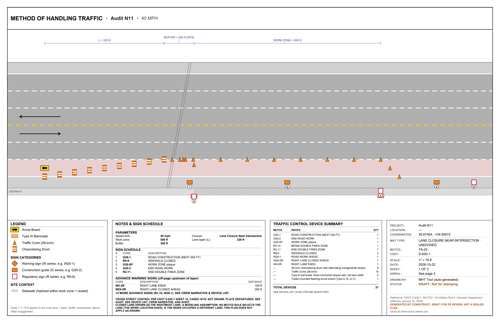

| Check | Result | Oracle | Plan | Source | Note |
|---|---|---|---|---|---|
| C1 taper | PASS | merging taper ≥ L = 320 ft (W=12, S=40) | page 1 label 320, page 1 notes 320, audit 320, audit summary 320, crew sheet 320 | MUTCD Table 6B-4 and 6B-3, p. 775 (L1, L2) |  |
| C2 buffer | PASS | ≥ 305 ft at 40 mph | page 1 label 305, page 1 notes 305, audit 305, crew sheet 305 | MUTCD Table 6B-2, p. 775; §6B.06 ¶11, p. 773 (L9) |  |
| C3 downstream taper | INFO | flagger: ¶14 "should be used"; near-intersection: ¶12 "If used" | no downstream taper in the crew sheet | MUTCD §6B.08 ¶12, ¶14, p. 776 (L4) | Case 18 runs the closed lane to the corner |
| C4 device spacing | PASS | taper ≤ 40 ft, tangent (buffer + work area) ≤ 80 ft | taper 40 ft ≤ 40; 5 cones carry the line past the cross street to the taper; cone runs at 71 ft ≤ 80? | MUTCD §6K.01 ¶04, p. 815; S-630-1 Note 18 (L10) |  |
| C5 device type and size | PASS | drums or vertical panels on the taper, drums ≥ 36 in; no Type 1 barricade at 55+ mph | 9 drums on the merging taper; drums 36-inch | S-630-1 Sheet 4 legend; MUTCD §6K.06 ¶01, p. 820; S-630-1 Note 16 (L11, L13) |  |
| C6 closed-approach sign series | PASS | W20-1 → W20-5R → W4-2R, gaps ≥ 100 ft (urban_low) | W20-1 300 → W20-5R 200 → W4-2R 100 | S-630-1 Sheet 10 Case 18; MUTCD Figs 6P-21/22, pp. 901/903; Table 6B-1 (L5, L15) |  |
| C6b cross-street W20-1 | PASS | W20-1 on each drawn cross-street approach | 2 approaches; all carry W20-1 | MUTCD Fig 6P-22, p. 903; S-630-1 Sheet 10 Case 18 (L15) |  |
| C8 arrow board | PASS | if drawn, at the start of the merging taper | the upstream start of the merging taper station 1125; taper starts at 1125.0; mode left arrow | MUTCD §6L.06 ¶19, p. 833 (L14) |  |
| C9 near or far side | PASS | cross street at station 600.0 → far side (Fig 6P-21: closure before the intersection; Fig 6P-22: past it) | audit far; page 1 / crew say neither; row asked far | MUTCD Figs 6P-21, 6P-22, pp. 901/903 (L16; rulings R7) |  |
| C9b far side: R3-7R or continuous channelizers | PASS | R3-7R RIGHT LANE MUST TURN RIGHT, or note 7's continuous channelizers | 5 cones continue the closed-lane line from the taper to the cross street | MUTCD Fig 6P-22 and note 7, pp. 902-903 (L15) |  |
| C10 device counts agree | **FLAG** | same quantity of every device on every surface | R2-10: page 1 summary 1, device XLSX 3, quote XLSX 3, crew sheet 3, audit 3; R2-11: page 1 summary 1, device XLSX 3, quote XLSX 3, crew sheet 3, audit 3; W20-1: page 1 summary 1, device XLSX 3, quote XLSX 3, crew sheet 3, audit 3 | Rule 10 / P2 one voice per fact |  |
| C10b notes match drawing | PASS | every value in NOTES equals its drawn label and the request | match | Rule 10 |  |
| C11 containment | PASS | 0/0/0 | 0/0/0 | tests/test_pdf_containment.py measure |  |
| C11b edition | **FLAG** | MUTCD 11th Edition throughout; S-630-1 July 2026 (26 sheets) | MUTCD 11th Edition; audit links S-630-01%20(19-Page%20Set).pdf | Rule 9; CLAUDE.md staleness note | edition finding: goes to #265 |
| C13 pedestrian access | PASS | the closure shown (TA-28) or the limit stated | pedestrianAccess=False, scan sidewalk=True; R9-9 | MUTCD TA-28, pp. 914-915; §6N.04 ¶06, p. 843 (L20) |  |

### `N12`: W Colfax Ave near Simms, Lakewood

near_intersection · West Colfax Avenue I 70 BUS;US 40 (primary) · urban_arterial, undivided, 2 lanes × 12.0 ft · 45 mph (work zone 45) · right lane · 600 ft · day · lakewood · urban_high · TA-21, Case 18: Traffic control around a work area near an intersection, one lane closed

**2 FLAG** · pin 39.74016, -105.13048

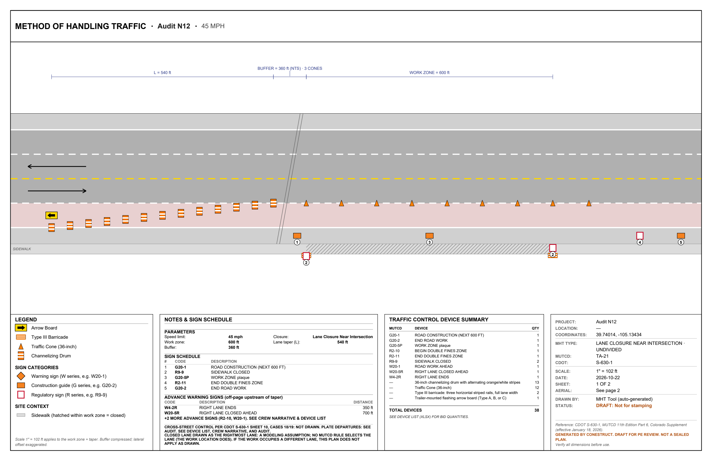

| Check | Result | Oracle | Plan | Source | Note |
|---|---|---|---|---|---|
| C1 taper | PASS | merging taper ≥ L = 540 ft (W=12, S=45) | page 1 label 540, page 1 notes 540, audit 540, audit summary 540, crew sheet 540 | MUTCD Table 6B-4 and 6B-3, p. 775 (L1, L2) |  |
| C2 buffer | PASS | ≥ 360 ft at 45 mph | page 1 label 360, page 1 notes 360, audit 360, crew sheet 360 | MUTCD Table 6B-2, p. 775; §6B.06 ¶11, p. 773 (L9) |  |
| C3 downstream taper | INFO | flagger: ¶14 "should be used"; near-intersection: ¶12 "If used" | no downstream taper in the crew sheet | MUTCD §6B.08 ¶12, ¶14, p. 776 (L4) | Case 18 runs the closed lane to the corner |
| C4 device spacing | PASS | taper ≤ 45 ft, tangent (buffer + work area) ≤ 90 ft | taper 45 ft ≤ 45; cone runs at 86, 90 ft ≤ 90? | MUTCD §6K.01 ¶04, p. 815; S-630-1 Note 18 (L10) |  |
| C5 device type and size | PASS | drums or vertical panels on the taper, drums ≥ 36 in; no Type 1 barricade at 55+ mph | 13 drums on the merging taper; drums 36-inch | S-630-1 Sheet 4 legend; MUTCD §6K.06 ¶01, p. 820; S-630-1 Note 16 (L11, L13) |  |
| C6 closed-approach sign series | PASS | W20-1 → W20-5R → W4-2R, gaps ≥ 350 ft (urban_high) | W20-1 1050 → W20-5R 700 → W4-2R 350 | S-630-1 Sheet 10 Case 18; MUTCD Figs 6P-21/22, pp. 901/903; Table 6B-1 (L5, L15) |  |
| C6b cross-street W20-1 | PASS | W20-1 on each drawn cross-street approach | 2 approaches; all carry W20-1 | MUTCD Fig 6P-22, p. 903; S-630-1 Sheet 10 Case 18 (L15) |  |
| C6c Lakewood breakpoint | INFO | Lakewood's 35 mph split makes this road urban_high | plan uses urban_high | data/jurisdictions/lakewood.json | INFO while 02-JURISDICTION-DATA.md is missing (Ryan, 2026-10-22) |
| C8 arrow board | PASS | if drawn, at the start of the merging taper | the upstream start of the merging taper station 1500; taper starts at 1500.0; mode left arrow | MUTCD §6L.06 ¶19, p. 833 (L14) |  |
| C9 near or far side | PASS | cross street at station -100.0 → near side (Fig 6P-21: closure before the intersection; Fig 6P-22: past it) | audit near; page 1 / crew say neither; row asked near | MUTCD Figs 6P-21, 6P-22, pp. 901/903 (L16; rulings R7) |  |
| C10 device counts agree | **FLAG** | same quantity of every device on every surface | R2-10: page 1 summary 1, device XLSX 3, quote XLSX 3, crew sheet 3, audit 3; R2-11: page 1 summary 1, device XLSX 3, quote XLSX 3, crew sheet 3, audit 3; W20-1: page 1 summary 1, device XLSX 3, quote XLSX 3, crew sheet 3, audit 3 | Rule 10 / P2 one voice per fact |  |
| C10b notes match drawing | PASS | every value in NOTES equals its drawn label and the request | match | Rule 10 |  |
| C11 containment | PASS | 0/0/0 | 0/0/0 | tests/test_pdf_containment.py measure |  |
| C11b edition | **FLAG** | MUTCD 11th Edition throughout; S-630-1 July 2026 (26 sheets) | MUTCD 11th Edition; audit links S-630-01%20(19-Page%20Set).pdf | Rule 9; CLAUDE.md staleness note | edition finding: goes to #265 |
| C13 pedestrian access | PASS | the closure shown (TA-28) or the limit stated | pedestrianAccess=False, scan sidewalk=True; R9-9 | MUTCD TA-28, pp. 914-915; §6N.04 ¶06, p. 843 (L20) |  |
| C14 cone height (45+ mph) | INFO | 36 in where ADT ≥ 2,000 (no ADT input) | 36-inch | S-630-1 Sheet 2 Note 15 (L12) |  |

### `N13`: Sheridan Blvd, Denver, signal 17 m

near_intersection · Sheridan Boulevard CO 95 (primary) · urban_arterial, undivided, 2 lanes × 12.0 ft · 45 mph (work zone 45) · right lane · 600 ft · day · denver · urban_high · TA-21, Case 18: Traffic control around a work area near an intersection, one lane closed

**2 FLAG** · pin 39.7909, -105.05325

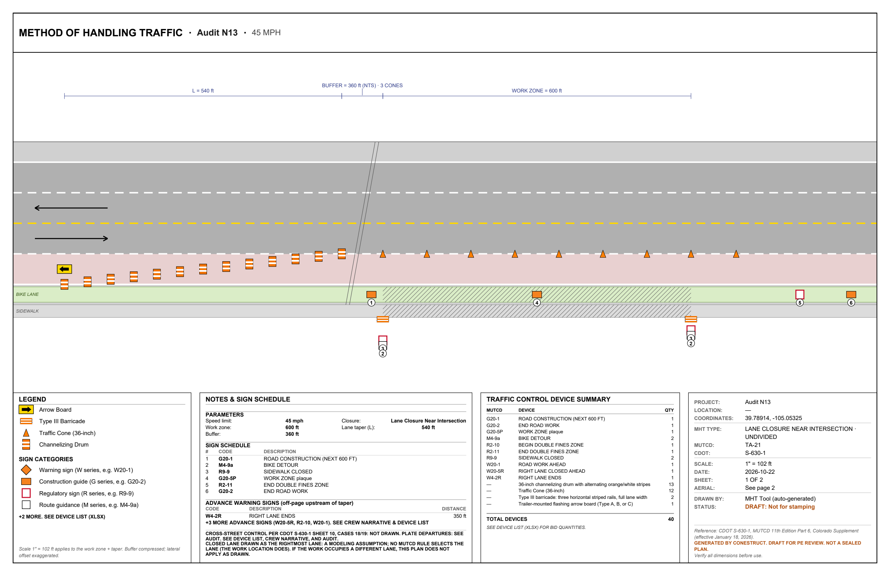

| Check | Result | Oracle | Plan | Source | Note |
|---|---|---|---|---|---|
| C1 taper | PASS | merging taper ≥ L = 540 ft (W=12, S=45) | page 1 label 540, page 1 notes 540, audit 540, audit summary 540, crew sheet 540 | MUTCD Table 6B-4 and 6B-3, p. 775 (L1, L2) |  |
| C2 buffer | PASS | ≥ 360 ft at 45 mph | page 1 label 360, page 1 notes 360, audit 360, crew sheet 360 | MUTCD Table 6B-2, p. 775; §6B.06 ¶11, p. 773 (L9) |  |
| C3 downstream taper | INFO | flagger: ¶14 "should be used"; near-intersection: ¶12 "If used" | no downstream taper in the crew sheet | MUTCD §6B.08 ¶12, ¶14, p. 776 (L4) | Case 18 runs the closed lane to the corner |
| C4 device spacing | PASS | taper ≤ 45 ft, tangent (buffer + work area) ≤ 90 ft | taper 45 ft ≤ 45; cone runs at 86, 90 ft ≤ 90? | MUTCD §6K.01 ¶04, p. 815; S-630-1 Note 18 (L10) |  |
| C5 device type and size | PASS | drums or vertical panels on the taper, drums ≥ 36 in; no Type 1 barricade at 55+ mph | 13 drums on the merging taper; drums 36-inch | S-630-1 Sheet 4 legend; MUTCD §6K.06 ¶01, p. 820; S-630-1 Note 16 (L11, L13) |  |
| C6 closed-approach sign series | PASS | W20-1 → W20-5R → W4-2R, gaps ≥ 350 ft (urban_high) | W20-1 1050 → W20-5R 700 → W4-2R 350 | S-630-1 Sheet 10 Case 18; MUTCD Figs 6P-21/22, pp. 901/903; Table 6B-1 (L5, L15) |  |
| C6b cross-street W20-1 | PASS | W20-1 on each drawn cross-street approach | 2 approaches; all carry W20-1 | MUTCD Fig 6P-22, p. 903; S-630-1 Sheet 10 Case 18 (L15) |  |
| C8 arrow board | PASS | if drawn, at the start of the merging taper | the upstream start of the merging taper station 1500; taper starts at 1500.0; mode left arrow | MUTCD §6L.06 ¶19, p. 833 (L14) |  |
| C9 near or far side | PASS | cross street at station -100.0 → near side (Fig 6P-21: closure before the intersection; Fig 6P-22: past it) | audit near; page 1 / crew say neither; row asked near | MUTCD Figs 6P-21, 6P-22, pp. 901/903 (L16; rulings R7) |  |
| C10 device counts agree | **FLAG** | same quantity of every device on every surface | R2-10: page 1 summary 1, device XLSX 3, quote XLSX 3, crew sheet 3, audit 3; R2-11: page 1 summary 1, device XLSX 3, quote XLSX 3, crew sheet 3, audit 3; W20-1: page 1 summary 1, device XLSX 3, quote XLSX 3, crew sheet 3, audit 3 | Rule 10 / P2 one voice per fact |  |
| C10b notes match drawing | PASS | every value in NOTES equals its drawn label and the request | match | Rule 10 |  |
| C11 containment | PASS | 0/0/0 | 0/0/0 | tests/test_pdf_containment.py measure |  |
| C11b edition | **FLAG** | MUTCD 11th Edition throughout; S-630-1 July 2026 (26 sheets) | MUTCD 11th Edition; audit links S-630-01%20(19-Page%20Set).pdf | Rule 9; CLAUDE.md staleness note | edition finding: goes to #265 |
| C13 pedestrian access | PASS | the closure shown (TA-28) or the limit stated | pedestrianAccess=False, scan sidewalk=True; R9-9 | MUTCD TA-28, pp. 914-915; §6N.04 ¶06, p. 843 (L20) |  |
| C14 cone height (45+ mph) | INFO | 36 in where ADT ≥ 2,000 (no ADT input) | 36-inch | S-630-1 Sheet 2 Note 15 (L12) |  |

### `N14`: CO 2 (Highway 2) at E 104th Ave, Commerce City

near_intersection · Highway 2 (primary) · urban_arterial, undivided, 2 lanes × 12.0 ft · 55 mph (work zone 55) · right lane · 700 ft · day · None · urban_high · TA-21, Case 18: Traffic control around a work area near an intersection, one lane closed

**2 FLAG** · pin 39.885314, -104.847744

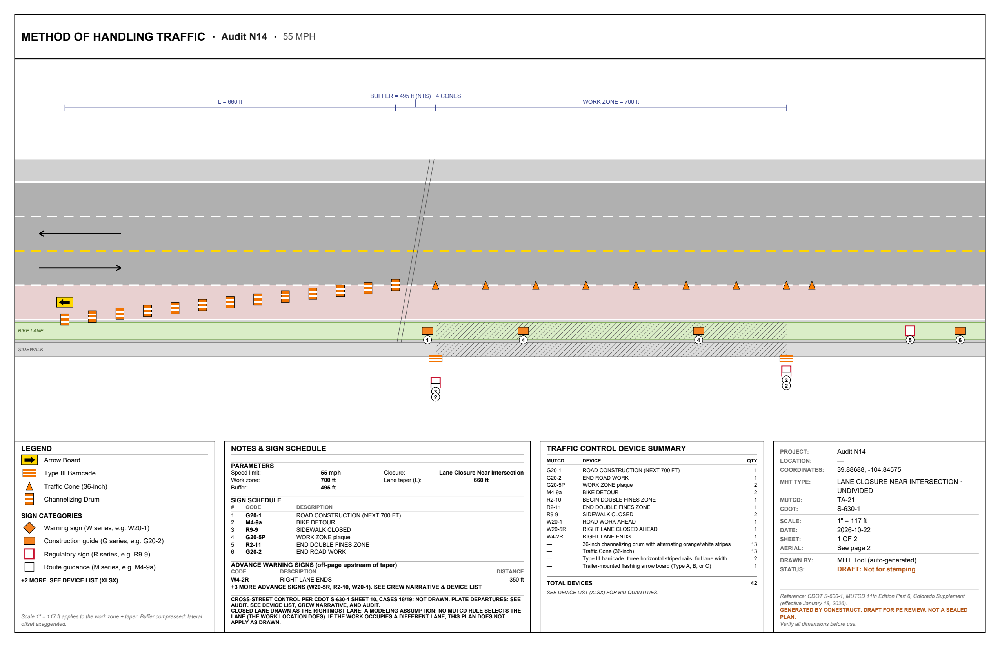

| Check | Result | Oracle | Plan | Source | Note |
|---|---|---|---|---|---|
| C1 taper | PASS | merging taper ≥ L = 660 ft (W=12, S=55) | page 1 label 660, page 1 notes 660, audit 660, audit summary 660, crew sheet 660 | MUTCD Table 6B-4 and 6B-3, p. 775 (L1, L2) |  |
| C2 buffer | PASS | ≥ 495 ft at 55 mph | page 1 label 495, page 1 notes 495, audit 495, crew sheet 495 | MUTCD Table 6B-2, p. 775; §6B.06 ¶11, p. 773 (L9) |  |
| C3 downstream taper | INFO | flagger: ¶14 "should be used"; near-intersection: ¶12 "If used" | no downstream taper in the crew sheet | MUTCD §6B.08 ¶12, ¶14, p. 776 (L4) | Case 18 runs the closed lane to the corner |
| C4 device spacing | PASS | taper ≤ 55 ft, tangent (buffer + work area) ≤ 110 ft | taper 55 ft ≤ 55; cone runs at 100, 99 ft ≤ 110? | MUTCD §6K.01 ¶04, p. 815; S-630-1 Note 18 (L10) |  |
| C5 device type and size | PASS | drums or vertical panels on the taper, drums ≥ 36 in; no Type 1 barricade at 55+ mph | 13 drums on the merging taper; drums 36-inch; Type 1 barricade: none | S-630-1 Sheet 4 legend; MUTCD §6K.06 ¶01, p. 820; S-630-1 Note 16 (L11, L13) |  |
| C6 closed-approach sign series | PASS | W20-1 → W20-5R → W4-2R, gaps ≥ 350 ft (urban_high) | W20-1 1050 → W20-5R 700 → W4-2R 350 | S-630-1 Sheet 10 Case 18; MUTCD Figs 6P-21/22, pp. 901/903; Table 6B-1 (L5, L15) |  |
| C6b cross-street W20-1 | PASS | W20-1 on each drawn cross-street approach | 1 approaches; all carry W20-1 | MUTCD Fig 6P-22, p. 903; S-630-1 Sheet 10 Case 18 (L15) |  |
| C8 arrow board | PASS | if drawn, at the start of the merging taper | the upstream start of the merging taper station 1855; taper starts at 1855.0; mode left arrow | MUTCD §6L.06 ¶19, p. 833 (L14) |  |
| C9 near or far side | PASS | cross street at station -99.0 → near side (Fig 6P-21: closure before the intersection; Fig 6P-22: past it) | audit near; page 1 / crew say neither; row asked near | MUTCD Figs 6P-21, 6P-22, pp. 901/903 (L16; rulings R7) |  |
| C10 device counts agree | **FLAG** | same quantity of every device on every surface | R2-10: page 1 summary 1, device XLSX 2, quote XLSX 2, crew sheet 2, audit 2; R2-11: page 1 summary 1, device XLSX 2, quote XLSX 2, crew sheet 2, audit 2; W20-1: page 1 summary 1, device XLSX 2, quote XLSX 2, crew sheet 2, audit 2 | Rule 10 / P2 one voice per fact |  |
| C10b notes match drawing | PASS | every value in NOTES equals its drawn label and the request | match | Rule 10 |  |
| C11 containment | PASS | 0/0/0 | 0/0/0 | tests/test_pdf_containment.py measure |  |
| C11b edition | **FLAG** | MUTCD 11th Edition throughout; S-630-1 July 2026 (26 sheets) | MUTCD 11th Edition; audit links S-630-01%20(19-Page%20Set).pdf | Rule 9; CLAUDE.md staleness note | edition finding: goes to #265 |
| C13 pedestrian access | PASS | the closure shown (TA-28) or the limit stated | pedestrianAccess=False, scan sidewalk=True; R9-9 | MUTCD TA-28, pp. 914-915; §6N.04 ¶06, p. 843 (L20) |  |
| C14 cone height (45+ mph) | INFO | 36 in where ADT ≥ 2,000 (no ADT input) | 36-inch | S-630-1 Sheet 2 Note 15 (L12) |  |

