# Shoulder-work audit: gallery

Production `1f08f49` (healthz `1f08f49fe0152e91dabe0c7420bd69e6dc2de81d`), fetched 2026-10-16 through the gate with paced requests, one site scan per plan, its signed token reused for the downloads.
32 plans built, 11 refusal cases, 1 rows not run.

- **Findings for review:** [findings.md](findings.md)
- **Oracle:** [oracle-sources.md](oracle-sources.md) (quotes and pages), [oracle-check.md](oracle-check.md) (the independent page check), [oracle.py](oracle.py)
- **Harness:** [matrix.json](matrix.json), [fetch.py](fetch.py), [check.py](check.py), [results.json](results.json); each plan's request, audit JSON, crew sheet, spreadsheets and page-1 text are under `runs/<id>/`

PASS means the plan meets the source. FLAG means it doesn't, or two surfaces disagree. INFO is recorded, not scored. A QUESTION is a Lakewood-only difference for Ryan (ruling e).

## Counts per check

| Check | PASS | FLAG | INFO | of which QUESTION |
|---|---|---|---|---|
| C1 taper | 32 | 0 | 0 |  |
| C2 advance sign spacing | 30 | 2 | 0 | 3 |
| C2b Lakewood breakpoint | 0 | 0 | 3 | 3 |
| C2c Case 11 distances | 0 | 2 | 0 |  |
| C3 limited sight distance | 0 | 16 | 0 |  |
| C4 buffer | 32 | 0 | 0 |  |
| C5 device spacing | 0 | 32 | 0 |  |
| C6a shoulder sign legend | 32 | 0 | 0 |  |
| C6b arrow board mode | 32 | 0 | 0 |  |
| C6c freeway sign set | 2 | 0 | 0 |  |
| C7 signs by side | 16 | 16 | 0 |  |
| C8 device counts agree | 32 | 0 | 0 |  |
| C8b drawn signs vs summary | 32 | 0 | 0 |  |
| C9a assumed shoulder width shown | 0 | 32 | 0 |  |
| C9b jurisdiction math | 0 | 0 | 25 |  |
| C9c edition (#265) | 0 | 0 | 19 |  |
| C9d CDOT edition link (#265) | 0 | 32 | 0 |  |
| C10 notes match drawing | 32 | 0 | 0 |  |
| C11 containment | 32 | 0 | 0 |  |
| C12a cone height | 6 | 10 | 0 |  |
| C12b Type 1 barricade | 8 | 0 | 0 |  |
| C12c sidewalk | 24 | 0 | 0 |  |
| C12d school | 0 | 0 | 3 |  |
| C12e night | 0 | 0 | 15 |  |
| C13 ≥8 ft shoulder closed | 32 | 0 | 0 |  |
| C15 carriageway | 0 | 2 | 0 |  |
| Refusals (C14) | 8 | 3 | | |

## Refusals

| # | Case | Pin | Result | HTTP | PDF | Message | Why flagged |
|---|---|---|---|---|---|---|---|
| X1 | `x-speed-80` | Q | **FLAG** | 400 | 400 | "Input should be less than or equal to 75" | message doesn't name /speed/ |
| X2 | `x-speed-15` | C | **FLAG** | 400 | 400 | "Input should be greater than or equal to 20" | message doesn't name /speed/ |
| X3 | `x-wzspeed-over` | F | **PASS** | 400 | 400 | "workZoneSpeed (45) must be <= posted speed (35)." |  |
| X4 | `x-short-zone` | I | **PASS** | 400 | 400 | {"error": "geometry_validation_failed", "message": "Work zone length (50 ft) is shorter than the required shoulder taper (L/3) of 120 ft at 45 mph. Increase the work zone to at least 120 ft, or reduce the speed limit.",  |  |
| X5 | `x-left-twoway` | C | **PASS** | 400 | 400 | {"error": "pin_model_input", "message": "meta.work.side 'left' needs shoulder work on a one-way street: a road tagged one-way and confirmed as a one-way street. Choose the right side, or plan shoulder work on a one-way s |  |
| X6 | `x-left-divided` | G | **PASS** | 400 | 400 | {"error": "pin_model_input", "message": "meta.work.side 'left' needs shoulder work on a one-way street: a road tagged one-way and confirmed as a one-way street. Choose the right side, or plan shoulder work on a one-way s |  |
| X7 | `x-median` | L | **PASS** | 400 | 400 | {"error": "pin_model_input", "message": "meta.work.side 'median' is not built yet: right-side work is laid out, and left-side shoulder or near-intersection lane work on a one-way street."} |  |
| X8 | `x-wrong-way` | A | **PASS** | 400 | 400 | {"error": "pin_model_input", "message": "meta.work.travel runs against this one-way road's legal direction (oneway='yes'): no traffic arrives from that side."} |  |
| X9 | `x-lanes-5` | D | **FLAG** | 400 | 400 | "Input should be less than or equal to 4" | message doesn't name /lanes/ |
| X10 | `x-freeway-narrow` | Q | **PASS** | 400 | 400 | {"error": "geometry_validation_failed", "message": "Lane width 10.0 ft is below the 11 ft minimum for freeway work zones (CDOT S-630-1 Sheet 7 Case 11 '11' MIN.' annotation). Increase lane width to at least 11 ft, or ver |  |
| X11 | `x-i25-4x11` | Q | **PASS** | 400 | 400 | "4 lanes x 11.0 ft + 10 ft shoulder = 54.0 ft exceeds the plan sheet's drawable half-road (52 ft). Use a lane width of 10.5 ft or less, or reduce the lane count." |  |

## Rows not run

- 30 `i25-r-65-night`: expected a plan; audit answered 400: {"detail":{"error":"geometry_validation_failed","message":"Lane width 10.5 ft is below the 11 ft minimum for freeway work zones (CDOT S-630-1 Sheet 7 Case 11 '11' MIN.' annotation). Increase lane width to at least 11 ft, or verify the scenario is not actually on 

## Plans

### 1. `bway-r-30`: N Broadway SB, Denver (one-way)

North Broadway (primary, oneway=yes) · urban_arterial, undivided, 4 lanes × 11.0 ft · 30 mph · right shoulder · 200 ft · day · sight distance normal · Denver · TA-3, Case 11: Shoulder closure on one-way street · scan ok ['adjacent_intersection', 'pedestrian_facility']

**3 FLAG** · pin 39.7337, -104.98753

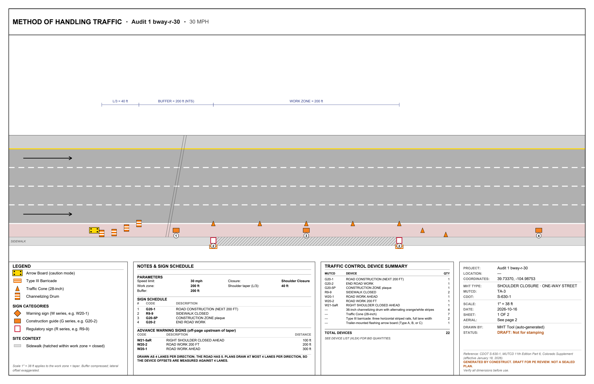

| Check | Result | Oracle | Plan | Source | Note |
|---|---|---|---|---|---|
| C1 taper | PASS | L/3 ≥ 40 ft (W=8 ft, S=30) | page 1 label 40, page 1 notes 40, audit 40, crew sheet 40 | MUTCD Table 6B-4 and 6B-3, p. 775 (O1, O2) |  |
| C2 advance sign spacing | PASS | urban_low: A 100, B 100, C 100 ft (minimum) | gaps 100, 100, 100 (signs at 100, 200, 300 ft) | MUTCD Table 6B-1, p. 773; S-630-1 Sheet 4 (O3) |  |
| C4 buffer | PASS | ≥ 200 ft at 30 mph | page 1 label 200, page 1 notes 200, audit 200, crew sheet 200, page 2 200 | MUTCD Table 6B-2, p. 775; S-630-1 Note 24, Sheet 14 (O5) |  |
| C5 device spacing | **FLAG** | taper ≤ 30 ft, tangent (buffer + work area) ≤ 60 ft | taper 13 ft ≤ 30; tangent 50 ft ≤ 60 from station 0 to 200; the 200 ft buffer (stations 200–400) has no channelizing devices: a 200 ft gap > 2S = 60 ft; downstream taper 50 ft (50–100) | MUTCD §6K.01 ¶04, p. 815; S-630-1 Note 18; §6B.08 ¶12, p. 776 (O6, O7) |  |
| C6a shoulder sign legend | PASS | W21-5aR only | W21-5aR | MUTCD §6H.22 ¶02, p. 807 (O8) |  |
| C6b arrow board mode | PASS | caution mode only | caution mode stated | MUTCD §6N.06 ¶09, p. 845; TA-4 Note 8, p. 866; S-630-1 Note 26 (O10) |  |
| C7 signs by side | PASS | right side only (TA-3 Note 1) | right side; audit Note 8: Not required: one shoulder closed (Note 8's Case 11 exception). Signs placed: 0 left, 8 right. MUTCD 11th Ed. Fig. 6P-3  | S-630-1 Note 8; MUTCD TA-3 Note 1, p. 864; §6N.06 ¶03, p. 845; #243 R54 (O9) |  |
| C8 device counts agree | PASS | same quantity of every device on every surface | 22 devices, 11 types, equal on 5 surfaces | Rule 10 / P2 one voice per fact |  |
| C8b drawn signs vs summary | PASS | every sign in the summary is drawn or listed off-page | match | Rule 10 | drawn counts read from page-1 schedule markers; cones and drums are vector glyphs and are not counted here |
| C9a assumed shoulder width shown | **FLAG** | page 1 states the 8 ft shoulder width the taper uses (no input exists) | page 1 never states the shoulder width | Rule 10; MUTCD TA-3 Note 8, p. 864 (O11) | the taper L = W·S… uses W; the audit discloses it only for one-way streets |
| C9b jurisdiction math | INFO | jurisdiction rules applied, or the plan says CDOT's are used | Denver; page 1 cites CDOT S-630-1 | Rule 10 | the engine always computes with CDOT values (src/api/schemas.py:1519) |
| C9c edition (#265) | INFO | Denver's record pins MUTCD 2009 R2 (PT-116.1) | plan cites MUTCD 11th Edition | data/jurisdictions/denver.json; ruling d | tracked in #265 |
| C9d CDOT edition link (#265) | **FLAG** | S-630-1 July 01, 2026, 26 sheets | audit links S-630-01%20(19-Page%20Set).pdf | S-630-1 2026; CLAUDE.md staleness note; ruling d | edition finding: goes to #265 |
| C10 notes match drawing | PASS | every value in NOTES equals its drawn label; every summary sign is in the schedule or off-page list | match | Rule 10 |  |
| C11 containment | PASS | 0/0/0 | 0/0/0 | tests/test_pdf_containment.py measure |  |
| C12c sidewalk | PASS | closure shown (TA-28) or limits stated | scan found a sidewalk; plan closes it (R9-9 / pedestrian notes) | MUTCD TA-28 Note 1, p. 914; §6N.04 ¶06, p. 843 (O15) |  |
| C13 ≥8 ft shoulder closed | PASS | ≥1 advance warning sign and channelizing devices on a shoulder taper | 3 advance signs, 4 taper devices (W=8 ft) | MUTCD §6N.06 ¶02, p. 845; TA-3 Note 8 (O11) |  |

### 2. `bway-l-30-night`: N Broadway SB, Denver (one-way)

North Broadway (primary, oneway=yes) · urban_arterial, undivided, 4 lanes × 11.0 ft · 30 mph · left shoulder · 1500 ft · night · sight distance limited · Denver · TA-3, Case 11: Shoulder closure on one-way street · scan ok ['adjacent_intersection', 'limited_sight_distance', 'pedestrian_facility']

**5 FLAG** · pin 39.7337, -104.98753

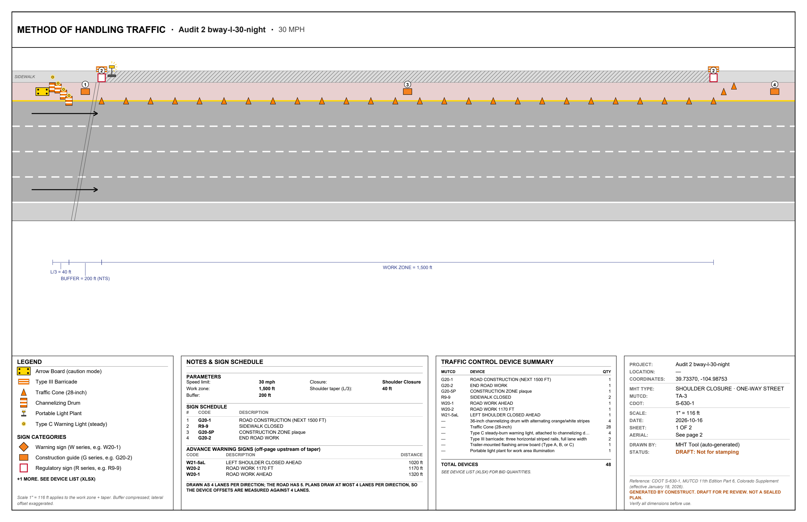

| Check | Result | Oracle | Plan | Source | Note |
|---|---|---|---|---|---|
| C1 taper | PASS | L/3 ≥ 40 ft (W=8 ft, S=30) | page 1 label 40, page 1 notes 40, audit 40, crew sheet 40 | MUTCD Table 6B-4 and 6B-3, p. 775 (O1, O2) |  |
| C2 advance sign spacing | PASS | urban_low: A 100, B 100, C 100 ft (minimum) | gaps 1020, 150, 150 (signs at 1020, 1170, 1320 ft) | MUTCD Table 6B-1, p. 773; S-630-1 Sheet 4 (O3) |  |
| C3 limited sight distance | **FLAG** | §6B.04 ¶07–¶08 allow an increase, no factor; audit's own claim: 50% farther from the taper = [150, 300, 450] | distances [1020, 1170, 1320]; audit: "Moved 3 advance warning sign(s) 50% farther upstream from the taper to compensate for limited sight distance." rule "MUTCD §6B.04: increased advance warning for limited sight distance" | MUTCD §6B.04 ¶04–¶08, p. 771 (O4) | signs sit at 1020, 1170, 1320 ft before the taper: 1.5 × their station from the work zone's far end (1020, 1170, 1320), not 50% farther from the taper as the audit says (150, 300, 450); the 50% factor is filed under §6B.04, which gives no factor, and isn't marked as chosen (Rule 12) |
| C4 buffer | PASS | ≥ 200 ft at 30 mph | page 1 label 200, page 1 notes 200, audit 200, crew sheet 200, page 2 200 | MUTCD Table 6B-2, p. 775; S-630-1 Note 24, Sheet 14 (O5) |  |
| C5 device spacing | **FLAG** | taper ≤ 30 ft, tangent (buffer + work area) ≤ 60 ft | taper 13 ft ≤ 30; tangent 60 ft ≤ 60 from station 0 to 1500; the 200 ft buffer (stations 1500–1700) has no channelizing devices: a 200 ft gap > 2S = 60 ft; downstream taper 50 ft (50–100) | MUTCD §6K.01 ¶04, p. 815; S-630-1 Note 18; §6B.08 ¶12, p. 776 (O6, O7) |  |
| C6a shoulder sign legend | PASS | W21-5aL only | W21-5aL | MUTCD §6H.22 ¶02, p. 807 (O8) |  |
| C6b arrow board mode | PASS | caution mode only | caution mode stated | MUTCD §6N.06 ¶09, p. 845; TA-4 Note 8, p. 866; S-630-1 Note 26 (O10) |  |
| C7 signs by side | PASS | left side only (TA-3 Note 1) | left side; audit Note 8: Not required: one shoulder closed (Note 8's Case 11 exception). Signs placed: 8 left, 0 right. MUTCD 11th Ed. Fig. 6P-3  | S-630-1 Note 8; MUTCD TA-3 Note 1, p. 864; §6N.06 ¶03, p. 845; #243 R54 (O9) |  |
| C8 device counts agree | PASS | same quantity of every device on every surface | 48 devices, 13 types, equal on 5 surfaces | Rule 10 / P2 one voice per fact |  |
| C8b drawn signs vs summary | PASS | every sign in the summary is drawn or listed off-page | match | Rule 10 | drawn counts read from page-1 schedule markers; cones and drums are vector glyphs and are not counted here |
| C9a assumed shoulder width shown | **FLAG** | page 1 states the 8 ft shoulder width the taper uses (no input exists) | page 1 never states the shoulder width | Rule 10; MUTCD TA-3 Note 8, p. 864 (O11) | the taper L = W·S… uses W; the audit discloses it only for one-way streets |
| C9b jurisdiction math | INFO | jurisdiction rules applied, or the plan says CDOT's are used | Denver; page 1 cites CDOT S-630-1 | Rule 10 | the engine always computes with CDOT values (src/api/schemas.py:1519) |
| C9c edition (#265) | INFO | Denver's record pins MUTCD 2009 R2 (PT-116.1) | plan cites MUTCD 11th Edition | data/jurisdictions/denver.json; ruling d | tracked in #265 |
| C9d CDOT edition link (#265) | **FLAG** | S-630-1 July 01, 2026, 26 sheets | audit links S-630-01%20(19-Page%20Set).pdf | S-630-1 2026; CLAUDE.md staleness note; ruling d | edition finding: goes to #265 |
| C10 notes match drawing | PASS | every value in NOTES equals its drawn label; every summary sign is in the schedule or off-page list | match | Rule 10 |  |
| C11 containment | PASS | 0/0/0 | 0/0/0 | tests/test_pdf_containment.py measure |  |
| C12a cone height | **FLAG** | ≥ 36 in at night or on a freeway | 28-inch | S-630-1 Sheet 2 Note 15 (O13) |  |
| C12c sidewalk | PASS | closure shown (TA-28) or limits stated | scan found a sidewalk; plan closes it (R9-9 / pedestrian notes) | MUTCD TA-28 Note 1, p. 914; §6N.04 ¶06, p. 843 (O15) |  |
| C12e night | INFO | recorded only | sonnel in the work zone must wear ANSI Class 2 (daytime) or Class 3 (nighttime) high-visibility apparel.; - Nighttime operation: Ensure all devices meet retroreflectivity re; quirements. Flagger stations require 500W quartz illumination at minimum 8 ft height per CDOT S-630-1 Sheet 2 General | unsourced beyond O13 |  |
| C13 ≥8 ft shoulder closed | PASS | ≥1 advance warning sign and channelizing devices on a shoulder taper | 3 advance signs, 4 taper devices (W=8 ft) | MUTCD §6N.06 ¶02, p. 845; TA-3 Note 8 (O11) |  |

### 3. `e14-l-25`: E 14th Ave at Washington St, Denver (one-way)

East 14th Avenue (secondary, oneway=yes) · urban_arterial, undivided, 3 lanes × 12.0 ft · 25 mph · left shoulder · 1500 ft · day · sight distance normal · Denver · TA-3, Case 11: Shoulder closure on one-way street · scan ok ['adjacent_intersection', 'bicycle_facility', 'pedestrian_facility']

**3 FLAG** · pin 39.73848, -104.979

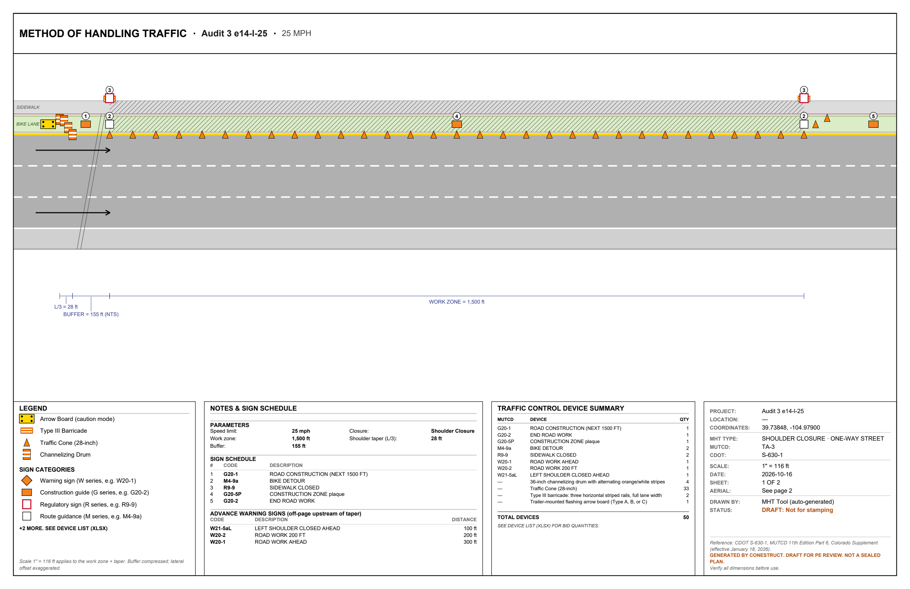

| Check | Result | Oracle | Plan | Source | Note |
|---|---|---|---|---|---|
| C1 taper | PASS | L/3 ≥ 28 ft (W=8 ft, S=25) | page 1 label 28, page 1 notes 28, audit 28, crew sheet 28 | MUTCD Table 6B-4 and 6B-3, p. 775 (O1, O2) |  |
| C2 advance sign spacing | PASS | urban_low: A 100, B 100, C 100 ft (minimum) | gaps 100, 100, 100 (signs at 100, 200, 300 ft) | MUTCD Table 6B-1, p. 773; S-630-1 Sheet 4 (O3) |  |
| C4 buffer | PASS | ≥ 155 ft at 25 mph | page 1 label 155, page 1 notes 155, audit 155, crew sheet 155, page 2 155 | MUTCD Table 6B-2, p. 775; S-630-1 Note 24, Sheet 14 (O5) |  |
| C5 device spacing | **FLAG** | taper ≤ 25 ft, tangent (buffer + work area) ≤ 50 ft | taper 9 ft ≤ 25; tangent 50 ft ≤ 50 from station 0 to 1500; the 155 ft buffer (stations 1500–1655) has no channelizing devices: a 155 ft gap > 2S = 50 ft; downstream taper 50 ft (50–100) | MUTCD §6K.01 ¶04, p. 815; S-630-1 Note 18; §6B.08 ¶12, p. 776 (O6, O7) |  |
| C6a shoulder sign legend | PASS | W21-5aL only | W21-5aL | MUTCD §6H.22 ¶02, p. 807 (O8) |  |
| C6b arrow board mode | PASS | caution mode only | caution mode stated | MUTCD §6N.06 ¶09, p. 845; TA-4 Note 8, p. 866; S-630-1 Note 26 (O10) |  |
| C7 signs by side | PASS | left side only (TA-3 Note 1) | left side; audit Note 8: Not required: one shoulder closed (Note 8's Case 11 exception). Signs placed: 10 left, 0 right. MUTCD 11th Ed. Fig. 6P-3 | S-630-1 Note 8; MUTCD TA-3 Note 1, p. 864; §6N.06 ¶03, p. 845; #243 R54 (O9) |  |
| C8 device counts agree | PASS | same quantity of every device on every surface | 50 devices, 12 types, equal on 5 surfaces | Rule 10 / P2 one voice per fact |  |
| C8b drawn signs vs summary | PASS | every sign in the summary is drawn or listed off-page | match | Rule 10 | drawn counts read from page-1 schedule markers; cones and drums are vector glyphs and are not counted here |
| C9a assumed shoulder width shown | **FLAG** | page 1 states the 8 ft shoulder width the taper uses (no input exists) | page 1 never states the shoulder width | Rule 10; MUTCD TA-3 Note 8, p. 864 (O11) | the taper L = W·S… uses W; the audit discloses it only for one-way streets |
| C9b jurisdiction math | INFO | jurisdiction rules applied, or the plan says CDOT's are used | Denver; page 1 cites CDOT S-630-1 | Rule 10 | the engine always computes with CDOT values (src/api/schemas.py:1519) |
| C9c edition (#265) | INFO | Denver's record pins MUTCD 2009 R2 (PT-116.1) | plan cites MUTCD 11th Edition | data/jurisdictions/denver.json; ruling d | tracked in #265 |
| C9d CDOT edition link (#265) | **FLAG** | S-630-1 July 01, 2026, 26 sheets | audit links S-630-01%20(19-Page%20Set).pdf | S-630-1 2026; CLAUDE.md staleness note; ruling d | edition finding: goes to #265 |
| C10 notes match drawing | PASS | every value in NOTES equals its drawn label; every summary sign is in the schedule or off-page list | match | Rule 10 |  |
| C11 containment | PASS | 0/0/0 | 0/0/0 | tests/test_pdf_containment.py measure |  |
| C12c sidewalk | PASS | closure shown (TA-28) or limits stated | scan found a sidewalk; plan closes it (R9-9 / pedestrian notes) | MUTCD TA-28 Note 1, p. 914; §6N.04 ¶06, p. 843 (O15) |  |
| C13 ≥8 ft shoulder closed | PASS | ≥1 advance warning sign and channelizing devices on a shoulder taper | 3 advance signs, 4 taper devices (W=8 ft) | MUTCD §6N.06 ¶02, p. 845; TA-3 Note 8 (O11) |  |

### 4. `e14-r-25-night`: E 14th Ave at Washington St, Denver (one-way)

East 14th Avenue (secondary, oneway=yes) · urban_arterial, undivided, 3 lanes × 12.0 ft · 25 mph · right shoulder · 200 ft · night · sight distance limited · Denver · TA-3, Case 11: Shoulder closure on one-way street · scan ok ['adjacent_intersection', 'bicycle_facility', 'limited_sight_distance', 'pedestrian_facility']

**5 FLAG** · pin 39.73848, -104.979

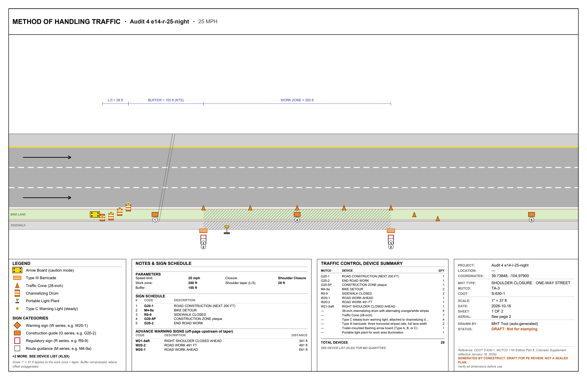

| Check | Result | Oracle | Plan | Source | Note |
|---|---|---|---|---|---|
| C1 taper | PASS | L/3 ≥ 28 ft (W=8 ft, S=25) | page 1 label 28, page 1 notes 28, audit 28, crew sheet 28 | MUTCD Table 6B-4 and 6B-3, p. 775 (O1, O2) |  |
| C2 advance sign spacing | PASS | urban_low: A 100, B 100, C 100 ft (minimum) | gaps 341, 150, 150 (signs at 341, 491, 641 ft) | MUTCD Table 6B-1, p. 773; S-630-1 Sheet 4 (O3) |  |
| C3 limited sight distance | **FLAG** | §6B.04 ¶07–¶08 allow an increase, no factor; audit's own claim: 50% farther from the taper = [150, 300, 450] | distances [341, 491, 641]; audit: "Moved 3 advance warning sign(s) 50% farther upstream from the taper to compensate for limited sight distance." rule "MUTCD §6B.04: increased advance warning for limited sight distance" | MUTCD §6B.04 ¶04–¶08, p. 771 (O4) | signs sit at 341, 491, 641 ft before the taper: 1.5 × their station from the work zone's far end (342, 492, 642), not 50% farther from the taper as the audit says (150, 300, 450); the 50% factor is filed under §6B.04, which gives no factor, and isn't marked as chosen (Rule 12) |
| C4 buffer | PASS | ≥ 155 ft at 25 mph | page 1 label 155, page 1 notes 155, audit 155, crew sheet 155, page 2 155 | MUTCD Table 6B-2, p. 775; S-630-1 Note 24, Sheet 14 (O5) |  |
| C5 device spacing | **FLAG** | taper ≤ 25 ft, tangent (buffer + work area) ≤ 50 ft | taper 9 ft ≤ 25; tangent 50 ft ≤ 50 from station 0 to 200; the 155 ft buffer (stations 200–355) has no channelizing devices: a 155 ft gap > 2S = 50 ft; downstream taper 50 ft (50–100) | MUTCD §6K.01 ¶04, p. 815; S-630-1 Note 18; §6B.08 ¶12, p. 776 (O6, O7) |  |
| C6a shoulder sign legend | PASS | W21-5aR only | W21-5aR | MUTCD §6H.22 ¶02, p. 807 (O8) |  |
| C6b arrow board mode | PASS | caution mode only | caution mode stated | MUTCD §6N.06 ¶09, p. 845; TA-4 Note 8, p. 866; S-630-1 Note 26 (O10) |  |
| C7 signs by side | PASS | right side only (TA-3 Note 1) | right side; audit Note 8: Not required: one shoulder closed (Note 8's Case 11 exception). Signs placed: 0 left, 10 right. MUTCD 11th Ed. Fig. 6P-3 | S-630-1 Note 8; MUTCD TA-3 Note 1, p. 864; §6N.06 ¶03, p. 845; #243 R54 (O9) |  |
| C8 device counts agree | PASS | same quantity of every device on every surface | 29 devices, 14 types, equal on 5 surfaces | Rule 10 / P2 one voice per fact |  |
| C8b drawn signs vs summary | PASS | every sign in the summary is drawn or listed off-page | match | Rule 10 | drawn counts read from page-1 schedule markers; cones and drums are vector glyphs and are not counted here |
| C9a assumed shoulder width shown | **FLAG** | page 1 states the 8 ft shoulder width the taper uses (no input exists) | page 1 never states the shoulder width | Rule 10; MUTCD TA-3 Note 8, p. 864 (O11) | the taper L = W·S… uses W; the audit discloses it only for one-way streets |
| C9b jurisdiction math | INFO | jurisdiction rules applied, or the plan says CDOT's are used | Denver; page 1 cites CDOT S-630-1 | Rule 10 | the engine always computes with CDOT values (src/api/schemas.py:1519) |
| C9c edition (#265) | INFO | Denver's record pins MUTCD 2009 R2 (PT-116.1) | plan cites MUTCD 11th Edition | data/jurisdictions/denver.json; ruling d | tracked in #265 |
| C9d CDOT edition link (#265) | **FLAG** | S-630-1 July 01, 2026, 26 sheets | audit links S-630-01%20(19-Page%20Set).pdf | S-630-1 2026; CLAUDE.md staleness note; ruling d | edition finding: goes to #265 |
| C10 notes match drawing | PASS | every value in NOTES equals its drawn label; every summary sign is in the schedule or off-page list | match | Rule 10 |  |
| C11 containment | PASS | 0/0/0 | 0/0/0 | tests/test_pdf_containment.py measure |  |
| C12a cone height | **FLAG** | ≥ 36 in at night or on a freeway | 28-inch | S-630-1 Sheet 2 Note 15 (O13) |  |
| C12c sidewalk | PASS | closure shown (TA-28) or limits stated | scan found a sidewalk; plan closes it (R9-9 / pedestrian notes) | MUTCD TA-28 Note 1, p. 914; §6N.04 ¶06, p. 843 (O15) |  |
| C12e night | INFO | recorded only | sonnel in the work zone must wear ANSI Class 2 (daytime) or Class 3 (nighttime) high-visibility apparel.; - Nighttime operation: Ensure all devices meet retroreflectivity re; quirements. Flagger stations require 500W quartz illumination at minimum 8 ft height per CDOT S-630-1 Sheet 2 General | unsourced beyond O13 |  |
| C13 ≥8 ft shoulder closed | PASS | ≥1 advance warning sign and channelizing devices on a shoulder taper | 3 advance signs, 4 taper devices (W=8 ft) | MUTCD §6N.06 ¶02, p. 845; TA-3 Note 8 (O11) |  |

### 5. `ogden-r-25-night`: Ogden St between 6th and 7th Ave, Denver (two-way residential)

Ogden Street (residential, oneway=no) · urban_arterial, undivided, 1 lanes × 12.0 ft · 25 mph · right shoulder · 200 ft · night · sight distance normal · Denver · TA-3, Case 11: Shoulder closure on undivided highway · scan ok ['adjacent_intersection', 'pedestrian_facility']

**4 FLAG** · pin 39.7265, -104.97525

| Check | Result | Oracle | Plan | Source | Note |
|---|---|---|---|---|---|
| C1 taper | PASS | L/3 ≥ 28 ft (W=8 ft, S=25) | page 1 label 28, page 1 notes 28, audit 28, crew sheet 28 | MUTCD Table 6B-4 and 6B-3, p. 775 (O1, O2) |  |
| C2 advance sign spacing | PASS | urban_low: A 100, B 100, C 100 ft (minimum) | gaps 100, 100, 100 (signs at 100, 200, 300 ft) | MUTCD Table 6B-1, p. 773; S-630-1 Sheet 4 (O3) |  |
| C4 buffer | PASS | ≥ 155 ft at 25 mph | page 1 label 155, page 1 notes 155, audit 155, crew sheet 155, page 2 155 | MUTCD Table 6B-2, p. 775; S-630-1 Note 24, Sheet 14 (O5) |  |
| C5 device spacing | **FLAG** | taper ≤ 25 ft, tangent (buffer + work area) ≤ 50 ft | taper 9 ft ≤ 25; tangent 50 ft ≤ 50 from station 0 to 200; the 155 ft buffer (stations 200–355) has no channelizing devices: a 155 ft gap > 2S = 50 ft; downstream taper 50 ft (50–100) | MUTCD §6K.01 ¶04, p. 815; S-630-1 Note 18; §6B.08 ¶12, p. 776 (O6, O7) |  |
| C6a shoulder sign legend | PASS | W21-5aR only | W21-5aR | MUTCD §6H.22 ¶02, p. 807 (O8) |  |
| C6b arrow board mode | PASS | caution mode only | caution mode stated | MUTCD §6N.06 ¶09, p. 845; TA-4 Note 8, p. 866; S-630-1 Note 26 (O10) |  |
| C7 signs by side | PASS | right side (own direction, TA-3 figure) | right side; audit Note 8: Required: False. Signs placed: 0 left, 8 right. | S-630-1 Note 8; MUTCD TA-3 Note 1, p. 864; §6N.06 ¶03, p. 845; #243 R54 (O9) |  |
| C8 device counts agree | PASS | same quantity of every device on every surface | 27 devices, 13 types, equal on 5 surfaces | Rule 10 / P2 one voice per fact |  |
| C8b drawn signs vs summary | PASS | every sign in the summary is drawn or listed off-page | match | Rule 10 | drawn counts read from page-1 schedule markers; cones and drums are vector glyphs and are not counted here |
| C9a assumed shoulder width shown | **FLAG** | page 1 states the 8 ft shoulder width the taper uses (no input exists) | page 1 never states the shoulder width | Rule 10; MUTCD TA-3 Note 8, p. 864 (O11) | the taper L = W·S… uses W; the audit discloses it only for one-way streets |
| C9b jurisdiction math | INFO | jurisdiction rules applied, or the plan says CDOT's are used | Denver; page 1 cites CDOT S-630-1 | Rule 10 | the engine always computes with CDOT values (src/api/schemas.py:1519) |
| C9c edition (#265) | INFO | Denver's record pins MUTCD 2009 R2 (PT-116.1) | plan cites MUTCD 11th Edition | data/jurisdictions/denver.json; ruling d | tracked in #265 |
| C9d CDOT edition link (#265) | **FLAG** | S-630-1 July 01, 2026, 26 sheets | audit links S-630-01%20(19-Page%20Set).pdf | S-630-1 2026; CLAUDE.md staleness note; ruling d | edition finding: goes to #265 |
| C10 notes match drawing | PASS | every value in NOTES equals its drawn label; every summary sign is in the schedule or off-page list | match | Rule 10 |  |
| C11 containment | PASS | 0/0/0 | 0/0/0 | tests/test_pdf_containment.py measure |  |
| C12a cone height | **FLAG** | ≥ 36 in at night or on a freeway | 28-inch | S-630-1 Sheet 2 Note 15 (O13) |  |
| C12c sidewalk | PASS | closure shown (TA-28) or limits stated | scan found a sidewalk; plan closes it (R9-9 / pedestrian notes) | MUTCD TA-28 Note 1, p. 914; §6N.04 ¶06, p. 843 (O15) |  |
| C12e night | INFO | recorded only | sonnel in the work zone must wear ANSI Class 2 (daytime) or Class 3 (nighttime) high-visibility apparel.; - Nighttime operation: Ensure all devices meet retroreflectivity re; quirements. Flagger stations require 500W quartz illumination at minimum 8 ft height per CDOT S-630-1 Sheet 2 General | unsourced beyond O13 |  |
| C13 ≥8 ft shoulder closed | PASS | ≥1 advance warning sign and channelizing devices on a shoulder taper | 3 advance signs, 4 taper devices (W=8 ft) | MUTCD §6N.06 ¶02, p. 845; TA-3 Note 8 (O11) |  |

### 6. `ogden-r-30`: Ogden St between 6th and 7th Ave, Denver (two-way residential)

Ogden Street (residential, oneway=no) · urban_arterial, undivided, 1 lanes × 12.0 ft · 30 mph · right shoulder · 800 ft · day · sight distance limited · Denver · TA-3, Case 11: Shoulder closure on undivided highway · scan ok ['adjacent_intersection', 'limited_sight_distance', 'pedestrian_facility']

**4 FLAG** · pin 39.7265, -104.97525

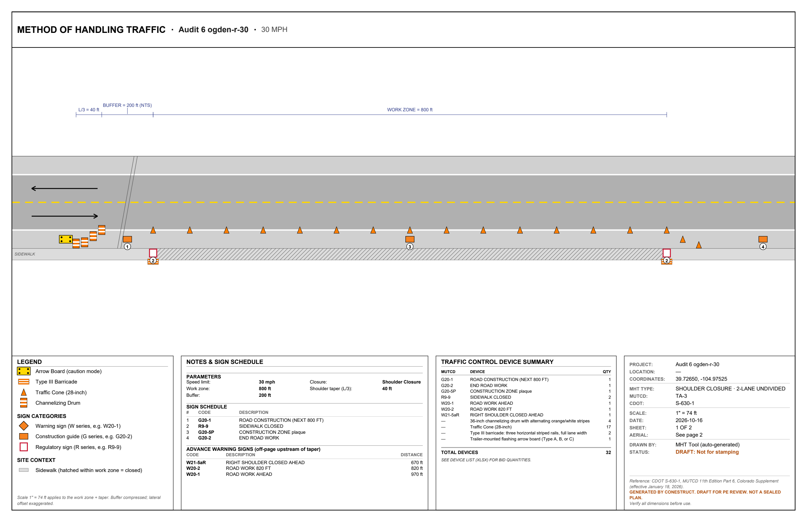

| Check | Result | Oracle | Plan | Source | Note |
|---|---|---|---|---|---|
| C1 taper | PASS | L/3 ≥ 40 ft (W=8 ft, S=30) | page 1 label 40, page 1 notes 40, audit 40, crew sheet 40 | MUTCD Table 6B-4 and 6B-3, p. 775 (O1, O2) |  |
| C2 advance sign spacing | PASS | urban_low: A 100, B 100, C 100 ft (minimum) | gaps 670, 150, 150 (signs at 670, 820, 970 ft) | MUTCD Table 6B-1, p. 773; S-630-1 Sheet 4 (O3) |  |
| C3 limited sight distance | **FLAG** | §6B.04 ¶07–¶08 allow an increase, no factor; audit's own claim: 50% farther from the taper = [150, 300, 450] | distances [670, 820, 970]; audit: "Moved 3 advance warning sign(s) 50% farther upstream from the taper to compensate for limited sight distance." rule "MUTCD §6B.04: increased advance warning for limited sight distance" | MUTCD §6B.04 ¶04–¶08, p. 771 (O4) | signs sit at 670, 820, 970 ft before the taper: 1.5 × their station from the work zone's far end (670, 820, 970), not 50% farther from the taper as the audit says (150, 300, 450); the 50% factor is filed under §6B.04, which gives no factor, and isn't marked as chosen (Rule 12) |
| C4 buffer | PASS | ≥ 200 ft at 30 mph | page 1 label 200, page 1 notes 200, audit 200, crew sheet 200, page 2 200 | MUTCD Table 6B-2, p. 775; S-630-1 Note 24, Sheet 14 (O5) |  |
| C5 device spacing | **FLAG** | taper ≤ 30 ft, tangent (buffer + work area) ≤ 60 ft | taper 13 ft ≤ 30; tangent 57 ft ≤ 60 from station 0 to 800; the 200 ft buffer (stations 800–1000) has no channelizing devices: a 200 ft gap > 2S = 60 ft; downstream taper 50 ft (50–100) | MUTCD §6K.01 ¶04, p. 815; S-630-1 Note 18; §6B.08 ¶12, p. 776 (O6, O7) |  |
| C6a shoulder sign legend | PASS | W21-5aR only | W21-5aR | MUTCD §6H.22 ¶02, p. 807 (O8) |  |
| C6b arrow board mode | PASS | caution mode only | caution mode stated | MUTCD §6N.06 ¶09, p. 845; TA-4 Note 8, p. 866; S-630-1 Note 26 (O10) |  |
| C7 signs by side | PASS | right side (own direction, TA-3 figure) | right side; audit Note 8: Required: False. Signs placed: 0 left, 8 right. | S-630-1 Note 8; MUTCD TA-3 Note 1, p. 864; §6N.06 ¶03, p. 845; #243 R54 (O9) |  |
| C8 device counts agree | PASS | same quantity of every device on every surface | 32 devices, 11 types, equal on 5 surfaces | Rule 10 / P2 one voice per fact |  |
| C8b drawn signs vs summary | PASS | every sign in the summary is drawn or listed off-page | match | Rule 10 | drawn counts read from page-1 schedule markers; cones and drums are vector glyphs and are not counted here |
| C9a assumed shoulder width shown | **FLAG** | page 1 states the 8 ft shoulder width the taper uses (no input exists) | page 1 never states the shoulder width | Rule 10; MUTCD TA-3 Note 8, p. 864 (O11) | the taper L = W·S… uses W; the audit discloses it only for one-way streets |
| C9b jurisdiction math | INFO | jurisdiction rules applied, or the plan says CDOT's are used | Denver; page 1 cites CDOT S-630-1 | Rule 10 | the engine always computes with CDOT values (src/api/schemas.py:1519) |
| C9c edition (#265) | INFO | Denver's record pins MUTCD 2009 R2 (PT-116.1) | plan cites MUTCD 11th Edition | data/jurisdictions/denver.json; ruling d | tracked in #265 |
| C9d CDOT edition link (#265) | **FLAG** | S-630-1 July 01, 2026, 26 sheets | audit links S-630-01%20(19-Page%20Set).pdf | S-630-1 2026; CLAUDE.md staleness note; ruling d | edition finding: goes to #265 |
| C10 notes match drawing | PASS | every value in NOTES equals its drawn label; every summary sign is in the schedule or off-page list | match | Rule 10 |  |
| C11 containment | PASS | 0/0/0 | 0/0/0 | tests/test_pdf_containment.py measure |  |
| C12c sidewalk | PASS | closure shown (TA-28) or limits stated | scan found a sidewalk; plan closes it (R9-9 / pedestrian notes) | MUTCD TA-28 Note 1, p. 914; §6N.04 ¶06, p. 843 (O15) |  |
| C13 ≥8 ft shoulder closed | PASS | ≥1 advance warning sign and channelizing devices on a shoulder taper | 3 advance signs, 4 taper devices (W=8 ft) | MUTCD §6N.06 ¶02, p. 845; TA-3 Note 8 (O11) |  |

### 7. `colfax-r-30-night`: E Colfax Ave, 2200 block, Denver

East Colfax Avenue I 70 BUS;US 40;US 287 (primary, oneway=yes) · urban_arterial, divided, 2 lanes × 12.0 ft · 30 mph · right shoulder · 1500 ft · night · sight distance normal · Denver · TA-3, Case 11: Shoulder closure on divided highway · scan ok ['adjacent_intersection', 'pedestrian_facility']

**5 FLAG** · pin 39.7401, -104.96054

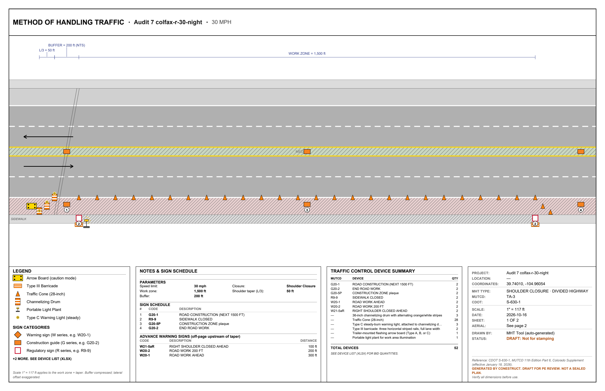

| Check | Result | Oracle | Plan | Source | Note |
|---|---|---|---|---|---|
| C1 taper | PASS | L/3 ≥ 50 ft (W=10 ft, S=30) | page 1 label 50, page 1 notes 50, audit 50, crew sheet 50 | MUTCD Table 6B-4 and 6B-3, p. 775 (O1, O2) |  |
| C2 advance sign spacing | PASS | urban_low: A 100, B 100, C 100 ft (minimum) | gaps 100, 100, 100 (signs at 100, 200, 300 ft) | MUTCD Table 6B-1, p. 773; S-630-1 Sheet 4 (O3) |  |
| C4 buffer | PASS | ≥ 200 ft at 30 mph | page 1 label 200, page 1 notes 200, audit 200, crew sheet 200, page 2 200 | MUTCD Table 6B-2, p. 775; S-630-1 Note 24, Sheet 14 (O5) |  |
| C5 device spacing | **FLAG** | taper ≤ 30 ft, tangent (buffer + work area) ≤ 60 ft | taper 25 ft ≤ 30; tangent 60 ft ≤ 60 from station 0 to 1500; the 200 ft buffer (stations 1500–1700) has no channelizing devices: a 200 ft gap > 2S = 60 ft; downstream taper 50 ft (50–100) | MUTCD §6K.01 ¶04, p. 815; S-630-1 Note 18; §6B.08 ¶12, p. 776 (O6, O7) |  |
| C6a shoulder sign legend | PASS | W21-5aR only | W21-5aR | MUTCD §6H.22 ¶02, p. 807 (O8) |  |
| C6b arrow board mode | PASS | caution mode only | caution mode stated | MUTCD §6N.06 ¶09, p. 845; TA-4 Note 8, p. 866; S-630-1 Note 26 (O10) |  |
| C7 signs by side | **FLAG** | closure side; a mirror is R54's house choice and must not be called required | crew sheet: "- Divided highway: All warning and regulatory signs must be posted on BOTH sides of the roadway per CDOT S-630-1 Sheet 2 General Note 8.", right side; audit Note 8: Not required: one shoulder closed (Note 8's Case 11 exception). Signs placed: 6 left, 8 right. | S-630-1 Note 8; MUTCD TA-3 Note 1, p. 864; §6N.06 ¶03, p. 845; #243 R54 (O9) |  |
| C8 device counts agree | PASS | same quantity of every device on every surface | 52 devices, 13 types, equal on 5 surfaces | Rule 10 / P2 one voice per fact |  |
| C8b drawn signs vs summary | PASS | every sign in the summary is drawn or listed off-page | match | Rule 10 | drawn counts read from page-1 schedule markers; cones and drums are vector glyphs and are not counted here |
| C9a assumed shoulder width shown | **FLAG** | page 1 states the 10 ft shoulder width the taper uses (no input exists) | page 1 never states the shoulder width | Rule 10; MUTCD TA-3 Note 8, p. 864 (O11) | the taper L = W·S… uses W; the audit discloses it only for one-way streets |
| C9b jurisdiction math | INFO | jurisdiction rules applied, or the plan says CDOT's are used | Denver; page 1 cites CDOT S-630-1 | Rule 10 | the engine always computes with CDOT values (src/api/schemas.py:1519) |
| C9c edition (#265) | INFO | Denver's record pins MUTCD 2009 R2 (PT-116.1) | plan cites MUTCD 11th Edition | data/jurisdictions/denver.json; ruling d | tracked in #265 |
| C9d CDOT edition link (#265) | **FLAG** | S-630-1 July 01, 2026, 26 sheets | audit links S-630-01%20(19-Page%20Set).pdf | S-630-1 2026; CLAUDE.md staleness note; ruling d | edition finding: goes to #265 |
| C10 notes match drawing | PASS | every value in NOTES equals its drawn label; every summary sign is in the schedule or off-page list | match | Rule 10 |  |
| C11 containment | PASS | 0/0/0 | 0/0/0 | tests/test_pdf_containment.py measure |  |
| C12a cone height | **FLAG** | ≥ 36 in at night or on a freeway | 28-inch | S-630-1 Sheet 2 Note 15 (O13) |  |
| C12c sidewalk | PASS | closure shown (TA-28) or limits stated | scan found a sidewalk; plan closes it (R9-9 / pedestrian notes) | MUTCD TA-28 Note 1, p. 914; §6N.04 ¶06, p. 843 (O15) |  |
| C12e night | INFO | recorded only | sonnel in the work zone must wear ANSI Class 2 (daytime) or Class 3 (nighttime) high-visibility apparel.; - Nighttime operation: Ensure all devices meet retroreflectivity re; quirements. Flagger stations require 500W quartz illumination at minimum 8 ft height per CDOT S-630-1 Sheet 2 General | unsourced beyond O13 |  |
| C13 ≥8 ft shoulder closed | PASS | ≥1 advance warning sign and channelizing devices on a shoulder taper | 3 advance signs, 3 taper devices (W=10 ft) | MUTCD §6N.06 ¶02, p. 845; TA-3 Note 8 (O11) |  |

### 8. `colfax-r-35`: E Colfax Ave, 2200 block, Denver

East Colfax Avenue I 70 BUS;US 40;US 287 (primary, oneway=yes) · urban_arterial, divided, 2 lanes × 12.0 ft · 35 mph · right shoulder · 200 ft · day · sight distance limited · Denver · TA-3, Case 11: Shoulder closure on divided highway · scan ok ['adjacent_intersection', 'limited_sight_distance', 'pedestrian_facility']

**5 FLAG** · pin 39.7401, -104.96054

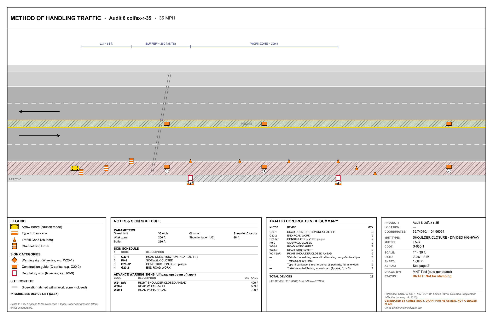

| Check | Result | Oracle | Plan | Source | Note |
|---|---|---|---|---|---|
| C1 taper | PASS | L/3 ≥ 68 ft (W=10 ft, S=35) | page 1 label 68, page 1 notes 68, audit 68, crew sheet 68 | MUTCD Table 6B-4 and 6B-3, p. 775 (O1, O2) |  |
| C2 advance sign spacing | PASS | urban_low: A 100, B 100, C 100 ft (minimum) | gaps 409, 150, 150 (signs at 409, 559, 709 ft) | MUTCD Table 6B-1, p. 773; S-630-1 Sheet 4 (O3) |  |
| C3 limited sight distance | **FLAG** | §6B.04 ¶07–¶08 allow an increase, no factor; audit's own claim: 50% farther from the taper = [150, 300, 450] | distances [409, 559, 709]; audit: "Moved 6 advance warning sign(s) 50% farther upstream from the taper to compensate for limited sight distance." rule "MUTCD §6B.04: increased advance warning for limited sight distance" | MUTCD §6B.04 ¶04–¶08, p. 771 (O4) | signs sit at 409, 559, 709 ft before the taper: 1.5 × their station from the work zone's far end (409, 559, 709), not 50% farther from the taper as the audit says (150, 300, 450); the 50% factor is filed under §6B.04, which gives no factor, and isn't marked as chosen (Rule 12) |
| C4 buffer | PASS | ≥ 250 ft at 35 mph | page 1 label 250, page 1 notes 250, audit 250, crew sheet 250, page 2 250 | MUTCD Table 6B-2, p. 775; S-630-1 Note 24, Sheet 14 (O5) |  |
| C5 device spacing | **FLAG** | taper ≤ 35 ft, tangent (buffer + work area) ≤ 70 ft | taper 34 ft ≤ 35; tangent 67 ft ≤ 70 from station 0 to 200; the 250 ft buffer (stations 200–450) has no channelizing devices: a 250 ft gap > 2S = 70 ft; downstream taper 50 ft (50–100) | MUTCD §6K.01 ¶04, p. 815; S-630-1 Note 18; §6B.08 ¶12, p. 776 (O6, O7) |  |
| C6a shoulder sign legend | PASS | W21-5aR only | W21-5aR | MUTCD §6H.22 ¶02, p. 807 (O8) |  |
| C6b arrow board mode | PASS | caution mode only | caution mode stated | MUTCD §6N.06 ¶09, p. 845; TA-4 Note 8, p. 866; S-630-1 Note 26 (O10) |  |
| C7 signs by side | **FLAG** | closure side; a mirror is R54's house choice and must not be called required | crew sheet: "- Divided highway: All warning and regulatory signs must be posted on BOTH sides of the roadway per CDOT S-630-1 Sheet 2 General Note 8.", right side; audit Note 8: Not required: one shoulder closed (Note 8's Case 11 exception). Signs placed: 6 left, 8 right. | S-630-1 Note 8; MUTCD TA-3 Note 1, p. 864; §6N.06 ¶03, p. 845; #243 R54 (O9) |  |
| C8 device counts agree | PASS | same quantity of every device on every surface | 26 devices, 11 types, equal on 5 surfaces | Rule 10 / P2 one voice per fact |  |
| C8b drawn signs vs summary | PASS | every sign in the summary is drawn or listed off-page | match | Rule 10 | drawn counts read from page-1 schedule markers; cones and drums are vector glyphs and are not counted here |
| C9a assumed shoulder width shown | **FLAG** | page 1 states the 10 ft shoulder width the taper uses (no input exists) | page 1 never states the shoulder width | Rule 10; MUTCD TA-3 Note 8, p. 864 (O11) | the taper L = W·S… uses W; the audit discloses it only for one-way streets |
| C9b jurisdiction math | INFO | jurisdiction rules applied, or the plan says CDOT's are used | Denver; page 1 cites CDOT S-630-1 | Rule 10 | the engine always computes with CDOT values (src/api/schemas.py:1519) |
| C9c edition (#265) | INFO | Denver's record pins MUTCD 2009 R2 (PT-116.1) | plan cites MUTCD 11th Edition | data/jurisdictions/denver.json; ruling d | tracked in #265 |
| C9d CDOT edition link (#265) | **FLAG** | S-630-1 July 01, 2026, 26 sheets | audit links S-630-01%20(19-Page%20Set).pdf | S-630-1 2026; CLAUDE.md staleness note; ruling d | edition finding: goes to #265 |
| C10 notes match drawing | PASS | every value in NOTES equals its drawn label; every summary sign is in the schedule or off-page list | match | Rule 10 |  |
| C11 containment | PASS | 0/0/0 | 0/0/0 | tests/test_pdf_containment.py measure |  |
| C12c sidewalk | PASS | closure shown (TA-28) or limits stated | scan found a sidewalk; plan closes it (R9-9 / pedestrian notes) | MUTCD TA-28 Note 1, p. 914; §6N.04 ¶06, p. 843 (O15) |  |
| C13 ≥8 ft shoulder closed | PASS | ≥1 advance warning sign and channelizing devices on a shoulder taper | 3 advance signs, 3 taper devices (W=10 ft) | MUTCD §6N.06 ¶02, p. 845; TA-3 Note 8 (O11) |  |

### 9. `southhigh-r-25`: E Louisiana Ave at South High School, Denver

East Louisiana Avenue (tertiary, oneway=no) · urban_arterial, undivided, 1 lanes × 12.0 ft · 25 mph · right shoulder · 200 ft · day · sight distance limited · Denver · TA-3, Case 11: Shoulder closure on undivided highway · scan ok ['adjacent_interchange', 'adjacent_intersection', 'limited_sight_distance', 'pedestrian_facility']

**4 FLAG** · pin 39.6928, -104.96595

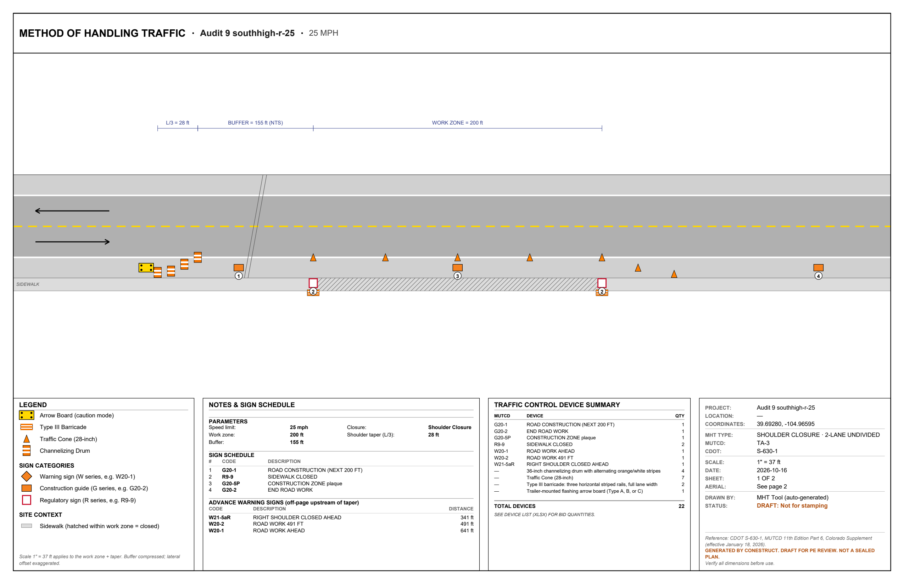

| Check | Result | Oracle | Plan | Source | Note |
|---|---|---|---|---|---|
| C1 taper | PASS | L/3 ≥ 28 ft (W=8 ft, S=25) | page 1 label 28, page 1 notes 28, audit 28, crew sheet 28 | MUTCD Table 6B-4 and 6B-3, p. 775 (O1, O2) |  |
| C2 advance sign spacing | PASS | urban_low: A 100, B 100, C 100 ft (minimum) | gaps 341, 150, 150 (signs at 341, 491, 641 ft) | MUTCD Table 6B-1, p. 773; S-630-1 Sheet 4 (O3) |  |
| C3 limited sight distance | **FLAG** | §6B.04 ¶07–¶08 allow an increase, no factor; audit's own claim: 50% farther from the taper = [150, 300, 450] | distances [341, 491, 641]; audit: "Moved 3 advance warning sign(s) 50% farther upstream from the taper to compensate for limited sight distance." rule "MUTCD §6B.04: increased advance warning for limited sight distance" | MUTCD §6B.04 ¶04–¶08, p. 771 (O4) | signs sit at 341, 491, 641 ft before the taper: 1.5 × their station from the work zone's far end (342, 492, 642), not 50% farther from the taper as the audit says (150, 300, 450); the 50% factor is filed under §6B.04, which gives no factor, and isn't marked as chosen (Rule 12) |
| C4 buffer | PASS | ≥ 155 ft at 25 mph | page 1 label 155, page 1 notes 155, audit 155, crew sheet 155, page 2 155 | MUTCD Table 6B-2, p. 775; S-630-1 Note 24, Sheet 14 (O5) |  |
| C5 device spacing | **FLAG** | taper ≤ 25 ft, tangent (buffer + work area) ≤ 50 ft | taper 9 ft ≤ 25; tangent 50 ft ≤ 50 from station 0 to 200; the 155 ft buffer (stations 200–355) has no channelizing devices: a 155 ft gap > 2S = 50 ft; downstream taper 50 ft (50–100) | MUTCD §6K.01 ¶04, p. 815; S-630-1 Note 18; §6B.08 ¶12, p. 776 (O6, O7) |  |
| C6a shoulder sign legend | PASS | W21-5aR only | W21-5aR | MUTCD §6H.22 ¶02, p. 807 (O8) |  |
| C6b arrow board mode | PASS | caution mode only | caution mode stated | MUTCD §6N.06 ¶09, p. 845; TA-4 Note 8, p. 866; S-630-1 Note 26 (O10) |  |
| C7 signs by side | PASS | right side (own direction, TA-3 figure) | right side; audit Note 8: Required: False. Signs placed: 0 left, 8 right. | S-630-1 Note 8; MUTCD TA-3 Note 1, p. 864; §6N.06 ¶03, p. 845; #243 R54 (O9) |  |
| C8 device counts agree | PASS | same quantity of every device on every surface | 22 devices, 11 types, equal on 5 surfaces | Rule 10 / P2 one voice per fact |  |
| C8b drawn signs vs summary | PASS | every sign in the summary is drawn or listed off-page | match | Rule 10 | drawn counts read from page-1 schedule markers; cones and drums are vector glyphs and are not counted here |
| C9a assumed shoulder width shown | **FLAG** | page 1 states the 8 ft shoulder width the taper uses (no input exists) | page 1 never states the shoulder width | Rule 10; MUTCD TA-3 Note 8, p. 864 (O11) | the taper L = W·S… uses W; the audit discloses it only for one-way streets |
| C9b jurisdiction math | INFO | jurisdiction rules applied, or the plan says CDOT's are used | Denver; page 1 cites CDOT S-630-1 | Rule 10 | the engine always computes with CDOT values (src/api/schemas.py:1519) |
| C9c edition (#265) | INFO | Denver's record pins MUTCD 2009 R2 (PT-116.1) | plan cites MUTCD 11th Edition | data/jurisdictions/denver.json; ruling d | tracked in #265 |
| C9d CDOT edition link (#265) | **FLAG** | S-630-1 July 01, 2026, 26 sheets | audit links S-630-01%20(19-Page%20Set).pdf | S-630-1 2026; CLAUDE.md staleness note; ruling d | edition finding: goes to #265 |
| C10 notes match drawing | PASS | every value in NOTES equals its drawn label; every summary sign is in the schedule or off-page list | match | Rule 10 |  |
| C11 containment | PASS | 0/0/0 | 0/0/0 | tests/test_pdf_containment.py measure |  |
| C12c sidewalk | PASS | closure shown (TA-28) or limits stated | scan found a sidewalk; plan closes it (R9-9 / pedestrian notes) | MUTCD TA-28 Note 1, p. 914; §6N.04 ¶06, p. 843 (O15) |  |
| C12d school | INFO | no work-zone school rule in the sources | scan school_zone=None; plan: no school mention | unsourced (INFO only) |  |
| C13 ≥8 ft shoulder closed | PASS | ≥1 advance warning sign and channelizing devices on a shoulder taper | 3 advance signs, 4 taper devices (W=8 ft) | MUTCD §6N.06 ¶02, p. 845; TA-3 Note 8 (O11) |  |

### 10. `southhigh-r-30-night`: E Louisiana Ave at South High School, Denver

East Louisiana Avenue (tertiary, oneway=no) · urban_arterial, undivided, 1 lanes × 12.0 ft · 30 mph · right shoulder · 1500 ft · night · sight distance normal · Denver · TA-3, Case 11: Shoulder closure on undivided highway · scan ok ['adjacent_intersection', 'bicycle_facility', 'pedestrian_facility']

**4 FLAG** · pin 39.6928, -104.96595

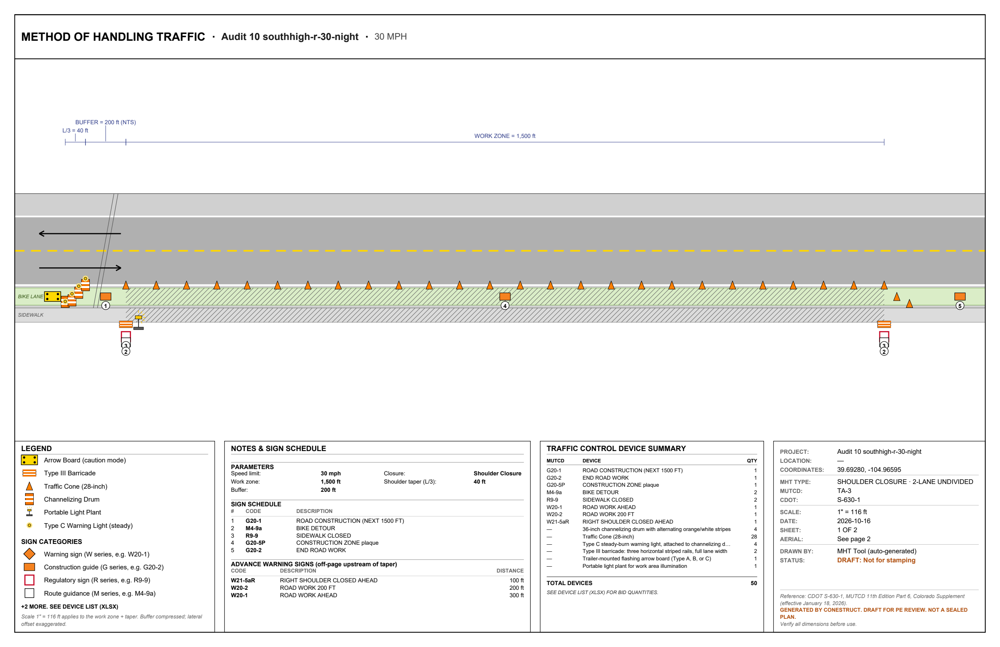

| Check | Result | Oracle | Plan | Source | Note |
|---|---|---|---|---|---|
| C1 taper | PASS | L/3 ≥ 40 ft (W=8 ft, S=30) | page 1 label 40, page 1 notes 40, audit 40, crew sheet 40 | MUTCD Table 6B-4 and 6B-3, p. 775 (O1, O2) |  |
| C2 advance sign spacing | PASS | urban_low: A 100, B 100, C 100 ft (minimum) | gaps 100, 100, 100 (signs at 100, 200, 300 ft) | MUTCD Table 6B-1, p. 773; S-630-1 Sheet 4 (O3) |  |
| C4 buffer | PASS | ≥ 200 ft at 30 mph | page 1 label 200, page 1 notes 200, audit 200, crew sheet 200, page 2 200 | MUTCD Table 6B-2, p. 775; S-630-1 Note 24, Sheet 14 (O5) |  |
| C5 device spacing | **FLAG** | taper ≤ 30 ft, tangent (buffer + work area) ≤ 60 ft | taper 13 ft ≤ 30; tangent 60 ft ≤ 60 from station 0 to 1500; the 200 ft buffer (stations 1500–1700) has no channelizing devices: a 200 ft gap > 2S = 60 ft; downstream taper 50 ft (50–100) | MUTCD §6K.01 ¶04, p. 815; S-630-1 Note 18; §6B.08 ¶12, p. 776 (O6, O7) |  |
| C6a shoulder sign legend | PASS | W21-5aR only | W21-5aR | MUTCD §6H.22 ¶02, p. 807 (O8) |  |
| C6b arrow board mode | PASS | caution mode only | caution mode stated | MUTCD §6N.06 ¶09, p. 845; TA-4 Note 8, p. 866; S-630-1 Note 26 (O10) |  |
| C7 signs by side | PASS | right side (own direction, TA-3 figure) | right side; audit Note 8: Required: False. Signs placed: 0 left, 10 right. | S-630-1 Note 8; MUTCD TA-3 Note 1, p. 864; §6N.06 ¶03, p. 845; #243 R54 (O9) |  |
| C8 device counts agree | PASS | same quantity of every device on every surface | 50 devices, 14 types, equal on 5 surfaces | Rule 10 / P2 one voice per fact |  |
| C8b drawn signs vs summary | PASS | every sign in the summary is drawn or listed off-page | match | Rule 10 | drawn counts read from page-1 schedule markers; cones and drums are vector glyphs and are not counted here |
| C9a assumed shoulder width shown | **FLAG** | page 1 states the 8 ft shoulder width the taper uses (no input exists) | page 1 never states the shoulder width | Rule 10; MUTCD TA-3 Note 8, p. 864 (O11) | the taper L = W·S… uses W; the audit discloses it only for one-way streets |
| C9b jurisdiction math | INFO | jurisdiction rules applied, or the plan says CDOT's are used | Denver; page 1 cites CDOT S-630-1 | Rule 10 | the engine always computes with CDOT values (src/api/schemas.py:1519) |
| C9c edition (#265) | INFO | Denver's record pins MUTCD 2009 R2 (PT-116.1) | plan cites MUTCD 11th Edition | data/jurisdictions/denver.json; ruling d | tracked in #265 |
| C9d CDOT edition link (#265) | **FLAG** | S-630-1 July 01, 2026, 26 sheets | audit links S-630-01%20(19-Page%20Set).pdf | S-630-1 2026; CLAUDE.md staleness note; ruling d | edition finding: goes to #265 |
| C10 notes match drawing | PASS | every value in NOTES equals its drawn label; every summary sign is in the schedule or off-page list | match | Rule 10 |  |
| C11 containment | PASS | 0/0/0 | 0/0/0 | tests/test_pdf_containment.py measure |  |
| C12a cone height | **FLAG** | ≥ 36 in at night or on a freeway | 28-inch | S-630-1 Sheet 2 Note 15 (O13) |  |
| C12c sidewalk | PASS | closure shown (TA-28) or limits stated | scan found a sidewalk; plan closes it (R9-9 / pedestrian notes) | MUTCD TA-28 Note 1, p. 914; §6N.04 ¶06, p. 843 (O15) |  |
| C12d school | INFO | no work-zone school rule in the sources | scan school_zone=None; plan: no school mention | unsourced (INFO only) |  |
| C12e night | INFO | recorded only | sonnel in the work zone must wear ANSI Class 2 (daytime) or Class 3 (nighttime) high-visibility apparel.; - Nighttime operation: Ensure all devices meet retroreflectivity re; quirements. Flagger stations require 500W quartz illumination at minimum 8 ft height per CDOT S-630-1 Sheet 2 General | unsourced beyond O13 |  |
| C13 ≥8 ft shoulder closed | PASS | ≥1 advance warning sign and channelizing devices on a shoulder taper | 3 advance signs, 4 taper devices (W=8 ft) | MUTCD §6N.06 ¶02, p. 845; TA-3 Note 8 (O11) |  |

### 11. `colo-r-35`: S Colorado Blvd, 4800 block, Denver

South Colorado Boulevard CO 2 (primary, oneway=yes) · urban_arterial, divided, 4 lanes × 10.5 ft · 35 mph · right shoulder · 1500 ft · day · sight distance normal · Denver · TA-3, Case 11: Shoulder closure on divided highway · scan ok ['adjacent_intersection', 'bicycle_facility', 'pedestrian_facility']

**4 FLAG** · pin 39.7112, -104.94062

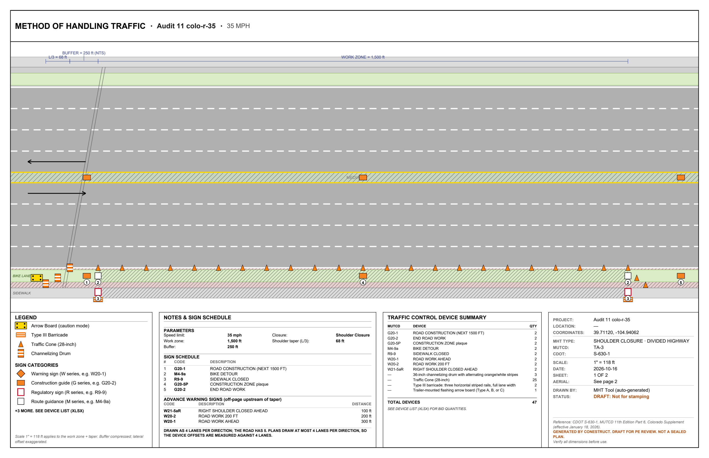

| Check | Result | Oracle | Plan | Source | Note |
|---|---|---|---|---|---|
| C1 taper | PASS | L/3 ≥ 68 ft (W=10 ft, S=35) | page 1 label 68, page 1 notes 68, audit 68, crew sheet 68 | MUTCD Table 6B-4 and 6B-3, p. 775 (O1, O2) |  |
| C2 advance sign spacing | PASS | urban_low: A 100, B 100, C 100 ft (minimum) | gaps 100, 100, 100 (signs at 100, 200, 300 ft) | MUTCD Table 6B-1, p. 773; S-630-1 Sheet 4 (O3) |  |
| C4 buffer | PASS | ≥ 250 ft at 35 mph | page 1 label 250, page 1 notes 250, audit 250, crew sheet 250, page 2 250 | MUTCD Table 6B-2, p. 775; S-630-1 Note 24, Sheet 14 (O5) |  |
| C5 device spacing | **FLAG** | taper ≤ 35 ft, tangent (buffer + work area) ≤ 70 ft | taper 34 ft ≤ 35; tangent 68 ft ≤ 70 from station 0 to 1500; the 250 ft buffer (stations 1500–1750) has no channelizing devices: a 250 ft gap > 2S = 70 ft; downstream taper 50 ft (50–100) | MUTCD §6K.01 ¶04, p. 815; S-630-1 Note 18; §6B.08 ¶12, p. 776 (O6, O7) |  |
| C6a shoulder sign legend | PASS | W21-5aR only | W21-5aR | MUTCD §6H.22 ¶02, p. 807 (O8) |  |
| C6b arrow board mode | PASS | caution mode only | caution mode stated | MUTCD §6N.06 ¶09, p. 845; TA-4 Note 8, p. 866; S-630-1 Note 26 (O10) |  |
| C7 signs by side | **FLAG** | closure side; a mirror is R54's house choice and must not be called required | crew sheet: "- Divided highway: All warning and regulatory signs must be posted on BOTH sides of the roadway per CDOT S-630-1 Sheet 2 General Note 8.", right side; audit Note 8: Not required: one shoulder closed (Note 8's Case 11 exception). Signs placed: 6 left, 10 right. | S-630-1 Note 8; MUTCD TA-3 Note 1, p. 864; §6N.06 ¶03, p. 845; #243 R54 (O9) |  |
| C8 device counts agree | PASS | same quantity of every device on every surface | 47 devices, 12 types, equal on 5 surfaces | Rule 10 / P2 one voice per fact |  |
| C8b drawn signs vs summary | PASS | every sign in the summary is drawn or listed off-page | match | Rule 10 | drawn counts read from page-1 schedule markers; cones and drums are vector glyphs and are not counted here |
| C9a assumed shoulder width shown | **FLAG** | page 1 states the 10 ft shoulder width the taper uses (no input exists) | page 1 never states the shoulder width | Rule 10; MUTCD TA-3 Note 8, p. 864 (O11) | the taper L = W·S… uses W; the audit discloses it only for one-way streets |
| C9b jurisdiction math | INFO | jurisdiction rules applied, or the plan says CDOT's are used | Denver; page 1 cites CDOT S-630-1 | Rule 10 | the engine always computes with CDOT values (src/api/schemas.py:1519) |
| C9c edition (#265) | INFO | Denver's record pins MUTCD 2009 R2 (PT-116.1) | plan cites MUTCD 11th Edition | data/jurisdictions/denver.json; ruling d | tracked in #265 |
| C9d CDOT edition link (#265) | **FLAG** | S-630-1 July 01, 2026, 26 sheets | audit links S-630-01%20(19-Page%20Set).pdf | S-630-1 2026; CLAUDE.md staleness note; ruling d | edition finding: goes to #265 |
| C10 notes match drawing | PASS | every value in NOTES equals its drawn label; every summary sign is in the schedule or off-page list | match | Rule 10 |  |
| C11 containment | PASS | 0/0/0 | 0/0/0 | tests/test_pdf_containment.py measure |  |
| C12c sidewalk | PASS | closure shown (TA-28) or limits stated | scan found a sidewalk; plan closes it (R9-9 / pedestrian notes) | MUTCD TA-28 Note 1, p. 914; §6N.04 ¶06, p. 843 (O15) |  |
| C13 ≥8 ft shoulder closed | PASS | ≥1 advance warning sign and channelizing devices on a shoulder taper | 3 advance signs, 3 taper devices (W=10 ft) | MUTCD §6N.06 ¶02, p. 845; TA-3 Note 8 (O11) |  |

### 12. `colo-r-40-night`: S Colorado Blvd, 4800 block, Denver

South Colorado Boulevard CO 2 (primary, oneway=yes) · urban_arterial, divided, 4 lanes × 10.5 ft · 40 mph · right shoulder · 200 ft · night · sight distance limited · Denver · TA-3, Case 11: Shoulder closure on divided highway · scan ok ['adjacent_intersection', 'limited_sight_distance', 'pedestrian_facility']

**6 FLAG** · pin 39.7112, -104.94062

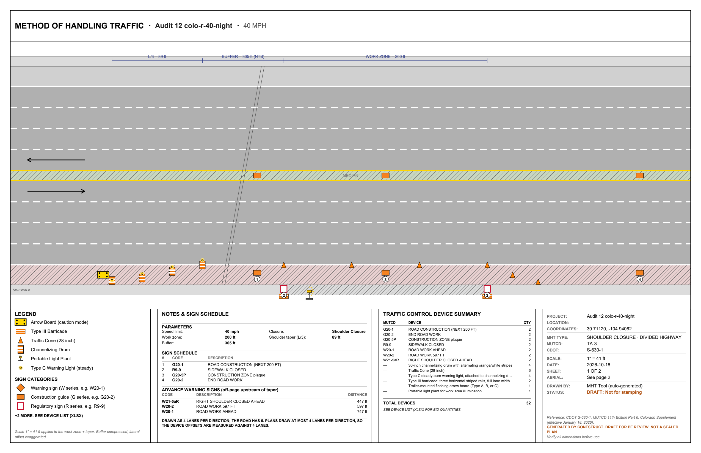

| Check | Result | Oracle | Plan | Source | Note |
|---|---|---|---|---|---|
| C1 taper | PASS | L/3 ≥ 89 ft (W=10 ft, S=40) | page 1 label 89, page 1 notes 89, audit 89, crew sheet 89 | MUTCD Table 6B-4 and 6B-3, p. 775 (O1, O2) |  |
| C2 advance sign spacing | PASS | urban_low: A 100, B 100, C 100 ft (minimum) | gaps 447, 150, 150 (signs at 447, 597, 747 ft) | MUTCD Table 6B-1, p. 773; S-630-1 Sheet 4 (O3) |  |
| C3 limited sight distance | **FLAG** | §6B.04 ¶07–¶08 allow an increase, no factor; audit's own claim: 50% farther from the taper = [150, 300, 450] | distances [447, 597, 747]; audit: "Moved 6 advance warning sign(s) 50% farther upstream from the taper to compensate for limited sight distance." rule "MUTCD §6B.04: increased advance warning for limited sight distance" | MUTCD §6B.04 ¶04–¶08, p. 771 (O4) | signs sit at 447, 597, 747 ft before the taper: 1.5 × their station from the work zone's far end (447, 597, 747), not 50% farther from the taper as the audit says (150, 300, 450); the 50% factor is filed under §6B.04, which gives no factor, and isn't marked as chosen (Rule 12) |
| C4 buffer | PASS | ≥ 305 ft at 40 mph | page 1 label 305, page 1 notes 305, audit 305, crew sheet 305, page 2 305 | MUTCD Table 6B-2, p. 775; S-630-1 Note 24, Sheet 14 (O5) |  |
| C5 device spacing | **FLAG** | taper ≤ 40 ft, tangent (buffer + work area) ≤ 80 ft | taper 30 ft ≤ 40; tangent 67 ft ≤ 80 from station 0 to 200; the 305 ft buffer (stations 200–505) has no channelizing devices: a 305 ft gap > 2S = 80 ft; downstream taper 50 ft (50–100) | MUTCD §6K.01 ¶04, p. 815; S-630-1 Note 18; §6B.08 ¶12, p. 776 (O6, O7) |  |
| C6a shoulder sign legend | PASS | W21-5aR only | W21-5aR | MUTCD §6H.22 ¶02, p. 807 (O8) |  |
| C6b arrow board mode | PASS | caution mode only | caution mode stated | MUTCD §6N.06 ¶09, p. 845; TA-4 Note 8, p. 866; S-630-1 Note 26 (O10) |  |
| C7 signs by side | **FLAG** | closure side; a mirror is R54's house choice and must not be called required | crew sheet: "- Divided highway: All warning and regulatory signs must be posted on BOTH sides of the roadway per CDOT S-630-1 Sheet 2 General Note 8.", right side; audit Note 8: Not required: one shoulder closed (Note 8's Case 11 exception). Signs placed: 6 left, 8 right. | S-630-1 Note 8; MUTCD TA-3 Note 1, p. 864; §6N.06 ¶03, p. 845; #243 R54 (O9) |  |
| C8 device counts agree | PASS | same quantity of every device on every surface | 32 devices, 13 types, equal on 5 surfaces | Rule 10 / P2 one voice per fact |  |
| C8b drawn signs vs summary | PASS | every sign in the summary is drawn or listed off-page | match | Rule 10 | drawn counts read from page-1 schedule markers; cones and drums are vector glyphs and are not counted here |
| C9a assumed shoulder width shown | **FLAG** | page 1 states the 10 ft shoulder width the taper uses (no input exists) | page 1 never states the shoulder width | Rule 10; MUTCD TA-3 Note 8, p. 864 (O11) | the taper L = W·S… uses W; the audit discloses it only for one-way streets |
| C9b jurisdiction math | INFO | jurisdiction rules applied, or the plan says CDOT's are used | Denver; page 1 cites CDOT S-630-1 | Rule 10 | the engine always computes with CDOT values (src/api/schemas.py:1519) |
| C9c edition (#265) | INFO | Denver's record pins MUTCD 2009 R2 (PT-116.1) | plan cites MUTCD 11th Edition | data/jurisdictions/denver.json; ruling d | tracked in #265 |
| C9d CDOT edition link (#265) | **FLAG** | S-630-1 July 01, 2026, 26 sheets | audit links S-630-01%20(19-Page%20Set).pdf | S-630-1 2026; CLAUDE.md staleness note; ruling d | edition finding: goes to #265 |
| C10 notes match drawing | PASS | every value in NOTES equals its drawn label; every summary sign is in the schedule or off-page list | match | Rule 10 |  |
| C11 containment | PASS | 0/0/0 | 0/0/0 | tests/test_pdf_containment.py measure |  |
| C12a cone height | **FLAG** | ≥ 36 in at night or on a freeway | 28-inch | S-630-1 Sheet 2 Note 15 (O13) |  |
| C12c sidewalk | PASS | closure shown (TA-28) or limits stated | scan found a sidewalk; plan closes it (R9-9 / pedestrian notes) | MUTCD TA-28 Note 1, p. 914; §6N.04 ¶06, p. 843 (O15) |  |
| C12e night | INFO | recorded only | sonnel in the work zone must wear ANSI Class 2 (daytime) or Class 3 (nighttime) high-visibility apparel.; - Nighttime operation: Ensure all devices meet retroreflectivity re; quirements. Flagger stations require 500W quartz illumination at minimum 8 ft height per CDOT S-630-1 Sheet 2 General | unsourced beyond O13 |  |
| C13 ≥8 ft shoulder closed | PASS | ≥1 advance warning sign and channelizing devices on a shoulder taper | 3 advance signs, 4 taper devices (W=10 ft) | MUTCD §6N.06 ¶02, p. 845; TA-3 Note 8 (O11) |  |

### 13. `expo-div-r-35-night`: Colorado Blvd at E Exposition Ave, Denver (divided)

South Colorado Boulevard CO 2 (primary, oneway=yes) · urban_arterial, divided, 3 lanes × 12.0 ft · 35 mph · right shoulder · 1500 ft · night · sight distance limited · Denver · TA-3, Case 11: Shoulder closure on divided highway · scan ok ['adjacent_interchange', 'adjacent_intersection', 'limited_sight_distance', 'pedestrian_facility']

**6 FLAG** · pin 39.709, -104.9407

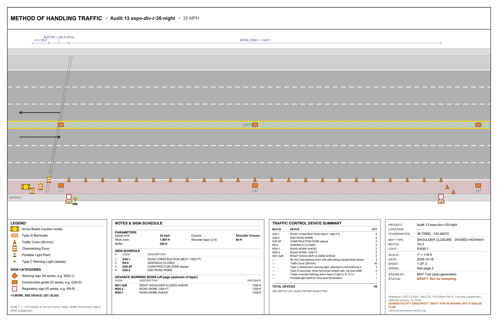

| Check | Result | Oracle | Plan | Source | Note |
|---|---|---|---|---|---|
| C1 taper | PASS | L/3 ≥ 68 ft (W=10 ft, S=35) | page 1 label 68, page 1 notes 68, audit 68, crew sheet 68 | MUTCD Table 6B-4 and 6B-3, p. 775 (O1, O2) |  |
| C2 advance sign spacing | PASS | urban_low: A 100, B 100, C 100 ft (minimum) | gaps 1059, 150, 150 (signs at 1059, 1209, 1359 ft) | MUTCD Table 6B-1, p. 773; S-630-1 Sheet 4 (O3) |  |
| C3 limited sight distance | **FLAG** | §6B.04 ¶07–¶08 allow an increase, no factor; audit's own claim: 50% farther from the taper = [150, 300, 450] | distances [1059, 1209, 1359]; audit: "Moved 6 advance warning sign(s) 50% farther upstream from the taper to compensate for limited sight distance." rule "MUTCD §6B.04: increased advance warning for limited sight distance" | MUTCD §6B.04 ¶04–¶08, p. 771 (O4) | signs sit at 1059, 1209, 1359 ft before the taper: 1.5 × their station from the work zone's far end (1059, 1209, 1359), not 50% farther from the taper as the audit says (150, 300, 450); the 50% factor is filed under §6B.04, which gives no factor, and isn't marked as chosen (Rule 12) |
| C4 buffer | PASS | ≥ 250 ft at 35 mph | page 1 label 250, page 1 notes 250, audit 250, crew sheet 250, page 2 250 | MUTCD Table 6B-2, p. 775; S-630-1 Note 24, Sheet 14 (O5) |  |
| C5 device spacing | **FLAG** | taper ≤ 35 ft, tangent (buffer + work area) ≤ 70 ft | taper 34 ft ≤ 35; tangent 68 ft ≤ 70 from station 0 to 1500; the 250 ft buffer (stations 1500–1750) has no channelizing devices: a 250 ft gap > 2S = 70 ft; downstream taper 50 ft (50–100) | MUTCD §6K.01 ¶04, p. 815; S-630-1 Note 18; §6B.08 ¶12, p. 776 (O6, O7) |  |
| C6a shoulder sign legend | PASS | W21-5aR only | W21-5aR | MUTCD §6H.22 ¶02, p. 807 (O8) |  |
| C6b arrow board mode | PASS | caution mode only | caution mode stated | MUTCD §6N.06 ¶09, p. 845; TA-4 Note 8, p. 866; S-630-1 Note 26 (O10) |  |
| C7 signs by side | **FLAG** | closure side; a mirror is R54's house choice and must not be called required | crew sheet: "- Divided highway: All warning and regulatory signs must be posted on BOTH sides of the roadway per CDOT S-630-1 Sheet 2 General Note 8.", right side; audit Note 8: Not required: one shoulder closed (Note 8's Case 11 exception). Signs placed: 6 left, 8 right. | S-630-1 Note 8; MUTCD TA-3 Note 1, p. 864; §6N.06 ¶03, p. 845; #243 R54 (O9) |  |
| C8 device counts agree | PASS | same quantity of every device on every surface | 49 devices, 13 types, equal on 5 surfaces | Rule 10 / P2 one voice per fact |  |
| C8b drawn signs vs summary | PASS | every sign in the summary is drawn or listed off-page | match | Rule 10 | drawn counts read from page-1 schedule markers; cones and drums are vector glyphs and are not counted here |
| C9a assumed shoulder width shown | **FLAG** | page 1 states the 10 ft shoulder width the taper uses (no input exists) | page 1 never states the shoulder width | Rule 10; MUTCD TA-3 Note 8, p. 864 (O11) | the taper L = W·S… uses W; the audit discloses it only for one-way streets |
| C9b jurisdiction math | INFO | jurisdiction rules applied, or the plan says CDOT's are used | Denver; page 1 cites CDOT S-630-1 | Rule 10 | the engine always computes with CDOT values (src/api/schemas.py:1519) |
| C9c edition (#265) | INFO | Denver's record pins MUTCD 2009 R2 (PT-116.1) | plan cites MUTCD 11th Edition | data/jurisdictions/denver.json; ruling d | tracked in #265 |
| C9d CDOT edition link (#265) | **FLAG** | S-630-1 July 01, 2026, 26 sheets | audit links S-630-01%20(19-Page%20Set).pdf | S-630-1 2026; CLAUDE.md staleness note; ruling d | edition finding: goes to #265 |
| C10 notes match drawing | PASS | every value in NOTES equals its drawn label; every summary sign is in the schedule or off-page list | match | Rule 10 |  |
| C11 containment | PASS | 0/0/0 | 0/0/0 | tests/test_pdf_containment.py measure |  |
| C12a cone height | **FLAG** | ≥ 36 in at night or on a freeway | 28-inch | S-630-1 Sheet 2 Note 15 (O13) |  |
| C12c sidewalk | PASS | closure shown (TA-28) or limits stated | scan found a sidewalk; plan closes it (R9-9 / pedestrian notes) | MUTCD TA-28 Note 1, p. 914; §6N.04 ¶06, p. 843 (O15) |  |
| C12e night | INFO | recorded only | sonnel in the work zone must wear ANSI Class 2 (daytime) or Class 3 (nighttime) high-visibility apparel.; - Nighttime operation: Ensure all devices meet retroreflectivity re; quirements. Flagger stations require 500W quartz illumination at minimum 8 ft height per CDOT S-630-1 Sheet 2 General | unsourced beyond O13 |  |
| C13 ≥8 ft shoulder closed | PASS | ≥1 advance warning sign and channelizing devices on a shoulder taper | 3 advance signs, 3 taper devices (W=10 ft) | MUTCD §6N.06 ¶02, p. 845; TA-3 Note 8 (O11) |  |

### 14. `expo-div-r-40`: Colorado Blvd at E Exposition Ave, Denver (divided)

South Colorado Boulevard CO 2 (primary, oneway=yes) · urban_arterial, divided, 3 lanes × 12.0 ft · 40 mph · right shoulder · 200 ft · day · sight distance normal · Denver · TA-3, Case 11: Shoulder closure on divided highway · scan ok ['adjacent_interchange', 'adjacent_intersection', 'pedestrian_facility']

**4 FLAG** · pin 39.709, -104.9407

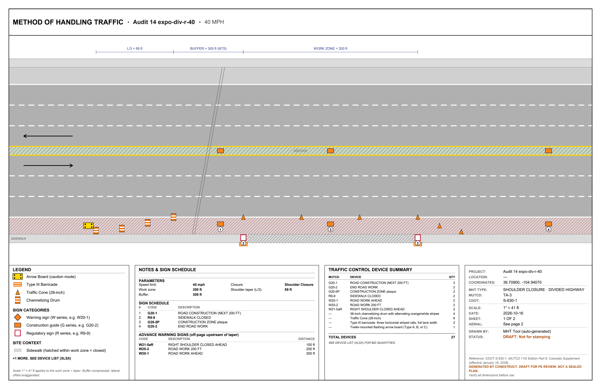

| Check | Result | Oracle | Plan | Source | Note |
|---|---|---|---|---|---|
| C1 taper | PASS | L/3 ≥ 89 ft (W=10 ft, S=40) | page 1 label 89, page 1 notes 89, audit 89, crew sheet 89 | MUTCD Table 6B-4 and 6B-3, p. 775 (O1, O2) |  |
| C2 advance sign spacing | PASS | urban_low: A 100, B 100, C 100 ft (minimum) | gaps 100, 100, 100 (signs at 100, 200, 300 ft) | MUTCD Table 6B-1, p. 773; S-630-1 Sheet 4 (O3) |  |
| C4 buffer | PASS | ≥ 305 ft at 40 mph | page 1 label 305, page 1 notes 305, audit 305, crew sheet 305, page 2 305 | MUTCD Table 6B-2, p. 775; S-630-1 Note 24, Sheet 14 (O5) |  |
| C5 device spacing | **FLAG** | taper ≤ 40 ft, tangent (buffer + work area) ≤ 80 ft | taper 30 ft ≤ 40; tangent 67 ft ≤ 80 from station 0 to 200; the 305 ft buffer (stations 200–505) has no channelizing devices: a 305 ft gap > 2S = 80 ft; downstream taper 50 ft (50–100) | MUTCD §6K.01 ¶04, p. 815; S-630-1 Note 18; §6B.08 ¶12, p. 776 (O6, O7) |  |
| C6a shoulder sign legend | PASS | W21-5aR only | W21-5aR | MUTCD §6H.22 ¶02, p. 807 (O8) |  |
| C6b arrow board mode | PASS | caution mode only | caution mode stated | MUTCD §6N.06 ¶09, p. 845; TA-4 Note 8, p. 866; S-630-1 Note 26 (O10) |  |
| C7 signs by side | **FLAG** | closure side; a mirror is R54's house choice and must not be called required | crew sheet: "- Divided highway: All warning and regulatory signs must be posted on BOTH sides of the roadway per CDOT S-630-1 Sheet 2 General Note 8.", right side; audit Note 8: Not required: one shoulder closed (Note 8's Case 11 exception). Signs placed: 6 left, 8 right. | S-630-1 Note 8; MUTCD TA-3 Note 1, p. 864; §6N.06 ¶03, p. 845; #243 R54 (O9) |  |
| C8 device counts agree | PASS | same quantity of every device on every surface | 27 devices, 11 types, equal on 5 surfaces | Rule 10 / P2 one voice per fact |  |
| C8b drawn signs vs summary | PASS | every sign in the summary is drawn or listed off-page | match | Rule 10 | drawn counts read from page-1 schedule markers; cones and drums are vector glyphs and are not counted here |
| C9a assumed shoulder width shown | **FLAG** | page 1 states the 10 ft shoulder width the taper uses (no input exists) | page 1 never states the shoulder width | Rule 10; MUTCD TA-3 Note 8, p. 864 (O11) | the taper L = W·S… uses W; the audit discloses it only for one-way streets |
| C9b jurisdiction math | INFO | jurisdiction rules applied, or the plan says CDOT's are used | Denver; page 1 cites CDOT S-630-1 | Rule 10 | the engine always computes with CDOT values (src/api/schemas.py:1519) |
| C9c edition (#265) | INFO | Denver's record pins MUTCD 2009 R2 (PT-116.1) | plan cites MUTCD 11th Edition | data/jurisdictions/denver.json; ruling d | tracked in #265 |
| C9d CDOT edition link (#265) | **FLAG** | S-630-1 July 01, 2026, 26 sheets | audit links S-630-01%20(19-Page%20Set).pdf | S-630-1 2026; CLAUDE.md staleness note; ruling d | edition finding: goes to #265 |
| C10 notes match drawing | PASS | every value in NOTES equals its drawn label; every summary sign is in the schedule or off-page list | match | Rule 10 |  |
| C11 containment | PASS | 0/0/0 | 0/0/0 | tests/test_pdf_containment.py measure |  |
| C12c sidewalk | PASS | closure shown (TA-28) or limits stated | scan found a sidewalk; plan closes it (R9-9 / pedestrian notes) | MUTCD TA-28 Note 1, p. 914; §6N.04 ¶06, p. 843 (O15) |  |
| C13 ≥8 ft shoulder closed | PASS | ≥1 advance warning sign and channelizing devices on a shoulder taper | 3 advance signs, 4 taper devices (W=10 ft) | MUTCD §6N.06 ¶02, p. 845; TA-3 Note 8 (O11) |  |

### 15. `alameda-r-35`: W Alameda Ave, Lakewood

West Alameda Avenue (primary, oneway=yes) · urban_arterial, divided, 4 lanes × 10.5 ft · 35 mph · right shoulder · 200 ft · day · sight distance normal · Lakewood · TA-3, Case 11: Shoulder closure on divided highway · scan ok ['adjacent_intersection', 'bicycle_facility', 'pedestrian_facility']

**4 FLAG** · pin 39.7113, -105.0815

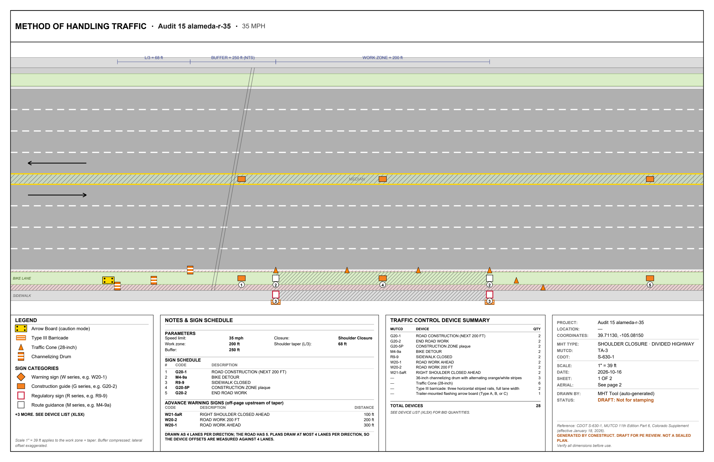

| Check | Result | Oracle | Plan | Source | Note |
|---|---|---|---|---|---|
| C1 taper | PASS | L/3 ≥ 68 ft (W=10 ft, S=35) | page 1 label 68, page 1 notes 68, audit 68, crew sheet 68 | MUTCD Table 6B-4 and 6B-3, p. 775 (O1, O2) |  |
| C2 advance sign spacing | PASS | urban_low: A 100, B 100, C 100 ft (minimum) | gaps 100, 100, 100 (signs at 100, 200, 300 ft) | MUTCD Table 6B-1, p. 773; S-630-1 Sheet 4 (O3) | QUESTION for Ryan (ruling e): under Lakewood's 35 mph split this road is urban_high (350/350/350 ft); the plan's gaps fall short of it. |
| C2b Lakewood breakpoint | INFO |  |  | data/jurisdictions/lakewood.json | QUESTION for Ryan (ruling e): under Lakewood's 35 mph split this road is urban_high (350/350/350 ft); the plan's gaps fall short of it. |
| C4 buffer | PASS | ≥ 250 ft at 35 mph | page 1 label 250, page 1 notes 250, audit 250, crew sheet 250, page 2 250 | MUTCD Table 6B-2, p. 775; S-630-1 Note 24, Sheet 14 (O5) |  |
| C5 device spacing | **FLAG** | taper ≤ 35 ft, tangent (buffer + work area) ≤ 70 ft | taper 34 ft ≤ 35; tangent 67 ft ≤ 70 from station 0 to 200; the 250 ft buffer (stations 200–450) has no channelizing devices: a 250 ft gap > 2S = 70 ft; downstream taper 50 ft (50–100) | MUTCD §6K.01 ¶04, p. 815; S-630-1 Note 18; §6B.08 ¶12, p. 776 (O6, O7) |  |
| C6a shoulder sign legend | PASS | W21-5aR only | W21-5aR | MUTCD §6H.22 ¶02, p. 807 (O8) |  |
| C6b arrow board mode | PASS | caution mode only | caution mode stated | MUTCD §6N.06 ¶09, p. 845; TA-4 Note 8, p. 866; S-630-1 Note 26 (O10) |  |
| C7 signs by side | **FLAG** | closure side; a mirror is R54's house choice and must not be called required | crew sheet: "- Divided highway: All warning and regulatory signs must be posted on BOTH sides of the roadway per CDOT S-630-1 Sheet 2 General Note 8.", right side; audit Note 8: Not required: one shoulder closed (Note 8's Case 11 exception). Signs placed: 6 left, 10 right. | S-630-1 Note 8; MUTCD TA-3 Note 1, p. 864; §6N.06 ¶03, p. 845; #243 R54 (O9) |  |
| C8 device counts agree | PASS | same quantity of every device on every surface | 28 devices, 12 types, equal on 5 surfaces | Rule 10 / P2 one voice per fact |  |
| C8b drawn signs vs summary | PASS | every sign in the summary is drawn or listed off-page | match | Rule 10 | drawn counts read from page-1 schedule markers; cones and drums are vector glyphs and are not counted here |
| C9a assumed shoulder width shown | **FLAG** | page 1 states the 10 ft shoulder width the taper uses (no input exists) | page 1 never states the shoulder width | Rule 10; MUTCD TA-3 Note 8, p. 864 (O11) | the taper L = W·S… uses W; the audit discloses it only for one-way streets |
| C9b jurisdiction math | INFO | jurisdiction rules applied, or the plan says CDOT's are used | Lakewood; page 1 cites CDOT S-630-1 | Rule 10 | the engine always computes with CDOT values (src/api/schemas.py:1519) |
| C9d CDOT edition link (#265) | **FLAG** | S-630-1 July 01, 2026, 26 sheets | audit links S-630-01%20(19-Page%20Set).pdf | S-630-1 2026; CLAUDE.md staleness note; ruling d | edition finding: goes to #265 |
| C10 notes match drawing | PASS | every value in NOTES equals its drawn label; every summary sign is in the schedule or off-page list | match | Rule 10 |  |
| C11 containment | PASS | 0/0/0 | 0/0/0 | tests/test_pdf_containment.py measure |  |
| C12c sidewalk | PASS | closure shown (TA-28) or limits stated | scan found a sidewalk; plan closes it (R9-9 / pedestrian notes) | MUTCD TA-28 Note 1, p. 914; §6N.04 ¶06, p. 843 (O15) |  |
| C13 ≥8 ft shoulder closed | PASS | ≥1 advance warning sign and channelizing devices on a shoulder taper | 3 advance signs, 3 taper devices (W=10 ft) | MUTCD §6N.06 ¶02, p. 845; TA-3 Note 8 (O11) |  |

### 16. `alameda-r-40-night`: W Alameda Ave, Lakewood

West Alameda Avenue (primary, oneway=yes) · urban_arterial, divided, 4 lanes × 10.5 ft · 40 mph · right shoulder · 1500 ft · night · sight distance limited · Lakewood · TA-3, Case 11: Shoulder closure on divided highway · scan ok ['adjacent_intersection', 'bicycle_facility', 'limited_sight_distance', 'pedestrian_facility']

**6 FLAG** · pin 39.7113, -105.0815

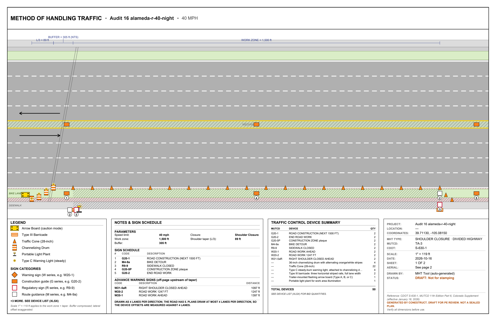

| Check | Result | Oracle | Plan | Source | Note |
|---|---|---|---|---|---|
| C1 taper | PASS | L/3 ≥ 89 ft (W=10 ft, S=40) | page 1 label 89, page 1 notes 89, audit 89, crew sheet 89 | MUTCD Table 6B-4 and 6B-3, p. 775 (O1, O2) |  |
| C2 advance sign spacing | PASS | urban_low: A 100, B 100, C 100 ft (minimum) | gaps 1097, 150, 150 (signs at 1097, 1247, 1397 ft) | MUTCD Table 6B-1, p. 773; S-630-1 Sheet 4 (O3) | QUESTION for Ryan (ruling e): under Lakewood's 35 mph split this road is urban_high (350/350/350 ft); the plan's gaps fall short of it. |
| C2b Lakewood breakpoint | INFO |  |  | data/jurisdictions/lakewood.json | QUESTION for Ryan (ruling e): under Lakewood's 35 mph split this road is urban_high (350/350/350 ft); the plan's gaps fall short of it. |
| C3 limited sight distance | **FLAG** | §6B.04 ¶07–¶08 allow an increase, no factor; audit's own claim: 50% farther from the taper = [150, 300, 450] | distances [1097, 1247, 1397]; audit: "Moved 6 advance warning sign(s) 50% farther upstream from the taper to compensate for limited sight distance." rule "MUTCD §6B.04: increased advance warning for limited sight distance" | MUTCD §6B.04 ¶04–¶08, p. 771 (O4) | signs sit at 1097, 1247, 1397 ft before the taper: 1.5 × their station from the work zone's far end (1097, 1247, 1397), not 50% farther from the taper as the audit says (150, 300, 450); the 50% factor is filed under §6B.04, which gives no factor, and isn't marked as chosen (Rule 12) |
| C4 buffer | PASS | ≥ 305 ft at 40 mph | page 1 label 305, page 1 notes 305, audit 305, crew sheet 305, page 2 305 | MUTCD Table 6B-2, p. 775; S-630-1 Note 24, Sheet 14 (O5) |  |
| C5 device spacing | **FLAG** | taper ≤ 40 ft, tangent (buffer + work area) ≤ 80 ft | taper 30 ft ≤ 40; tangent 79 ft ≤ 80 from station 0 to 1500; the 305 ft buffer (stations 1500–1805) has no channelizing devices: a 305 ft gap > 2S = 80 ft; downstream taper 50 ft (50–100) | MUTCD §6K.01 ¶04, p. 815; S-630-1 Note 18; §6B.08 ¶12, p. 776 (O6, O7) |  |
| C6a shoulder sign legend | PASS | W21-5aR only | W21-5aR | MUTCD §6H.22 ¶02, p. 807 (O8) |  |
| C6b arrow board mode | PASS | caution mode only | caution mode stated | MUTCD §6N.06 ¶09, p. 845; TA-4 Note 8, p. 866; S-630-1 Note 26 (O10) |  |
| C7 signs by side | **FLAG** | closure side; a mirror is R54's house choice and must not be called required | crew sheet: "- Divided highway: All warning and regulatory signs must be posted on BOTH sides of the roadway per CDOT S-630-1 Sheet 2 General Note 8.", right side; audit Note 8: Not required: one shoulder closed (Note 8's Case 11 exception). Signs placed: 6 left, 10 right. | S-630-1 Note 8; MUTCD TA-3 Note 1, p. 864; §6N.06 ¶03, p. 845; #243 R54 (O9) |  |
| C8 device counts agree | PASS | same quantity of every device on every surface | 50 devices, 14 types, equal on 5 surfaces | Rule 10 / P2 one voice per fact |  |
| C8b drawn signs vs summary | PASS | every sign in the summary is drawn or listed off-page | match | Rule 10 | drawn counts read from page-1 schedule markers; cones and drums are vector glyphs and are not counted here |
| C9a assumed shoulder width shown | **FLAG** | page 1 states the 10 ft shoulder width the taper uses (no input exists) | page 1 never states the shoulder width | Rule 10; MUTCD TA-3 Note 8, p. 864 (O11) | the taper L = W·S… uses W; the audit discloses it only for one-way streets |
| C9b jurisdiction math | INFO | jurisdiction rules applied, or the plan says CDOT's are used | Lakewood; page 1 cites CDOT S-630-1 | Rule 10 | the engine always computes with CDOT values (src/api/schemas.py:1519) |
| C9d CDOT edition link (#265) | **FLAG** | S-630-1 July 01, 2026, 26 sheets | audit links S-630-01%20(19-Page%20Set).pdf | S-630-1 2026; CLAUDE.md staleness note; ruling d | edition finding: goes to #265 |
| C10 notes match drawing | PASS | every value in NOTES equals its drawn label; every summary sign is in the schedule or off-page list | match | Rule 10 |  |
| C11 containment | PASS | 0/0/0 | 0/0/0 | tests/test_pdf_containment.py measure |  |
| C12a cone height | **FLAG** | ≥ 36 in at night or on a freeway | 28-inch | S-630-1 Sheet 2 Note 15 (O13) |  |
| C12c sidewalk | PASS | closure shown (TA-28) or limits stated | scan found a sidewalk; plan closes it (R9-9 / pedestrian notes) | MUTCD TA-28 Note 1, p. 914; §6N.04 ¶06, p. 843 (O15) |  |
| C12e night | INFO | recorded only | sonnel in the work zone must wear ANSI Class 2 (daytime) or Class 3 (nighttime) high-visibility apparel.; - Nighttime operation: Ensure all devices meet retroreflectivity re; quirements. Flagger stations require 500W quartz illumination at minimum 8 ft height per CDOT S-630-1 Sheet 2 General | unsourced beyond O13 |  |
| C13 ≥8 ft shoulder closed | PASS | ≥1 advance warning sign and channelizing devices on a shoulder taper | 3 advance signs, 4 taper devices (W=10 ft) | MUTCD §6N.06 ¶02, p. 845; TA-3 Note 8 (O11) |  |

### 17. `wads-r-45`: S Wadsworth Blvd, 1500 block, Lakewood

South Wadsworth Service Road (residential, oneway=no) · urban_arterial, undivided, 1 lanes × 12.0 ft · 45 mph · right shoulder · 1500 ft · day · sight distance normal · Lakewood · TA-3, Case 11: Shoulder closure on undivided highway · scan ok ['adjacent_intersection', 'pedestrian_facility']

**3 FLAG** · pin 39.68857, -105.08112

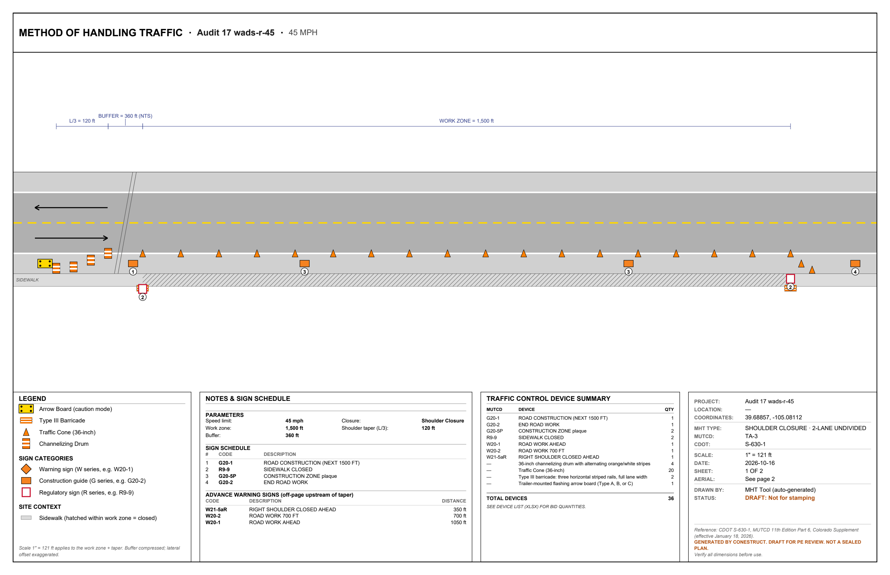

| Check | Result | Oracle | Plan | Source | Note |
|---|---|---|---|---|---|
| C1 taper | PASS | L/3 ≥ 120 ft (W=8 ft, S=45) | page 1 label 120, page 1 notes 120, audit 120, crew sheet 120 | MUTCD Table 6B-4 and 6B-3, p. 775 (O1, O2) |  |
| C2 advance sign spacing | PASS | urban_high: A 350, B 350, C 350 ft (minimum) | gaps 350, 350, 350 (signs at 350, 700, 1050 ft) | MUTCD Table 6B-1, p. 773; S-630-1 Sheet 4 (O3) |  |
| C4 buffer | PASS | ≥ 360 ft at 45 mph | page 1 label 360, page 1 notes 360, audit 360, crew sheet 360, page 2 360 | MUTCD Table 6B-2, p. 775; S-630-1 Note 24, Sheet 14 (O5) |  |
| C5 device spacing | **FLAG** | taper ≤ 45 ft, tangent (buffer + work area) ≤ 90 ft | taper 40 ft ≤ 45; tangent 88 ft ≤ 90 from station 0 to 1500; the 360 ft buffer (stations 1500–1860) has no channelizing devices: a 360 ft gap > 2S = 90 ft; downstream taper 50 ft (50–100) | MUTCD §6K.01 ¶04, p. 815; S-630-1 Note 18; §6B.08 ¶12, p. 776 (O6, O7) |  |
| C6a shoulder sign legend | PASS | W21-5aR only | W21-5aR | MUTCD §6H.22 ¶02, p. 807 (O8) |  |
| C6b arrow board mode | PASS | caution mode only | caution mode stated | MUTCD §6N.06 ¶09, p. 845; TA-4 Note 8, p. 866; S-630-1 Note 26 (O10) |  |
| C7 signs by side | PASS | right side (own direction, TA-3 figure) | right side; audit Note 8: Required: False. Signs placed: 0 left, 9 right. | S-630-1 Note 8; MUTCD TA-3 Note 1, p. 864; §6N.06 ¶03, p. 845; #243 R54 (O9) |  |
| C8 device counts agree | PASS | same quantity of every device on every surface | 36 devices, 11 types, equal on 5 surfaces | Rule 10 / P2 one voice per fact |  |
| C8b drawn signs vs summary | PASS | every sign in the summary is drawn or listed off-page | match | Rule 10 | drawn counts read from page-1 schedule markers; cones and drums are vector glyphs and are not counted here |
| C9a assumed shoulder width shown | **FLAG** | page 1 states the 8 ft shoulder width the taper uses (no input exists) | page 1 never states the shoulder width | Rule 10; MUTCD TA-3 Note 8, p. 864 (O11) | the taper L = W·S… uses W; the audit discloses it only for one-way streets |
| C9b jurisdiction math | INFO | jurisdiction rules applied, or the plan says CDOT's are used | Lakewood; page 1 cites CDOT S-630-1 | Rule 10 | the engine always computes with CDOT values (src/api/schemas.py:1519) |
| C9d CDOT edition link (#265) | **FLAG** | S-630-1 July 01, 2026, 26 sheets | audit links S-630-01%20(19-Page%20Set).pdf | S-630-1 2026; CLAUDE.md staleness note; ruling d | edition finding: goes to #265 |
| C10 notes match drawing | PASS | every value in NOTES equals its drawn label; every summary sign is in the schedule or off-page list | match | Rule 10 |  |
| C11 containment | PASS | 0/0/0 | 0/0/0 | tests/test_pdf_containment.py measure |  |
| C12c sidewalk | PASS | closure shown (TA-28) or limits stated | scan found a sidewalk; plan closes it (R9-9 / pedestrian notes) | MUTCD TA-28 Note 1, p. 914; §6N.04 ¶06, p. 843 (O15) |  |
| C13 ≥8 ft shoulder closed | PASS | ≥1 advance warning sign and channelizing devices on a shoulder taper | 3 advance signs, 4 taper devices (W=8 ft) | MUTCD §6N.06 ¶02, p. 845; TA-3 Note 8 (O11) |  |

### 18. `wads-r-45-night`: S Wadsworth Blvd, 1500 block, Lakewood

South Wadsworth Service Road (residential, oneway=no) · urban_arterial, undivided, 1 lanes × 12.0 ft · 45 mph · right shoulder · 200 ft · night · sight distance limited · Lakewood · TA-3, Case 11: Shoulder closure on undivided highway · scan ok ['adjacent_intersection', 'limited_sight_distance', 'pedestrian_facility']

**4 FLAG** · pin 39.68857, -105.08112

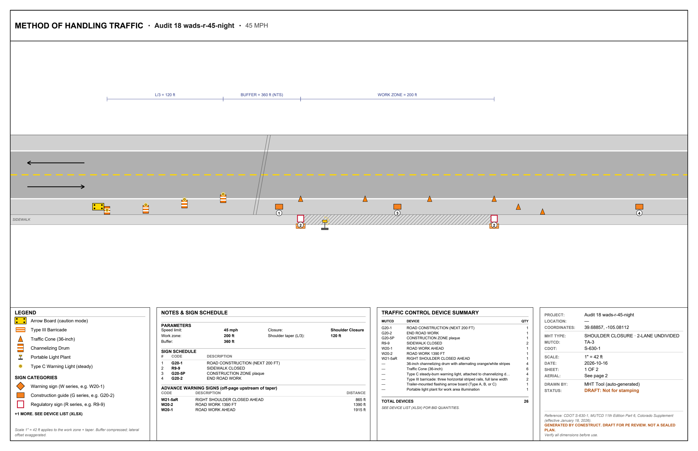

| Check | Result | Oracle | Plan | Source | Note |
|---|---|---|---|---|---|
| C1 taper | PASS | L/3 ≥ 120 ft (W=8 ft, S=45) | page 1 label 120, page 1 notes 120, audit 120, crew sheet 120 | MUTCD Table 6B-4 and 6B-3, p. 775 (O1, O2) |  |
| C2 advance sign spacing | PASS | urban_high: A 350, B 350, C 350 ft (minimum) | gaps 865, 525, 525 (signs at 865, 1390, 1915 ft) | MUTCD Table 6B-1, p. 773; S-630-1 Sheet 4 (O3) |  |
| C3 limited sight distance | **FLAG** | §6B.04 ¶07–¶08 allow an increase, no factor; audit's own claim: 50% farther from the taper = [525, 1050, 1575] | distances [865, 1390, 1915]; audit: "Moved 3 advance warning sign(s) 50% farther upstream from the taper to compensate for limited sight distance." rule "MUTCD §6B.04: increased advance warning for limited sight distance" | MUTCD §6B.04 ¶04–¶08, p. 771 (O4) | signs sit at 865, 1390, 1915 ft before the taper: 1.5 × their station from the work zone's far end (865, 1390, 1915), not 50% farther from the taper as the audit says (525, 1050, 1575); the 50% factor is filed under §6B.04, which gives no factor, and isn't marked as chosen (Rule 12) |
| C4 buffer | PASS | ≥ 360 ft at 45 mph | page 1 label 360, page 1 notes 360, audit 360, crew sheet 360, page 2 360 | MUTCD Table 6B-2, p. 775; S-630-1 Note 24, Sheet 14 (O5) |  |
| C5 device spacing | **FLAG** | taper ≤ 45 ft, tangent (buffer + work area) ≤ 90 ft | taper 40 ft ≤ 45; tangent 67 ft ≤ 90 from station 0 to 200; the 360 ft buffer (stations 200–560) has no channelizing devices: a 360 ft gap > 2S = 90 ft; downstream taper 50 ft (50–100) | MUTCD §6K.01 ¶04, p. 815; S-630-1 Note 18; §6B.08 ¶12, p. 776 (O6, O7) |  |
| C6a shoulder sign legend | PASS | W21-5aR only | W21-5aR | MUTCD §6H.22 ¶02, p. 807 (O8) |  |
| C6b arrow board mode | PASS | caution mode only | caution mode stated | MUTCD §6N.06 ¶09, p. 845; TA-4 Note 8, p. 866; S-630-1 Note 26 (O10) |  |
| C7 signs by side | PASS | right side (own direction, TA-3 figure) | right side; audit Note 8: Required: False. Signs placed: 0 left, 8 right. | S-630-1 Note 8; MUTCD TA-3 Note 1, p. 864; §6N.06 ¶03, p. 845; #243 R54 (O9) |  |
| C8 device counts agree | PASS | same quantity of every device on every surface | 26 devices, 13 types, equal on 5 surfaces | Rule 10 / P2 one voice per fact |  |
| C8b drawn signs vs summary | PASS | every sign in the summary is drawn or listed off-page | match | Rule 10 | drawn counts read from page-1 schedule markers; cones and drums are vector glyphs and are not counted here |
| C9a assumed shoulder width shown | **FLAG** | page 1 states the 8 ft shoulder width the taper uses (no input exists) | page 1 never states the shoulder width | Rule 10; MUTCD TA-3 Note 8, p. 864 (O11) | the taper L = W·S… uses W; the audit discloses it only for one-way streets |
| C9b jurisdiction math | INFO | jurisdiction rules applied, or the plan says CDOT's are used | Lakewood; page 1 cites CDOT S-630-1 | Rule 10 | the engine always computes with CDOT values (src/api/schemas.py:1519) |
| C9d CDOT edition link (#265) | **FLAG** | S-630-1 July 01, 2026, 26 sheets | audit links S-630-01%20(19-Page%20Set).pdf | S-630-1 2026; CLAUDE.md staleness note; ruling d | edition finding: goes to #265 |
| C10 notes match drawing | PASS | every value in NOTES equals its drawn label; every summary sign is in the schedule or off-page list | match | Rule 10 |  |
| C11 containment | PASS | 0/0/0 | 0/0/0 | tests/test_pdf_containment.py measure |  |
| C12a cone height | PASS | ≥ 36 in at night or on a freeway | 36-inch | S-630-1 Sheet 2 Note 15 (O13) |  |
| C12c sidewalk | PASS | closure shown (TA-28) or limits stated | scan found a sidewalk; plan closes it (R9-9 / pedestrian notes) | MUTCD TA-28 Note 1, p. 914; §6N.04 ¶06, p. 843 (O15) |  |
| C12e night | INFO | recorded only | sonnel in the work zone must wear ANSI Class 2 (daytime) or Class 3 (nighttime) high-visibility apparel.; - Nighttime operation: Ensure all devices meet retroreflectivity re; quirements. Flagger stations require 500W quartz illumination at minimum 8 ft height per CDOT S-630-1 Sheet 2 General | unsourced beyond O13 |  |
| C13 ≥8 ft shoulder closed | PASS | ≥1 advance warning sign and channelizing devices on a shoulder taper | 3 advance signs, 4 taper devices (W=8 ft) | MUTCD §6N.06 ¶02, p. 845; TA-3 Note 8 (O11) |  |

### 19. `lkwdhigh-r-25-night`: W 9th Ave beside Lakewood High School, Lakewood (two-way residential)

West 9th Avenue (residential, oneway=no) · urban_arterial, undivided, 1 lanes × 12.0 ft · 25 mph · right shoulder · 200 ft · night · sight distance normal · Lakewood · TA-3, Case 11: Shoulder closure on undivided highway · scan ok ['adjacent_intersection', 'pedestrian_facility']

**4 FLAG** · pin 39.73105, -105.10397

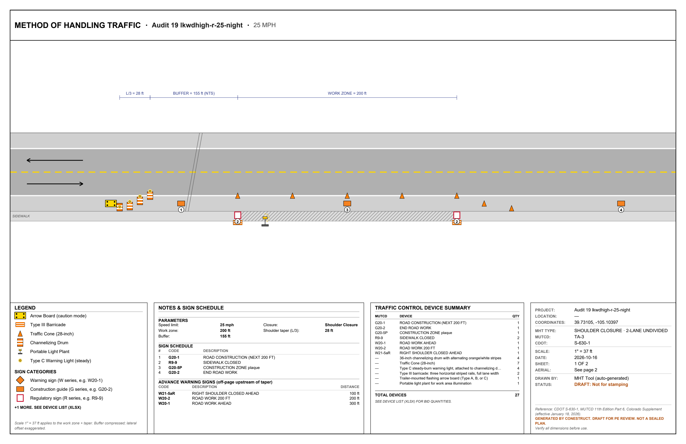

| Check | Result | Oracle | Plan | Source | Note |
|---|---|---|---|---|---|
| C1 taper | PASS | L/3 ≥ 28 ft (W=8 ft, S=25) | page 1 label 28, page 1 notes 28, audit 28, crew sheet 28 | MUTCD Table 6B-4 and 6B-3, p. 775 (O1, O2) |  |
| C2 advance sign spacing | PASS | urban_low: A 100, B 100, C 100 ft (minimum) | gaps 100, 100, 100 (signs at 100, 200, 300 ft) | MUTCD Table 6B-1, p. 773; S-630-1 Sheet 4 (O3) |  |
| C4 buffer | PASS | ≥ 155 ft at 25 mph | page 1 label 155, page 1 notes 155, audit 155, crew sheet 155, page 2 155 | MUTCD Table 6B-2, p. 775; S-630-1 Note 24, Sheet 14 (O5) |  |
| C5 device spacing | **FLAG** | taper ≤ 25 ft, tangent (buffer + work area) ≤ 50 ft | taper 9 ft ≤ 25; tangent 50 ft ≤ 50 from station 0 to 200; the 155 ft buffer (stations 200–355) has no channelizing devices: a 155 ft gap > 2S = 50 ft; downstream taper 50 ft (50–100) | MUTCD §6K.01 ¶04, p. 815; S-630-1 Note 18; §6B.08 ¶12, p. 776 (O6, O7) |  |
| C6a shoulder sign legend | PASS | W21-5aR only | W21-5aR | MUTCD §6H.22 ¶02, p. 807 (O8) |  |
| C6b arrow board mode | PASS | caution mode only | caution mode stated | MUTCD §6N.06 ¶09, p. 845; TA-4 Note 8, p. 866; S-630-1 Note 26 (O10) |  |
| C7 signs by side | PASS | right side (own direction, TA-3 figure) | right side; audit Note 8: Required: False. Signs placed: 0 left, 8 right. | S-630-1 Note 8; MUTCD TA-3 Note 1, p. 864; §6N.06 ¶03, p. 845; #243 R54 (O9) |  |
| C8 device counts agree | PASS | same quantity of every device on every surface | 27 devices, 13 types, equal on 5 surfaces | Rule 10 / P2 one voice per fact |  |
| C8b drawn signs vs summary | PASS | every sign in the summary is drawn or listed off-page | match | Rule 10 | drawn counts read from page-1 schedule markers; cones and drums are vector glyphs and are not counted here |
| C9a assumed shoulder width shown | **FLAG** | page 1 states the 8 ft shoulder width the taper uses (no input exists) | page 1 never states the shoulder width | Rule 10; MUTCD TA-3 Note 8, p. 864 (O11) | the taper L = W·S… uses W; the audit discloses it only for one-way streets |
| C9b jurisdiction math | INFO | jurisdiction rules applied, or the plan says CDOT's are used | Lakewood; page 1 cites CDOT S-630-1 | Rule 10 | the engine always computes with CDOT values (src/api/schemas.py:1519) |
| C9d CDOT edition link (#265) | **FLAG** | S-630-1 July 01, 2026, 26 sheets | audit links S-630-01%20(19-Page%20Set).pdf | S-630-1 2026; CLAUDE.md staleness note; ruling d | edition finding: goes to #265 |
| C10 notes match drawing | PASS | every value in NOTES equals its drawn label; every summary sign is in the schedule or off-page list | match | Rule 10 |  |
| C11 containment | PASS | 0/0/0 | 0/0/0 | tests/test_pdf_containment.py measure |  |
| C12a cone height | **FLAG** | ≥ 36 in at night or on a freeway | 28-inch | S-630-1 Sheet 2 Note 15 (O13) |  |
| C12c sidewalk | PASS | closure shown (TA-28) or limits stated | scan found a sidewalk; plan closes it (R9-9 / pedestrian notes) | MUTCD TA-28 Note 1, p. 914; §6N.04 ¶06, p. 843 (O15) |  |
| C12d school | INFO | no work-zone school rule in the sources | scan school_zone=None; plan: no school mention | unsourced (INFO only) |  |
| C12e night | INFO | recorded only | sonnel in the work zone must wear ANSI Class 2 (daytime) or Class 3 (nighttime) high-visibility apparel.; - Nighttime operation: Ensure all devices meet retroreflectivity re; quirements. Flagger stations require 500W quartz illumination at minimum 8 ft height per CDOT S-630-1 Sheet 2 General | unsourced beyond O13 |  |
| C13 ≥8 ft shoulder closed | PASS | ≥1 advance warning sign and channelizing devices on a shoulder taper | 3 advance signs, 4 taper devices (W=8 ft) | MUTCD §6N.06 ¶02, p. 845; TA-3 Note 8 (O11) |  |

### 20. `kipling-r-35`: Kipling St (CO 391) near W 10th Ave, Lakewood

Kipling Street CO 391 (primary, oneway=yes) · urban_arterial, divided, 3 lanes × 12.0 ft · 35 mph · right shoulder · 1500 ft · day · sight distance limited · Lakewood · TA-3, Case 11: Shoulder closure on divided highway · scan ok ['adjacent_interchange', 'adjacent_intersection', 'bicycle_facility', 'limited_sight_distance', 'pedestrian_facility']

**5 FLAG** · pin 39.735, -105.1093

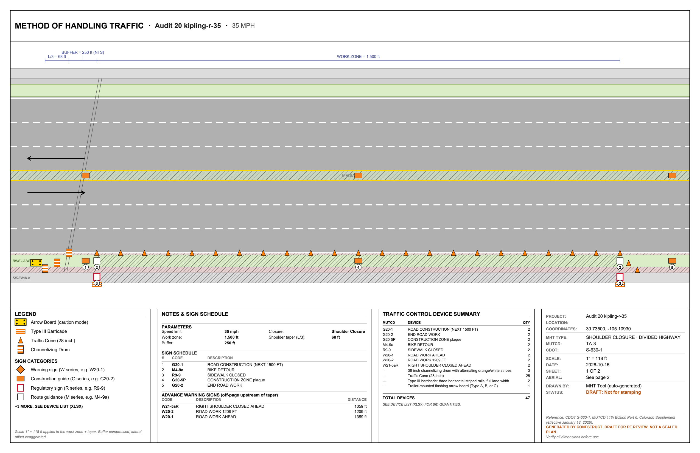

| Check | Result | Oracle | Plan | Source | Note |
|---|---|---|---|---|---|
| C1 taper | PASS | L/3 ≥ 68 ft (W=10 ft, S=35) | page 1 label 68, page 1 notes 68, audit 68, crew sheet 68 | MUTCD Table 6B-4 and 6B-3, p. 775 (O1, O2) |  |
| C2 advance sign spacing | PASS | urban_low: A 100, B 100, C 100 ft (minimum) | gaps 1059, 150, 150 (signs at 1059, 1209, 1359 ft) | MUTCD Table 6B-1, p. 773; S-630-1 Sheet 4 (O3) | QUESTION for Ryan (ruling e): under Lakewood's 35 mph split this road is urban_high (350/350/350 ft); the plan's gaps fall short of it. |
| C2b Lakewood breakpoint | INFO |  |  | data/jurisdictions/lakewood.json | QUESTION for Ryan (ruling e): under Lakewood's 35 mph split this road is urban_high (350/350/350 ft); the plan's gaps fall short of it. |
| C3 limited sight distance | **FLAG** | §6B.04 ¶07–¶08 allow an increase, no factor; audit's own claim: 50% farther from the taper = [150, 300, 450] | distances [1059, 1209, 1359]; audit: "Moved 6 advance warning sign(s) 50% farther upstream from the taper to compensate for limited sight distance." rule "MUTCD §6B.04: increased advance warning for limited sight distance" | MUTCD §6B.04 ¶04–¶08, p. 771 (O4) | signs sit at 1059, 1209, 1359 ft before the taper: 1.5 × their station from the work zone's far end (1059, 1209, 1359), not 50% farther from the taper as the audit says (150, 300, 450); the 50% factor is filed under §6B.04, which gives no factor, and isn't marked as chosen (Rule 12) |
| C4 buffer | PASS | ≥ 250 ft at 35 mph | page 1 label 250, page 1 notes 250, audit 250, crew sheet 250, page 2 250 | MUTCD Table 6B-2, p. 775; S-630-1 Note 24, Sheet 14 (O5) |  |
| C5 device spacing | **FLAG** | taper ≤ 35 ft, tangent (buffer + work area) ≤ 70 ft | taper 34 ft ≤ 35; tangent 68 ft ≤ 70 from station 0 to 1500; the 250 ft buffer (stations 1500–1750) has no channelizing devices: a 250 ft gap > 2S = 70 ft; downstream taper 50 ft (50–100) | MUTCD §6K.01 ¶04, p. 815; S-630-1 Note 18; §6B.08 ¶12, p. 776 (O6, O7) |  |
| C6a shoulder sign legend | PASS | W21-5aR only | W21-5aR | MUTCD §6H.22 ¶02, p. 807 (O8) |  |
| C6b arrow board mode | PASS | caution mode only | caution mode stated | MUTCD §6N.06 ¶09, p. 845; TA-4 Note 8, p. 866; S-630-1 Note 26 (O10) |  |
| C7 signs by side | **FLAG** | closure side; a mirror is R54's house choice and must not be called required | crew sheet: "- Divided highway: All warning and regulatory signs must be posted on BOTH sides of the roadway per CDOT S-630-1 Sheet 2 General Note 8.", right side; audit Note 8: Not required: one shoulder closed (Note 8's Case 11 exception). Signs placed: 6 left, 10 right. | S-630-1 Note 8; MUTCD TA-3 Note 1, p. 864; §6N.06 ¶03, p. 845; #243 R54 (O9) |  |
| C8 device counts agree | PASS | same quantity of every device on every surface | 47 devices, 12 types, equal on 5 surfaces | Rule 10 / P2 one voice per fact |  |
| C8b drawn signs vs summary | PASS | every sign in the summary is drawn or listed off-page | match | Rule 10 | drawn counts read from page-1 schedule markers; cones and drums are vector glyphs and are not counted here |
| C9a assumed shoulder width shown | **FLAG** | page 1 states the 10 ft shoulder width the taper uses (no input exists) | page 1 never states the shoulder width | Rule 10; MUTCD TA-3 Note 8, p. 864 (O11) | the taper L = W·S… uses W; the audit discloses it only for one-way streets |
| C9b jurisdiction math | INFO | jurisdiction rules applied, or the plan says CDOT's are used | Lakewood; page 1 cites CDOT S-630-1 | Rule 10 | the engine always computes with CDOT values (src/api/schemas.py:1519) |
| C9d CDOT edition link (#265) | **FLAG** | S-630-1 July 01, 2026, 26 sheets | audit links S-630-01%20(19-Page%20Set).pdf | S-630-1 2026; CLAUDE.md staleness note; ruling d | edition finding: goes to #265 |
| C10 notes match drawing | PASS | every value in NOTES equals its drawn label; every summary sign is in the schedule or off-page list | match | Rule 10 |  |
| C11 containment | PASS | 0/0/0 | 0/0/0 | tests/test_pdf_containment.py measure |  |
| C12c sidewalk | PASS | closure shown (TA-28) or limits stated | scan found a sidewalk; plan closes it (R9-9 / pedestrian notes) | MUTCD TA-28 Note 1, p. 914; §6N.04 ¶06, p. 843 (O15) |  |
| C13 ≥8 ft shoulder closed | PASS | ≥1 advance warning sign and channelizing devices on a shoulder taper | 3 advance signs, 3 taper devices (W=10 ft) | MUTCD §6N.06 ¶02, p. 845; TA-3 Note 8 (O11) |  |

### 21. `santafe-r-55-night`: S Santa Fe Dr (US 85), divided

South Santa Fe Drive US 85 (trunk, oneway=yes) · urban_arterial, divided, 3 lanes × 12.0 ft · 55 mph · right shoulder · 1500 ft · night · sight distance normal · Denver · TA-3, Case 11: Shoulder closure on divided highway · scan ok ['adjacent_interchange', 'adjacent_intersection', 'bicycle_facility', 'pedestrian_facility']

**4 FLAG** · pin 39.69322, -104.99425

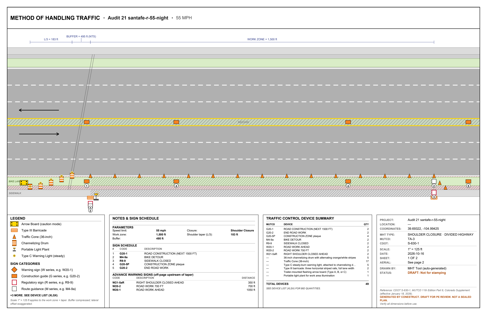

| Check | Result | Oracle | Plan | Source | Note |
|---|---|---|---|---|---|
| C1 taper | PASS | L/3 ≥ 183 ft (W=10 ft, S=55) | page 1 label 183, page 1 notes 183, audit 183, crew sheet 183 | MUTCD Table 6B-4 and 6B-3, p. 775 (O1, O2) |  |
| C2 advance sign spacing | PASS | urban_high: A 350, B 350, C 350 ft (minimum) | gaps 350, 350, 350 (signs at 350, 700, 1050 ft) | MUTCD Table 6B-1, p. 773; S-630-1 Sheet 4 (O3) |  |
| C4 buffer | PASS | ≥ 495 ft at 55 mph | page 1 label 495, page 1 notes 495, audit 495, crew sheet 495, page 2 495 | MUTCD Table 6B-2, p. 775; S-630-1 Note 24, Sheet 14 (O5) |  |
| C5 device spacing | **FLAG** | taper ≤ 55 ft, tangent (buffer + work area) ≤ 110 ft | taper 46 ft ≤ 55; tangent 107 ft ≤ 110 from station 0 to 1500; the 495 ft buffer (stations 1500–1995) has no channelizing devices: a 495 ft gap > 2S = 110 ft; downstream taper 50 ft (50–100) | MUTCD §6K.01 ¶04, p. 815; S-630-1 Note 18; §6B.08 ¶12, p. 776 (O6, O7) |  |
| C6a shoulder sign legend | PASS | W21-5aR only | W21-5aR | MUTCD §6H.22 ¶02, p. 807 (O8) |  |
| C6b arrow board mode | PASS | caution mode only | caution mode stated | MUTCD §6N.06 ¶09, p. 845; TA-4 Note 8, p. 866; S-630-1 Note 26 (O10) |  |
| C7 signs by side | **FLAG** | closure side; a mirror is R54's house choice and must not be called required | crew sheet: "- Divided highway: All warning and regulatory signs must be posted on BOTH sides of the roadway per CDOT S-630-1 Sheet 2 General Note 8.", right side; audit Note 8: Not required: one shoulder closed (Note 8's Case 11 exception). Signs placed: 7 left, 11 right. | S-630-1 Note 8; MUTCD TA-3 Note 1, p. 864; §6N.06 ¶03, p. 845; #243 R54 (O9) |  |
| C8 device counts agree | PASS | same quantity of every device on every surface | 49 devices, 14 types, equal on 5 surfaces | Rule 10 / P2 one voice per fact |  |
| C8b drawn signs vs summary | PASS | every sign in the summary is drawn or listed off-page | match | Rule 10 | drawn counts read from page-1 schedule markers; cones and drums are vector glyphs and are not counted here |
| C9a assumed shoulder width shown | **FLAG** | page 1 states the 10 ft shoulder width the taper uses (no input exists) | page 1 never states the shoulder width | Rule 10; MUTCD TA-3 Note 8, p. 864 (O11) | the taper L = W·S… uses W; the audit discloses it only for one-way streets |
| C9b jurisdiction math | INFO | jurisdiction rules applied, or the plan says CDOT's are used | Denver; page 1 cites CDOT S-630-1 | Rule 10 | the engine always computes with CDOT values (src/api/schemas.py:1519) |
| C9c edition (#265) | INFO | Denver's record pins MUTCD 2009 R2 (PT-116.1) | plan cites MUTCD 11th Edition | data/jurisdictions/denver.json; ruling d | tracked in #265 |
| C9d CDOT edition link (#265) | **FLAG** | S-630-1 July 01, 2026, 26 sheets | audit links S-630-01%20(19-Page%20Set).pdf | S-630-1 2026; CLAUDE.md staleness note; ruling d | edition finding: goes to #265 |
| C10 notes match drawing | PASS | every value in NOTES equals its drawn label; every summary sign is in the schedule or off-page list | match | Rule 10 |  |
| C11 containment | PASS | 0/0/0 | 0/0/0 | tests/test_pdf_containment.py measure |  |
| C12a cone height | PASS | ≥ 36 in at night or on a freeway | 36-inch | S-630-1 Sheet 2 Note 15 (O13) |  |
| C12b Type 1 barricade | PASS | none at 55 mph or more | none | S-630-1 Sheet 2 Note 16 (O14) |  |
| C12c sidewalk | PASS | closure shown (TA-28) or limits stated | scan found a sidewalk; plan closes it (R9-9 / pedestrian notes) | MUTCD TA-28 Note 1, p. 914; §6N.04 ¶06, p. 843 (O15) |  |
| C12e night | INFO | recorded only | sonnel in the work zone must wear ANSI Class 2 (daytime) or Class 3 (nighttime) high-visibility apparel.; - Nighttime operation: Ensure all devices meet retroreflectivity re; quirements. Flagger stations require 500W quartz illumination at minimum 8 ft height per CDOT S-630-1 Sheet 2 General | unsourced beyond O13 |  |
| C13 ≥8 ft shoulder closed | PASS | ≥1 advance warning sign and channelizing devices on a shoulder taper | 3 advance signs, 5 taper devices (W=10 ft) | MUTCD §6N.06 ¶02, p. 845; TA-3 Note 8 (O11) |  |

### 22. `santafe-r-55`: S Santa Fe Dr (US 85), divided

South Santa Fe Drive US 85 (trunk, oneway=yes) · urban_arterial, divided, 3 lanes × 12.0 ft · 55 mph · right shoulder · 800 ft · day · sight distance limited · Denver · TA-3, Case 11: Shoulder closure on divided highway · scan ok ['adjacent_interchange', 'adjacent_intersection', 'bicycle_facility', 'limited_sight_distance', 'pedestrian_facility']

**5 FLAG** · pin 39.69322, -104.99425

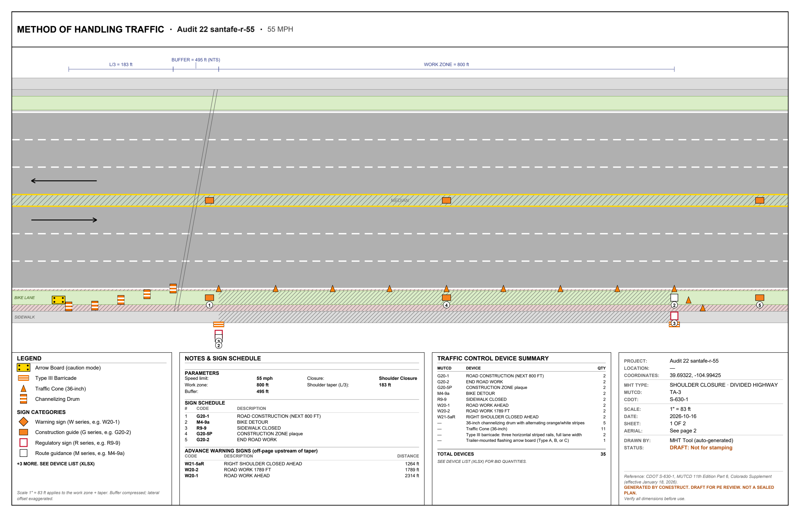

| Check | Result | Oracle | Plan | Source | Note |
|---|---|---|---|---|---|
| C1 taper | PASS | L/3 ≥ 183 ft (W=10 ft, S=55) | page 1 label 183, page 1 notes 183, audit 183, crew sheet 183 | MUTCD Table 6B-4 and 6B-3, p. 775 (O1, O2) |  |
| C2 advance sign spacing | PASS | urban_high: A 350, B 350, C 350 ft (minimum) | gaps 1264, 525, 525 (signs at 1264, 1789, 2314 ft) | MUTCD Table 6B-1, p. 773; S-630-1 Sheet 4 (O3) |  |
| C3 limited sight distance | **FLAG** | §6B.04 ¶07–¶08 allow an increase, no factor; audit's own claim: 50% farther from the taper = [525, 1050, 1575] | distances [1264, 1789, 2314]; audit: "Moved 6 advance warning sign(s) 50% farther upstream from the taper to compensate for limited sight distance." rule "MUTCD §6B.04: increased advance warning for limited sight distance" | MUTCD §6B.04 ¶04–¶08, p. 771 (O4) | signs sit at 1264, 1789, 2314 ft before the taper: 1.5 × their station from the work zone's far end (1264, 1789, 2314), not 50% farther from the taper as the audit says (525, 1050, 1575); the 50% factor is filed under §6B.04, which gives no factor, and isn't marked as chosen (Rule 12) |
| C4 buffer | PASS | ≥ 495 ft at 55 mph | page 1 label 495, page 1 notes 495, audit 495, crew sheet 495, page 2 495 | MUTCD Table 6B-2, p. 775; S-630-1 Note 24, Sheet 14 (O5) |  |
| C5 device spacing | **FLAG** | taper ≤ 55 ft, tangent (buffer + work area) ≤ 110 ft | taper 46 ft ≤ 55; tangent 100 ft ≤ 110 from station 0 to 800; the 495 ft buffer (stations 800–1295) has no channelizing devices: a 495 ft gap > 2S = 110 ft; downstream taper 50 ft (50–100) | MUTCD §6K.01 ¶04, p. 815; S-630-1 Note 18; §6B.08 ¶12, p. 776 (O6, O7) |  |
| C6a shoulder sign legend | PASS | W21-5aR only | W21-5aR | MUTCD §6H.22 ¶02, p. 807 (O8) |  |
| C6b arrow board mode | PASS | caution mode only | caution mode stated | MUTCD §6N.06 ¶09, p. 845; TA-4 Note 8, p. 866; S-630-1 Note 26 (O10) |  |
| C7 signs by side | **FLAG** | closure side; a mirror is R54's house choice and must not be called required | crew sheet: "- Divided highway: All warning and regulatory signs must be posted on BOTH sides of the roadway per CDOT S-630-1 Sheet 2 General Note 8.", right side; audit Note 8: Not required: one shoulder closed (Note 8's Case 11 exception). Signs placed: 6 left, 10 right. | S-630-1 Note 8; MUTCD TA-3 Note 1, p. 864; §6N.06 ¶03, p. 845; #243 R54 (O9) |  |
| C8 device counts agree | PASS | same quantity of every device on every surface | 35 devices, 12 types, equal on 5 surfaces | Rule 10 / P2 one voice per fact |  |
| C8b drawn signs vs summary | PASS | every sign in the summary is drawn or listed off-page | match | Rule 10 | drawn counts read from page-1 schedule markers; cones and drums are vector glyphs and are not counted here |
| C9a assumed shoulder width shown | **FLAG** | page 1 states the 10 ft shoulder width the taper uses (no input exists) | page 1 never states the shoulder width | Rule 10; MUTCD TA-3 Note 8, p. 864 (O11) | the taper L = W·S… uses W; the audit discloses it only for one-way streets |
| C9b jurisdiction math | INFO | jurisdiction rules applied, or the plan says CDOT's are used | Denver; page 1 cites CDOT S-630-1 | Rule 10 | the engine always computes with CDOT values (src/api/schemas.py:1519) |
| C9c edition (#265) | INFO | Denver's record pins MUTCD 2009 R2 (PT-116.1) | plan cites MUTCD 11th Edition | data/jurisdictions/denver.json; ruling d | tracked in #265 |
| C9d CDOT edition link (#265) | **FLAG** | S-630-1 July 01, 2026, 26 sheets | audit links S-630-01%20(19-Page%20Set).pdf | S-630-1 2026; CLAUDE.md staleness note; ruling d | edition finding: goes to #265 |
| C10 notes match drawing | PASS | every value in NOTES equals its drawn label; every summary sign is in the schedule or off-page list | match | Rule 10 |  |
| C11 containment | PASS | 0/0/0 | 0/0/0 | tests/test_pdf_containment.py measure |  |
| C12b Type 1 barricade | PASS | none at 55 mph or more | none | S-630-1 Sheet 2 Note 16 (O14) |  |
| C12c sidewalk | PASS | closure shown (TA-28) or limits stated | scan found a sidewalk; plan closes it (R9-9 / pedestrian notes) | MUTCD TA-28 Note 1, p. 914; §6N.04 ¶06, p. 843 (O15) |  |
| C13 ≥8 ft shoulder closed | PASS | ≥1 advance warning sign and channelizing devices on a shoulder taper | 3 advance signs, 5 taper devices (W=10 ft) | MUTCD §6N.06 ¶02, p. 845; TA-3 Note 8 (O11) |  |

### 23. `lookout-r-40`: Lookout Mountain Rd (mountain)

Lookout Mountain Road CR 68 (tertiary, oneway=no) · urban_arterial, undivided, 1 lanes × 12.0 ft · 40 mph · right shoulder · 800 ft · day · sight distance limited · None · TA-3, Case 11: Shoulder closure on undivided highway · scan ok ['limited_sight_distance']

**4 FLAG** · pin 39.74231, -105.23925

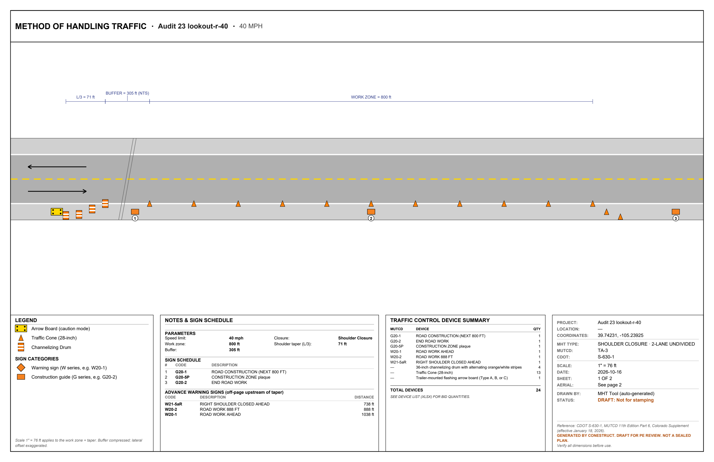

| Check | Result | Oracle | Plan | Source | Note |
|---|---|---|---|---|---|
| C1 taper | PASS | L/3 ≥ 71 ft (W=8 ft, S=40) | page 1 label 71, page 1 notes 71, audit 71, crew sheet 71 | MUTCD Table 6B-4 and 6B-3, p. 775 (O1, O2) |  |
| C2 advance sign spacing | PASS | urban_low: A 100, B 100, C 100 ft (minimum) | gaps 738, 150, 150 (signs at 738, 888, 1038 ft) | MUTCD Table 6B-1, p. 773; S-630-1 Sheet 4 (O3) |  |
| C3 limited sight distance | **FLAG** | §6B.04 ¶07–¶08 allow an increase, no factor; audit's own claim: 50% farther from the taper = [150, 300, 450] | distances [738, 888, 1038]; audit: "Moved 3 advance warning sign(s) 50% farther upstream from the taper to compensate for limited sight distance." rule "MUTCD §6B.04: increased advance warning for limited sight distance" | MUTCD §6B.04 ¶04–¶08, p. 771 (O4) | signs sit at 738, 888, 1038 ft before the taper: 1.5 × their station from the work zone's far end (738, 888, 1038), not 50% farther from the taper as the audit says (150, 300, 450); the 50% factor is filed under §6B.04, which gives no factor, and isn't marked as chosen (Rule 12) |
| C4 buffer | PASS | ≥ 305 ft at 40 mph | page 1 label 305, page 1 notes 305, audit 305, crew sheet 305, page 2 305 | MUTCD Table 6B-2, p. 775; S-630-1 Note 24, Sheet 14 (O5) |  |
| C5 device spacing | **FLAG** | taper ≤ 40 ft, tangent (buffer + work area) ≤ 80 ft | taper 24 ft ≤ 40; tangent 80 ft ≤ 80 from station 0 to 800; the 305 ft buffer (stations 800–1105) has no channelizing devices: a 305 ft gap > 2S = 80 ft; downstream taper 50 ft (50–100) | MUTCD §6K.01 ¶04, p. 815; S-630-1 Note 18; §6B.08 ¶12, p. 776 (O6, O7) |  |
| C6a shoulder sign legend | PASS | W21-5aR only | W21-5aR | MUTCD §6H.22 ¶02, p. 807 (O8) |  |
| C6b arrow board mode | PASS | caution mode only | caution mode stated | MUTCD §6N.06 ¶09, p. 845; TA-4 Note 8, p. 866; S-630-1 Note 26 (O10) |  |
| C7 signs by side | PASS | right side (own direction, TA-3 figure) | right side; audit Note 8: Required: False. Signs placed: 0 left, 6 right. | S-630-1 Note 8; MUTCD TA-3 Note 1, p. 864; §6N.06 ¶03, p. 845; #243 R54 (O9) |  |
| C8 device counts agree | PASS | same quantity of every device on every surface | 24 devices, 9 types, equal on 5 surfaces | Rule 10 / P2 one voice per fact |  |
| C8b drawn signs vs summary | PASS | every sign in the summary is drawn or listed off-page | match | Rule 10 | drawn counts read from page-1 schedule markers; cones and drums are vector glyphs and are not counted here |
| C9a assumed shoulder width shown | **FLAG** | page 1 states the 8 ft shoulder width the taper uses (no input exists) | page 1 never states the shoulder width | Rule 10; MUTCD TA-3 Note 8, p. 864 (O11) | the taper L = W·S… uses W; the audit discloses it only for one-way streets |
| C9d CDOT edition link (#265) | **FLAG** | S-630-1 July 01, 2026, 26 sheets | audit links S-630-01%20(19-Page%20Set).pdf | S-630-1 2026; CLAUDE.md staleness note; ruling d | edition finding: goes to #265 |
| C10 notes match drawing | PASS | every value in NOTES equals its drawn label; every summary sign is in the schedule or off-page list | match | Rule 10 |  |
| C11 containment | PASS | 0/0/0 | 0/0/0 | tests/test_pdf_containment.py measure |  |
| C13 ≥8 ft shoulder closed | PASS | ≥1 advance warning sign and channelizing devices on a shoulder taper | 3 advance signs, 4 taper devices (W=8 ft) | MUTCD §6N.06 ¶02, p. 845; TA-3 Note 8 (O11) |  |

### 24. `lookout-r-35-night`: Lookout Mountain Rd (mountain)

Lookout Mountain Road CR 68 (tertiary, oneway=no) · urban_arterial, undivided, 1 lanes × 12.0 ft · 35 mph · right shoulder · 200 ft · night · sight distance limited · None · TA-3, Case 11: Shoulder closure on undivided highway · scan ok ['limited_sight_distance']

**5 FLAG** · pin 39.74231, -105.23925

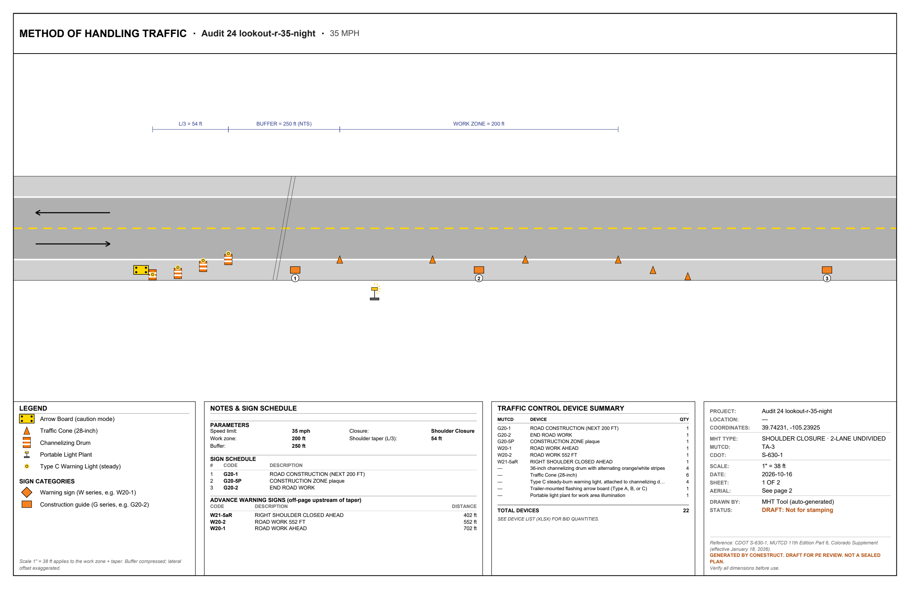

| Check | Result | Oracle | Plan | Source | Note |
|---|---|---|---|---|---|
| C1 taper | PASS | L/3 ≥ 54 ft (W=8 ft, S=35) | page 1 label 54, page 1 notes 54, audit 54, crew sheet 54 | MUTCD Table 6B-4 and 6B-3, p. 775 (O1, O2) |  |
| C2 advance sign spacing | PASS | urban_low: A 100, B 100, C 100 ft (minimum) | gaps 402, 150, 150 (signs at 402, 552, 702 ft) | MUTCD Table 6B-1, p. 773; S-630-1 Sheet 4 (O3) |  |
| C3 limited sight distance | **FLAG** | §6B.04 ¶07–¶08 allow an increase, no factor; audit's own claim: 50% farther from the taper = [150, 300, 450] | distances [402, 552, 702]; audit: "Moved 3 advance warning sign(s) 50% farther upstream from the taper to compensate for limited sight distance." rule "MUTCD §6B.04: increased advance warning for limited sight distance" | MUTCD §6B.04 ¶04–¶08, p. 771 (O4) | signs sit at 402, 552, 702 ft before the taper: 1.5 × their station from the work zone's far end (402, 552, 702), not 50% farther from the taper as the audit says (150, 300, 450); the 50% factor is filed under §6B.04, which gives no factor, and isn't marked as chosen (Rule 12) |
| C4 buffer | PASS | ≥ 250 ft at 35 mph | page 1 label 250, page 1 notes 250, audit 250, crew sheet 250, page 2 250 | MUTCD Table 6B-2, p. 775; S-630-1 Note 24, Sheet 14 (O5) |  |
| C5 device spacing | **FLAG** | taper ≤ 35 ft, tangent (buffer + work area) ≤ 70 ft | taper 18 ft ≤ 35; tangent 67 ft ≤ 70 from station 0 to 200; the 250 ft buffer (stations 200–450) has no channelizing devices: a 250 ft gap > 2S = 70 ft; downstream taper 50 ft (50–100) | MUTCD §6K.01 ¶04, p. 815; S-630-1 Note 18; §6B.08 ¶12, p. 776 (O6, O7) |  |
| C6a shoulder sign legend | PASS | W21-5aR only | W21-5aR | MUTCD §6H.22 ¶02, p. 807 (O8) |  |
| C6b arrow board mode | PASS | caution mode only | caution mode stated | MUTCD §6N.06 ¶09, p. 845; TA-4 Note 8, p. 866; S-630-1 Note 26 (O10) |  |
| C7 signs by side | PASS | right side (own direction, TA-3 figure) | right side; audit Note 8: Required: False. Signs placed: 0 left, 6 right. | S-630-1 Note 8; MUTCD TA-3 Note 1, p. 864; §6N.06 ¶03, p. 845; #243 R54 (O9) |  |
| C8 device counts agree | PASS | same quantity of every device on every surface | 22 devices, 11 types, equal on 5 surfaces | Rule 10 / P2 one voice per fact |  |
| C8b drawn signs vs summary | PASS | every sign in the summary is drawn or listed off-page | match | Rule 10 | drawn counts read from page-1 schedule markers; cones and drums are vector glyphs and are not counted here |
| C9a assumed shoulder width shown | **FLAG** | page 1 states the 8 ft shoulder width the taper uses (no input exists) | page 1 never states the shoulder width | Rule 10; MUTCD TA-3 Note 8, p. 864 (O11) | the taper L = W·S… uses W; the audit discloses it only for one-way streets |
| C9d CDOT edition link (#265) | **FLAG** | S-630-1 July 01, 2026, 26 sheets | audit links S-630-01%20(19-Page%20Set).pdf | S-630-1 2026; CLAUDE.md staleness note; ruling d | edition finding: goes to #265 |
| C10 notes match drawing | PASS | every value in NOTES equals its drawn label; every summary sign is in the schedule or off-page list | match | Rule 10 |  |
| C11 containment | PASS | 0/0/0 | 0/0/0 | tests/test_pdf_containment.py measure |  |
| C12a cone height | **FLAG** | ≥ 36 in at night or on a freeway | 28-inch | S-630-1 Sheet 2 Note 15 (O13) |  |
| C12e night | INFO | recorded only | sonnel in the work zone must wear ANSI Class 2 (daytime) or Class 3 (nighttime) high-visibility apparel.; - Nighttime operation: Ensure all devices meet retroreflectivity re; quirements. Flagger stations require 500W quartz illumination at minimum 8 ft height per CDOT S-630-1 Sheet 2 General | unsourced beyond O13 |  |
| C13 ≥8 ft shoulder closed | PASS | ≥1 advance warning sign and channelizing devices on a shoulder taper | 3 advance signs, 4 taper devices (W=8 ft) | MUTCD §6N.06 ¶02, p. 845; TA-3 Note 8 (O11) |  |

### 25. `canyon-r-45-night`: Boulder Canyon Dr (CO 119, mountain)

Boulder Canyon Drive CO 119 (primary, oneway=None) · rural_undivided, undivided, 1 lanes × 12.0 ft · 45 mph · right shoulder · 1500 ft · night · sight distance limited · None · TA-3, Case 11: Shoulder closure on undivided highway · scan ok ['limited_sight_distance']

**4 FLAG** · pin 40.00185, -105.41289

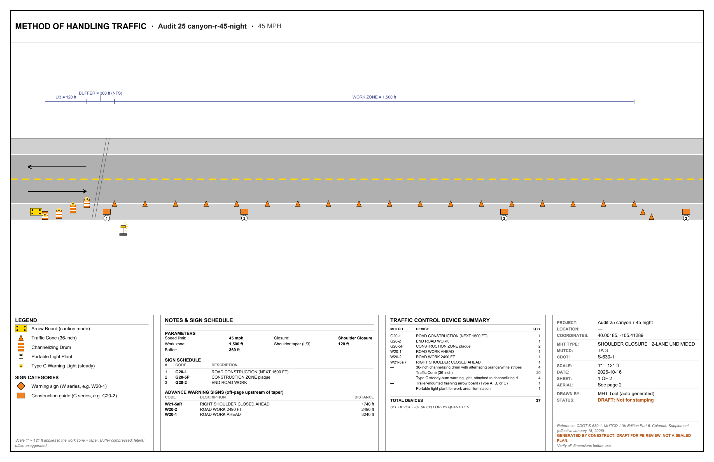

| Check | Result | Oracle | Plan | Source | Note |
|---|---|---|---|---|---|
| C1 taper | PASS | L/3 ≥ 120 ft (W=8 ft, S=45) | page 1 label 120, page 1 notes 120, audit 120, crew sheet 120 | MUTCD Table 6B-4 and 6B-3, p. 775 (O1, O2) |  |
| C2 advance sign spacing | PASS | rural: A 500, B 500, C 500 ft (minimum) | gaps 1740, 750, 750 (signs at 1740, 2490, 3240 ft) | MUTCD Table 6B-1, p. 773; S-630-1 Sheet 4 (O3) |  |
| C3 limited sight distance | **FLAG** | §6B.04 ¶07–¶08 allow an increase, no factor; audit's own claim: 50% farther from the taper = [750, 1500, 2250] | distances [1740, 2490, 3240]; audit: "Moved 3 advance warning sign(s) 50% farther upstream from the taper to compensate for limited sight distance." rule "MUTCD §6B.04: increased advance warning for limited sight distance" | MUTCD §6B.04 ¶04–¶08, p. 771 (O4) | signs sit at 1740, 2490, 3240 ft before the taper: 1.5 × their station from the work zone's far end (1740, 2490, 3240), not 50% farther from the taper as the audit says (750, 1500, 2250); the 50% factor is filed under §6B.04, which gives no factor, and isn't marked as chosen (Rule 12) |
| C4 buffer | PASS | ≥ 360 ft at 45 mph | page 1 label 360, page 1 notes 360, audit 360, crew sheet 360, page 2 360 | MUTCD Table 6B-2, p. 775; S-630-1 Note 24, Sheet 14 (O5) |  |
| C5 device spacing | **FLAG** | taper ≤ 45 ft, tangent (buffer + work area) ≤ 90 ft | taper 40 ft ≤ 45; tangent 88 ft ≤ 90 from station 0 to 1500; the 360 ft buffer (stations 1500–1860) has no channelizing devices: a 360 ft gap > 2S = 90 ft; downstream taper 50 ft (50–100) | MUTCD §6K.01 ¶04, p. 815; S-630-1 Note 18; §6B.08 ¶12, p. 776 (O6, O7) |  |
| C6a shoulder sign legend | PASS | W21-5aR only | W21-5aR | MUTCD §6H.22 ¶02, p. 807 (O8) |  |
| C6b arrow board mode | PASS | caution mode only | caution mode stated | MUTCD §6N.06 ¶09, p. 845; TA-4 Note 8, p. 866; S-630-1 Note 26 (O10) |  |
| C7 signs by side | PASS | right side (own direction, TA-3 figure) | right side; audit Note 8: Required: False. Signs placed: 0 left, 7 right. | S-630-1 Note 8; MUTCD TA-3 Note 1, p. 864; §6N.06 ¶03, p. 845; #243 R54 (O9) |  |
| C8 device counts agree | PASS | same quantity of every device on every surface | 37 devices, 11 types, equal on 5 surfaces | Rule 10 / P2 one voice per fact |  |
| C8b drawn signs vs summary | PASS | every sign in the summary is drawn or listed off-page | match | Rule 10 | drawn counts read from page-1 schedule markers; cones and drums are vector glyphs and are not counted here |
| C9a assumed shoulder width shown | **FLAG** | page 1 states the 8 ft shoulder width the taper uses (no input exists) | page 1 never states the shoulder width | Rule 10; MUTCD TA-3 Note 8, p. 864 (O11) | the taper L = W·S… uses W; the audit discloses it only for one-way streets |
| C9d CDOT edition link (#265) | **FLAG** | S-630-1 July 01, 2026, 26 sheets | audit links S-630-01%20(19-Page%20Set).pdf | S-630-1 2026; CLAUDE.md staleness note; ruling d | edition finding: goes to #265 |
| C10 notes match drawing | PASS | every value in NOTES equals its drawn label; every summary sign is in the schedule or off-page list | match | Rule 10 |  |
| C11 containment | PASS | 0/0/0 | 0/0/0 | tests/test_pdf_containment.py measure |  |
| C12a cone height | PASS | ≥ 36 in at night or on a freeway | 36-inch | S-630-1 Sheet 2 Note 15 (O13) |  |
| C12e night | INFO | recorded only | sonnel in the work zone must wear ANSI Class 2 (daytime) or Class 3 (nighttime) high-visibility apparel.; - Nighttime operation: Ensure all devices meet retroreflectivity re; quirements. Flagger stations require 500W quartz illumination at minimum 8 ft height per CDOT S-630-1 Sheet 2 General | unsourced beyond O13 |  |
| C13 ≥8 ft shoulder closed | PASS | ≥1 advance warning sign and channelizing devices on a shoulder taper | 3 advance signs, 4 taper devices (W=8 ft) | MUTCD §6N.06 ¶02, p. 845; TA-3 Note 8 (O11) |  |

### 26. `canyon-r-55`: Boulder Canyon Dr (CO 119, mountain)

Boulder Canyon Drive CO 119 (primary, oneway=None) · rural_undivided, undivided, 1 lanes × 12.0 ft · 55 mph · right shoulder · 800 ft · day · sight distance limited · None · TA-3, Case 11: Shoulder closure on undivided highway · scan ok ['limited_sight_distance']

**4 FLAG** · pin 40.00185, -105.41289

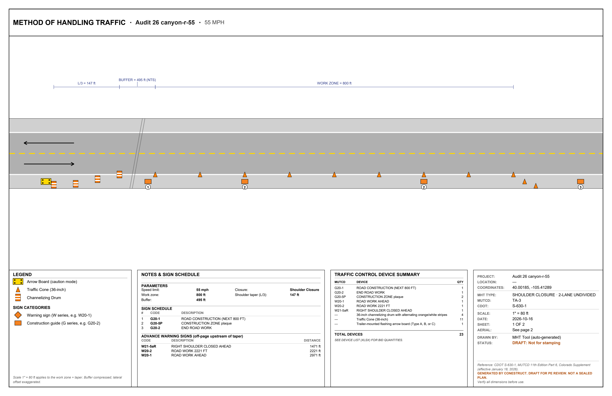

| Check | Result | Oracle | Plan | Source | Note |
|---|---|---|---|---|---|
| C1 taper | PASS | L/3 ≥ 147 ft (W=8 ft, S=55) | page 1 label 147, page 1 notes 147, audit 147, crew sheet 147 | MUTCD Table 6B-4 and 6B-3, p. 775 (O1, O2) |  |
| C2 advance sign spacing | PASS | rural: A 500, B 500, C 500 ft (minimum) | gaps 1471, 750, 750 (signs at 1471, 2221, 2971 ft) | MUTCD Table 6B-1, p. 773; S-630-1 Sheet 4 (O3) |  |
| C3 limited sight distance | **FLAG** | §6B.04 ¶07–¶08 allow an increase, no factor; audit's own claim: 50% farther from the taper = [750, 1500, 2250] | distances [1471, 2221, 2971]; audit: "Moved 3 advance warning sign(s) 50% farther upstream from the taper to compensate for limited sight distance." rule "MUTCD §6B.04: increased advance warning for limited sight distance" | MUTCD §6B.04 ¶04–¶08, p. 771 (O4) | signs sit at 1471, 2221, 2971 ft before the taper: 1.5 × their station from the work zone's far end (1471, 2221, 2971), not 50% farther from the taper as the audit says (750, 1500, 2250); the 50% factor is filed under §6B.04, which gives no factor, and isn't marked as chosen (Rule 12) |
| C4 buffer | PASS | ≥ 495 ft at 55 mph | page 1 label 495, page 1 notes 495, audit 495, crew sheet 495, page 2 495 | MUTCD Table 6B-2, p. 775; S-630-1 Note 24, Sheet 14 (O5) |  |
| C5 device spacing | **FLAG** | taper ≤ 55 ft, tangent (buffer + work area) ≤ 110 ft | taper 49 ft ≤ 55; tangent 100 ft ≤ 110 from station 0 to 800; the 495 ft buffer (stations 800–1295) has no channelizing devices: a 495 ft gap > 2S = 110 ft; downstream taper 50 ft (50–100) | MUTCD §6K.01 ¶04, p. 815; S-630-1 Note 18; §6B.08 ¶12, p. 776 (O6, O7) |  |
| C6a shoulder sign legend | PASS | W21-5aR only | W21-5aR | MUTCD §6H.22 ¶02, p. 807 (O8) |  |
| C6b arrow board mode | PASS | caution mode only | caution mode stated | MUTCD §6N.06 ¶09, p. 845; TA-4 Note 8, p. 866; S-630-1 Note 26 (O10) |  |
| C7 signs by side | PASS | right side (own direction, TA-3 figure) | right side; audit Note 8: Required: False. Signs placed: 0 left, 7 right. | S-630-1 Note 8; MUTCD TA-3 Note 1, p. 864; §6N.06 ¶03, p. 845; #243 R54 (O9) |  |
| C8 device counts agree | PASS | same quantity of every device on every surface | 23 devices, 9 types, equal on 5 surfaces | Rule 10 / P2 one voice per fact |  |
| C8b drawn signs vs summary | PASS | every sign in the summary is drawn or listed off-page | match | Rule 10 | drawn counts read from page-1 schedule markers; cones and drums are vector glyphs and are not counted here |
| C9a assumed shoulder width shown | **FLAG** | page 1 states the 8 ft shoulder width the taper uses (no input exists) | page 1 never states the shoulder width | Rule 10; MUTCD TA-3 Note 8, p. 864 (O11) | the taper L = W·S… uses W; the audit discloses it only for one-way streets |
| C9d CDOT edition link (#265) | **FLAG** | S-630-1 July 01, 2026, 26 sheets | audit links S-630-01%20(19-Page%20Set).pdf | S-630-1 2026; CLAUDE.md staleness note; ruling d | edition finding: goes to #265 |
| C10 notes match drawing | PASS | every value in NOTES equals its drawn label; every summary sign is in the schedule or off-page list | match | Rule 10 |  |
| C11 containment | PASS | 0/0/0 | 0/0/0 | tests/test_pdf_containment.py measure |  |
| C12b Type 1 barricade | PASS | none at 55 mph or more | none | S-630-1 Sheet 2 Note 16 (O14) |  |
| C13 ≥8 ft shoulder closed | PASS | ≥1 advance warning sign and channelizing devices on a shoulder taper | 3 advance signs, 4 taper devices (W=8 ft) | MUTCD §6N.06 ¶02, p. 845; TA-3 Note 8 (O11) |  |

### 27. `hartsel-r-65`: US 24 near Hartsel (rural)

US 24 (trunk, oneway=None) · rural_divided, divided, 1 lanes × 12.0 ft · 65 mph · right shoulder · 1500 ft · day · sight distance normal · None · TA-3, Case 11: Shoulder closure on divided highway · scan ok []

**5 FLAG** · pin 39.02175, -105.79286

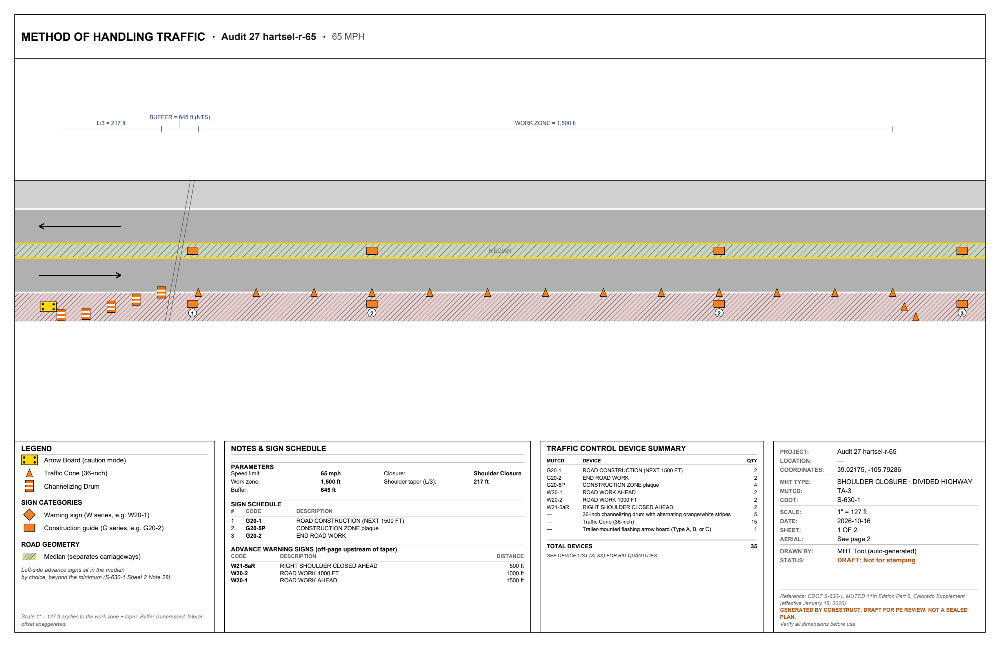

| Check | Result | Oracle | Plan | Source | Note |
|---|---|---|---|---|---|
| C1 taper | PASS | L/3 ≥ 217 ft (W=10 ft, S=65) | page 1 label 217, page 1 notes 217, audit 217, crew sheet 217 | MUTCD Table 6B-4 and 6B-3, p. 775 (O1, O2) |  |
| C2 advance sign spacing | PASS | rural: A 500, B 500, C 500 ft (minimum) | gaps 500, 500, 500 (signs at 500, 1000, 1500 ft) | MUTCD Table 6B-1, p. 773; S-630-1 Sheet 4 (O3) |  |
| C15 carriageway | **FLAG** | a divided road's carriageways are mapped one-way; a single two-way way is one undivided road | OSM way 17122234 (trunk) has oneway=None; the plan says "Case 11: Shoulder closure on divided highway" | Rule 10 (the plan contradicts the road it relays) | the site's classifier marks every trunk road divided (conestruct/site/lib/road-detection/classify.ts roadTypeAndDivided) |
| C4 buffer | PASS | ≥ 645 ft at 65 mph | page 1 label 645, page 1 notes 645, audit 645, crew sheet 645, page 2 645 | MUTCD Table 6B-2, p. 775; S-630-1 Note 24, Sheet 14 (O5) |  |
| C5 device spacing | **FLAG** | taper ≤ 65 ft, tangent (buffer + work area) ≤ 130 ft | taper 54 ft ≤ 65; tangent 125 ft ≤ 130 from station 0 to 1500; the 645 ft buffer (stations 1500–2145) has no channelizing devices: a 645 ft gap > 2S = 130 ft; downstream taper 50 ft (50–100) | MUTCD §6K.01 ¶04, p. 815; S-630-1 Note 18; §6B.08 ¶12, p. 776 (O6, O7) |  |
| C6a shoulder sign legend | PASS | W21-5aR only | W21-5aR | MUTCD §6H.22 ¶02, p. 807 (O8) |  |
| C6b arrow board mode | PASS | caution mode only | caution mode stated | MUTCD §6N.06 ¶09, p. 845; TA-4 Note 8, p. 866; S-630-1 Note 26 (O10) |  |
| C7 signs by side | **FLAG** | closure side; a mirror is R54's house choice and must not be called required | crew sheet: "- Divided highway: All warning and regulatory signs must be posted on BOTH sides of the roadway per CDOT S-630-1 Sheet 2 General Note 8.", right side; audit Note 8: Not required: one shoulder closed (Note 8's Case 11 exception). Signs placed: 7 left, 7 right. | S-630-1 Note 8; MUTCD TA-3 Note 1, p. 864; §6N.06 ¶03, p. 845; #243 R54 (O9) |  |
| C8 device counts agree | PASS | same quantity of every device on every surface | 35 devices, 9 types, equal on 5 surfaces | Rule 10 / P2 one voice per fact |  |
| C8b drawn signs vs summary | PASS | every sign in the summary is drawn or listed off-page | match | Rule 10 | drawn counts read from page-1 schedule markers; cones and drums are vector glyphs and are not counted here |
| C9a assumed shoulder width shown | **FLAG** | page 1 states the 10 ft shoulder width the taper uses (no input exists) | page 1 never states the shoulder width | Rule 10; MUTCD TA-3 Note 8, p. 864 (O11) | the taper L = W·S… uses W; the audit discloses it only for one-way streets |
| C9d CDOT edition link (#265) | **FLAG** | S-630-1 July 01, 2026, 26 sheets | audit links S-630-01%20(19-Page%20Set).pdf | S-630-1 2026; CLAUDE.md staleness note; ruling d | edition finding: goes to #265 |
| C10 notes match drawing | PASS | every value in NOTES equals its drawn label; every summary sign is in the schedule or off-page list | match | Rule 10 |  |
| C11 containment | PASS | 0/0/0 | 0/0/0 | tests/test_pdf_containment.py measure |  |
| C12b Type 1 barricade | PASS | none at 55 mph or more | none | S-630-1 Sheet 2 Note 16 (O14) |  |
| C13 ≥8 ft shoulder closed | PASS | ≥1 advance warning sign and channelizing devices on a shoulder taper | 3 advance signs, 5 taper devices (W=10 ft) | MUTCD §6N.06 ¶02, p. 845; TA-3 Note 8 (O11) |  |

### 28. `hartsel-r-65-night`: US 24 near Hartsel (rural)

US 24 (trunk, oneway=None) · rural_divided, divided, 1 lanes × 12.0 ft · 65 mph · right shoulder · 5000 ft · night · sight distance limited · None · TA-3, Case 11: Shoulder closure on divided highway · scan ok ['limited_sight_distance']

**6 FLAG** · pin 39.02175, -105.79286

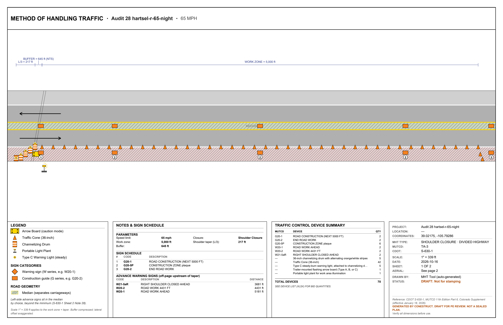

| Check | Result | Oracle | Plan | Source | Note |
|---|---|---|---|---|---|
| C1 taper | PASS | L/3 ≥ 217 ft (W=10 ft, S=65) | page 1 label 217, page 1 notes 217, audit 217, crew sheet 217 | MUTCD Table 6B-4 and 6B-3, p. 775 (O1, O2) |  |
| C2 advance sign spacing | PASS | rural: A 500, B 500, C 500 ft (minimum) | gaps 3681, 750, 750 (signs at 3681, 4431, 5181 ft) | MUTCD Table 6B-1, p. 773; S-630-1 Sheet 4 (O3) |  |
| C15 carriageway | **FLAG** | a divided road's carriageways are mapped one-way; a single two-way way is one undivided road | OSM way 17122234 (trunk) has oneway=None; the plan says "Case 11: Shoulder closure on divided highway" | Rule 10 (the plan contradicts the road it relays) | the site's classifier marks every trunk road divided (conestruct/site/lib/road-detection/classify.ts roadTypeAndDivided) |
| C3 limited sight distance | **FLAG** | §6B.04 ¶07–¶08 allow an increase, no factor; audit's own claim: 50% farther from the taper = [750, 1500, 2250] | distances [3681, 4431, 5181]; audit: "Moved 6 advance warning sign(s) 50% farther upstream from the taper to compensate for limited sight distance." rule "MUTCD §6B.04: increased advance warning for limited sight distance" | MUTCD §6B.04 ¶04–¶08, p. 771 (O4) | signs sit at 3681, 4431, 5181 ft before the taper: 1.5 × their station from the work zone's far end (3681, 4431, 5181), not 50% farther from the taper as the audit says (750, 1500, 2250); the 50% factor is filed under §6B.04, which gives no factor, and isn't marked as chosen (Rule 12) |
| C4 buffer | PASS | ≥ 645 ft at 65 mph | page 1 label 645, page 1 notes 645, audit 645, crew sheet 645, page 2 645 | MUTCD Table 6B-2, p. 775; S-630-1 Note 24, Sheet 14 (O5) |  |
| C5 device spacing | **FLAG** | taper ≤ 65 ft, tangent (buffer + work area) ≤ 130 ft | taper 54 ft ≤ 65; tangent 128 ft ≤ 130 from station 0 to 5000; the 645 ft buffer (stations 5000–5645) has no channelizing devices: a 645 ft gap > 2S = 130 ft; downstream taper 50 ft (50–100) | MUTCD §6K.01 ¶04, p. 815; S-630-1 Note 18; §6B.08 ¶12, p. 776 (O6, O7) |  |
| C6a shoulder sign legend | PASS | W21-5aR only | W21-5aR | MUTCD §6H.22 ¶02, p. 807 (O8) |  |
| C6b arrow board mode | PASS | caution mode only | caution mode stated | MUTCD §6N.06 ¶09, p. 845; TA-4 Note 8, p. 866; S-630-1 Note 26 (O10) |  |
| C7 signs by side | **FLAG** | closure side; a mirror is R54's house choice and must not be called required | crew sheet: "- Divided highway: All warning and regulatory signs must be posted on BOTH sides of the roadway per CDOT S-630-1 Sheet 2 General Note 8.", right side; audit Note 8: Not required: one shoulder closed (Note 8's Case 11 exception). Signs placed: 8 left, 8 right. | S-630-1 Note 8; MUTCD TA-3 Note 1, p. 864; §6N.06 ¶03, p. 845; #243 R54 (O9) |  |
| C8 device counts agree | PASS | same quantity of every device on every surface | 70 devices, 11 types, equal on 5 surfaces | Rule 10 / P2 one voice per fact |  |
| C8b drawn signs vs summary | PASS | every sign in the summary is drawn or listed off-page | match | Rule 10 | drawn counts read from page-1 schedule markers; cones and drums are vector glyphs and are not counted here |
| C9a assumed shoulder width shown | **FLAG** | page 1 states the 10 ft shoulder width the taper uses (no input exists) | page 1 never states the shoulder width | Rule 10; MUTCD TA-3 Note 8, p. 864 (O11) | the taper L = W·S… uses W; the audit discloses it only for one-way streets |
| C9d CDOT edition link (#265) | **FLAG** | S-630-1 July 01, 2026, 26 sheets | audit links S-630-01%20(19-Page%20Set).pdf | S-630-1 2026; CLAUDE.md staleness note; ruling d | edition finding: goes to #265 |
| C10 notes match drawing | PASS | every value in NOTES equals its drawn label; every summary sign is in the schedule or off-page list | match | Rule 10 |  |
| C11 containment | PASS | 0/0/0 | 0/0/0 | tests/test_pdf_containment.py measure |  |
| C12a cone height | PASS | ≥ 36 in at night or on a freeway | 36-inch | S-630-1 Sheet 2 Note 15 (O13) |  |
| C12b Type 1 barricade | PASS | none at 55 mph or more | none | S-630-1 Sheet 2 Note 16 (O14) |  |
| C12e night | INFO | recorded only | sonnel in the work zone must wear ANSI Class 2 (daytime) or Class 3 (nighttime) high-visibility apparel.; - Nighttime operation: Ensure all devices meet retroreflectivity re; quirements. Flagger stations require 500W quartz illumination at minimum 8 ft height per CDOT S-630-1 Sheet 2 General | unsourced beyond O13 |  |
| C13 ≥8 ft shoulder closed | PASS | ≥1 advance warning sign and channelizing devices on a shoulder taper | 3 advance signs, 5 taper devices (W=10 ft) | MUTCD §6N.06 ¶02, p. 845; TA-3 Note 8 (O11) |  |

### 29. `lamar-r-55`: US 50/287, Lamar

US 50;US 287 (trunk, oneway=yes) · urban_arterial, divided, 2 lanes × 12.0 ft · 55 mph · right shoulder · 200 ft · day · sight distance normal · None · TA-3, Case 11: Shoulder closure on divided highway · scan ok ['adjacent_interchange']

**4 FLAG** · pin 38.1158, -102.62119

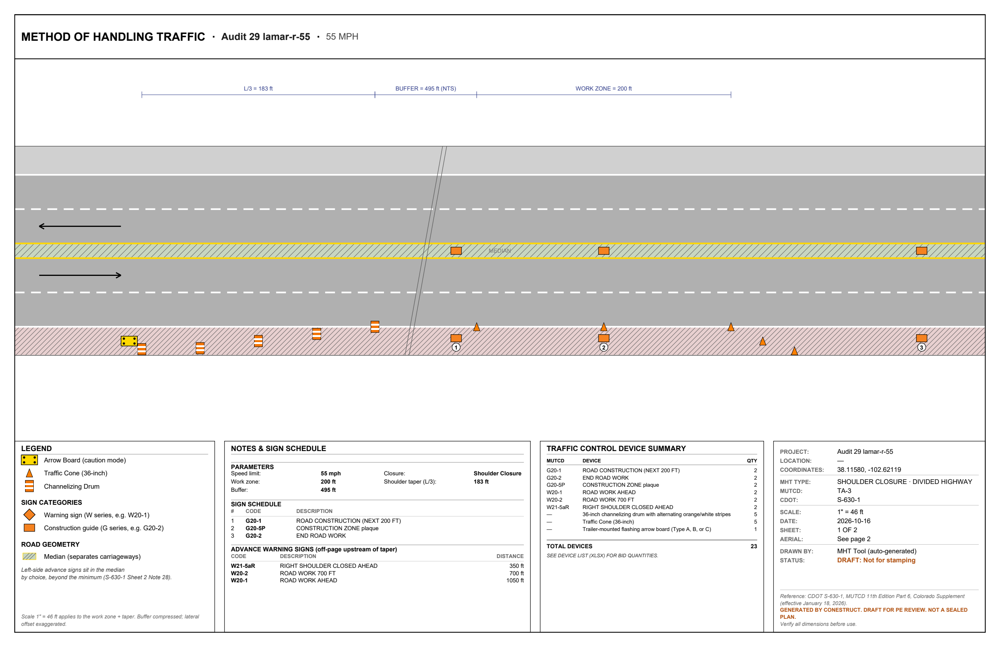

| Check | Result | Oracle | Plan | Source | Note |
|---|---|---|---|---|---|
| C1 taper | PASS | L/3 ≥ 183 ft (W=10 ft, S=55) | page 1 label 183, page 1 notes 183, audit 183, crew sheet 183 | MUTCD Table 6B-4 and 6B-3, p. 775 (O1, O2) |  |
| C2 advance sign spacing | PASS | urban_high: A 350, B 350, C 350 ft (minimum) | gaps 350, 350, 350 (signs at 350, 700, 1050 ft) | MUTCD Table 6B-1, p. 773; S-630-1 Sheet 4 (O3) |  |
| C4 buffer | PASS | ≥ 495 ft at 55 mph | page 1 label 495, page 1 notes 495, audit 495, crew sheet 495, page 2 495 | MUTCD Table 6B-2, p. 775; S-630-1 Note 24, Sheet 14 (O5) |  |
| C5 device spacing | **FLAG** | taper ≤ 55 ft, tangent (buffer + work area) ≤ 110 ft | taper 46 ft ≤ 55; tangent 100 ft ≤ 110 from station 0 to 200; the 495 ft buffer (stations 200–695) has no channelizing devices: a 495 ft gap > 2S = 110 ft; downstream taper 50 ft (50–100) | MUTCD §6K.01 ¶04, p. 815; S-630-1 Note 18; §6B.08 ¶12, p. 776 (O6, O7) |  |
| C6a shoulder sign legend | PASS | W21-5aR only | W21-5aR | MUTCD §6H.22 ¶02, p. 807 (O8) |  |
| C6b arrow board mode | PASS | caution mode only | caution mode stated | MUTCD §6N.06 ¶09, p. 845; TA-4 Note 8, p. 866; S-630-1 Note 26 (O10) |  |
| C7 signs by side | **FLAG** | closure side; a mirror is R54's house choice and must not be called required | crew sheet: "- Divided highway: All warning and regulatory signs must be posted on BOTH sides of the roadway per CDOT S-630-1 Sheet 2 General Note 8.", right side; audit Note 8: Not required: one shoulder closed (Note 8's Case 11 exception). Signs placed: 6 left, 6 right. | S-630-1 Note 8; MUTCD TA-3 Note 1, p. 864; §6N.06 ¶03, p. 845; #243 R54 (O9) |  |
| C8 device counts agree | PASS | same quantity of every device on every surface | 23 devices, 9 types, equal on 5 surfaces | Rule 10 / P2 one voice per fact |  |
| C8b drawn signs vs summary | PASS | every sign in the summary is drawn or listed off-page | match | Rule 10 | drawn counts read from page-1 schedule markers; cones and drums are vector glyphs and are not counted here |
| C9a assumed shoulder width shown | **FLAG** | page 1 states the 10 ft shoulder width the taper uses (no input exists) | page 1 never states the shoulder width | Rule 10; MUTCD TA-3 Note 8, p. 864 (O11) | the taper L = W·S… uses W; the audit discloses it only for one-way streets |
| C9d CDOT edition link (#265) | **FLAG** | S-630-1 July 01, 2026, 26 sheets | audit links S-630-01%20(19-Page%20Set).pdf | S-630-1 2026; CLAUDE.md staleness note; ruling d | edition finding: goes to #265 |
| C10 notes match drawing | PASS | every value in NOTES equals its drawn label; every summary sign is in the schedule or off-page list | match | Rule 10 |  |
| C11 containment | PASS | 0/0/0 | 0/0/0 | tests/test_pdf_containment.py measure |  |
| C12b Type 1 barricade | PASS | none at 55 mph or more | none | S-630-1 Sheet 2 Note 16 (O14) |  |
| C13 ≥8 ft shoulder closed | PASS | ≥1 advance warning sign and channelizing devices on a shoulder taper | 3 advance signs, 5 taper devices (W=10 ft) | MUTCD §6N.06 ¶02, p. 845; TA-3 Note 8 (O11) |  |

### 30b. `i25-r-65-night-3lanes`: I-25, Denver

South Valley Highway I 25 (motorway, oneway=yes) · freeway, divided, 3 lanes × 12 ft · 65 mph · right shoulder · 1500 ft · night · sight distance normal · Denver · TA-5, Case 11: Shoulder closure on divided highway · scan ok ['adjacent_interchange', 'adjacent_intersection', 'pedestrian_facility']

**6 FLAG** · pin 39.68539, -104.96427

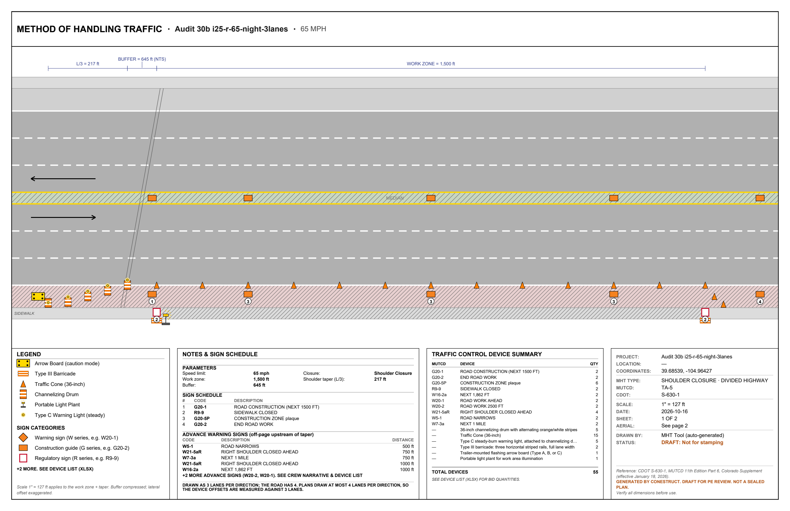

| Check | Result | Oracle | Plan | Source | Note |
|---|---|---|---|---|---|
| C1 taper | PASS | L/3 ≥ 217 ft (W=10 ft, S=65) | page 1 label 217, page 1 notes 217, audit 217, crew sheet 217 | MUTCD Table 6B-4 and 6B-3, p. 775 (O1, O2) |  |
| C2 advance sign spacing | **FLAG** | freeway: A 1000, B 1500, C 2640 ft (minimum) | gaps 500, 250, 250, 1500, 2640 (signs at 500, 750, 1000, 2500, 5140 ft) | MUTCD Table 6B-1, p. 773; S-630-1 Sheet 4 (O3) |  |
| C2c Case 11 distances | **FLAG** | W5-1 ≥ 500 ft, W21-5aR ≥ 1000 ft, W21-5aR ≥ 2000 ft, W20-1 ≥ 5200 ft | W5-1 500, W21-5aR 750, W21-5aR 1000, W20-1 5140 | S-630-1 Sheet 7, Case No. 11 (O16) | W21-5aR at 750 ft (Case 11: 1000); W21-5aR at 1000 ft (Case 11: 2000); W20-1 at 5140 ft (Case 11: 5200) |
| C4 buffer | PASS | ≥ 645 ft at 65 mph | page 1 label 645, page 1 notes 645, audit 645, crew sheet 645, page 2 645 | MUTCD Table 6B-2, p. 775; S-630-1 Note 24, Sheet 14 (O5) |  |
| C5 device spacing | **FLAG** | taper ≤ 65 ft, tangent (buffer + work area) ≤ 130 ft | taper 54 ft ≤ 65; tangent 125 ft ≤ 130 from station 0 to 1500; the 645 ft buffer (stations 1500–2145) has no channelizing devices: a 645 ft gap > 2S = 130 ft; downstream taper 50 ft (50–100) | MUTCD §6K.01 ¶04, p. 815; S-630-1 Note 18; §6B.08 ¶12, p. 776 (O6, O7) |  |
| C6a shoulder sign legend | PASS | W21-5aR only | W21-5aR | MUTCD §6H.22 ¶02, p. 807 (O8) |  |
| C6b arrow board mode | PASS | caution mode only | caution mode stated | MUTCD §6N.06 ¶09, p. 845; TA-4 Note 8, p. 866; S-630-1 Note 26 (O10) |  |
| C6c freeway sign set | PASS | W20-1 then W21-5a; plaque W16-2/W16-4P/W7-3aP if the end isn't visible | G20-1, G20-2, G20-5P, R9-9, W16-2a, W20-1, W20-2, W21-5aR, W5-1, W7-3a, arrow_board, barricade_iii, cone, drum, light_plant, warning_light | MUTCD §6N.06 ¶03, p. 845; TA-5, p. 869; S-630-1 Sheet 7 Case 11 (O12) |  |
| C7 signs by side | **FLAG** | closure side; a mirror is R54's house choice and must not be called required | crew sheet: "- Divided highway: All warning and regulatory signs must be posted on BOTH sides of the roadway per CDOT S-630-1 Sheet 2 General Note 8.", right side; audit Note 8: Not required: one shoulder closed (Note 8's Case 11 exception). Signs placed: 12 left, 14 right. | S-630-1 Note 8; MUTCD TA-3 Note 1, p. 864; §6N.06 ¶03, p. 845; #243 R54 (O9) |  |
| C8 device counts agree | PASS | same quantity of every device on every surface | 55 devices, 16 types, equal on 5 surfaces | Rule 10 / P2 one voice per fact |  |
| C8b drawn signs vs summary | PASS | every sign in the summary is drawn or listed off-page | match | Rule 10 | drawn counts read from page-1 schedule markers; cones and drums are vector glyphs and are not counted here |
| C9a assumed shoulder width shown | **FLAG** | page 1 states the 10 ft shoulder width the taper uses (no input exists) | page 1 never states the shoulder width | Rule 10; MUTCD TA-3 Note 8, p. 864 (O11) | the taper L = W·S… uses W; the audit discloses it only for one-way streets |
| C9b jurisdiction math | INFO | jurisdiction rules applied, or the plan says CDOT's are used | Denver; page 1 cites CDOT S-630-1 | Rule 10 | the engine always computes with CDOT values (src/api/schemas.py:1519) |
| C9c edition (#265) | INFO | Denver's record pins MUTCD 2009 R2 (PT-116.1) | plan cites MUTCD 11th Edition | data/jurisdictions/denver.json; ruling d | tracked in #265 |
| C9d CDOT edition link (#265) | **FLAG** | S-630-1 July 01, 2026, 26 sheets | audit links S-630-01%20(19-Page%20Set).pdf | S-630-1 2026; CLAUDE.md staleness note; ruling d | edition finding: goes to #265 |
| C10 notes match drawing | PASS | every value in NOTES equals its drawn label; every summary sign is in the schedule or off-page list | match | Rule 10 |  |
| C11 containment | PASS | 0/0/0 | 0/0/0 | tests/test_pdf_containment.py measure |  |
| C12a cone height | PASS | ≥ 36 in at night or on a freeway | 36-inch | S-630-1 Sheet 2 Note 15 (O13) |  |
| C12b Type 1 barricade | PASS | none at 55 mph or more | none | S-630-1 Sheet 2 Note 16 (O14) |  |
| C12c sidewalk | PASS | closure shown (TA-28) or limits stated | scan found a sidewalk; plan closes it (R9-9 / pedestrian notes) | MUTCD TA-28 Note 1, p. 914; §6N.04 ¶06, p. 843 (O15) |  |
| C12e night | INFO | recorded only | sonnel in the work zone must wear ANSI Class 2 (daytime) or Class 3 (nighttime) high-visibility apparel.; - Nighttime operation: Ensure all devices meet retroreflectivity re; quirements. Flagger stations require 500W quartz illumination at minimum 8 ft height per CDOT S-630-1 Sheet 2 General | unsourced beyond O13 |  |
| C13 ≥8 ft shoulder closed | PASS | ≥1 advance warning sign and channelizing devices on a shoulder taper | 7 advance signs, 5 taper devices (W=10 ft) | MUTCD §6N.06 ¶02, p. 845; TA-3 Note 8 (O11) |  |

### 31. `e470-r-75`: E-470

E-470 E470 (motorway, oneway=yes) · freeway, divided, 2 lanes × 12.0 ft · 75 mph · right shoulder · 5000 ft · day · sight distance normal · Denver · TA-5, Case 11: Shoulder closure on divided highway · scan ok ['adjacent_interchange']

**6 FLAG** · pin 39.8282, -104.7472

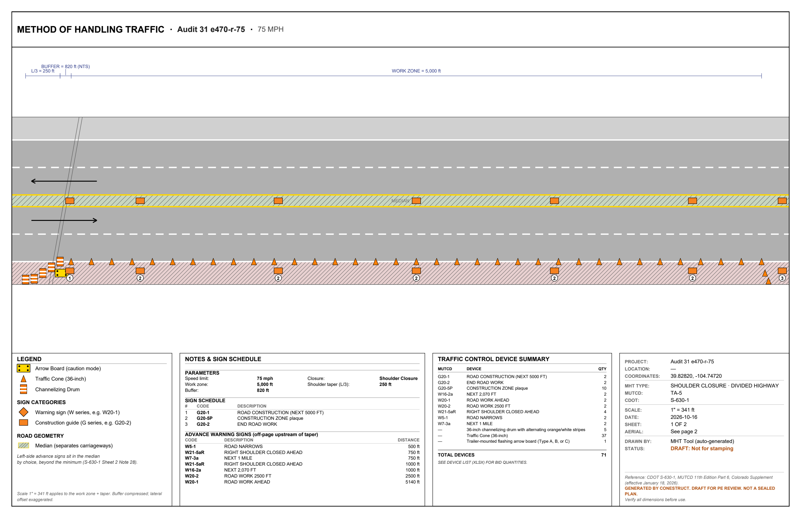

| Check | Result | Oracle | Plan | Source | Note |
|---|---|---|---|---|---|
| C1 taper | PASS | L/3 ≥ 250 ft (W=10 ft, S=75) | page 1 label 250, page 1 notes 250, audit 250, crew sheet 250 | MUTCD Table 6B-4 and 6B-3, p. 775 (O1, O2) |  |
| C2 advance sign spacing | **FLAG** | freeway: A 1000, B 1500, C 2640 ft (minimum) | gaps 500, 250, 250, 1500, 2640 (signs at 500, 750, 1000, 2500, 5140 ft) | MUTCD Table 6B-1, p. 773; S-630-1 Sheet 4 (O3) |  |
| C2c Case 11 distances | **FLAG** | W5-1 ≥ 500 ft, W21-5aR ≥ 1000 ft, W21-5aR ≥ 2000 ft, W20-1 ≥ 5200 ft | W5-1 500, W21-5aR 750, W21-5aR 1000, W20-1 5140 | S-630-1 Sheet 7, Case No. 11 (O16) | W21-5aR at 750 ft (Case 11: 1000); W21-5aR at 1000 ft (Case 11: 2000); W20-1 at 5140 ft (Case 11: 5200) |
| C4 buffer | PASS | ≥ 820 ft at 75 mph | page 1 label 820, page 1 notes 820, audit 820, crew sheet 820, page 2 820 | MUTCD Table 6B-2, p. 775; S-630-1 Note 24, Sheet 14 (O5) |  |
| C5 device spacing | **FLAG** | taper ≤ 75 ft, tangent (buffer + work area) ≤ 150 ft | taper 62 ft ≤ 75; tangent 147 ft ≤ 150 from station 0 to 5000; the 820 ft buffer (stations 5000–5820) has no channelizing devices: a 820 ft gap > 2S = 150 ft; downstream taper 50 ft (50–100) | MUTCD §6K.01 ¶04, p. 815; S-630-1 Note 18; §6B.08 ¶12, p. 776 (O6, O7) |  |
| C6a shoulder sign legend | PASS | W21-5aR only | W21-5aR | MUTCD §6H.22 ¶02, p. 807 (O8) |  |
| C6b arrow board mode | PASS | caution mode only | caution mode stated | MUTCD §6N.06 ¶09, p. 845; TA-4 Note 8, p. 866; S-630-1 Note 26 (O10) |  |
| C6c freeway sign set | PASS | W20-1 then W21-5a; plaque W16-2/W16-4P/W7-3aP if the end isn't visible | G20-1, G20-2, G20-5P, W16-2a, W20-1, W20-2, W21-5aR, W5-1, W7-3a, arrow_board, cone, drum | MUTCD §6N.06 ¶03, p. 845; TA-5, p. 869; S-630-1 Sheet 7 Case 11 (O12) |  |
| C7 signs by side | **FLAG** | closure side; a mirror is R54's house choice and must not be called required | crew sheet: "- Divided highway: All warning and regulatory signs must be posted on BOTH sides of the roadway per CDOT S-630-1 Sheet 2 General Note 8.", right side; audit Note 8: Not required: one shoulder closed (Note 8's Case 11 exception). Signs placed: 14 left, 14 right. | S-630-1 Note 8; MUTCD TA-3 Note 1, p. 864; §6N.06 ¶03, p. 845; #243 R54 (O9) |  |
| C8 device counts agree | PASS | same quantity of every device on every surface | 71 devices, 12 types, equal on 5 surfaces | Rule 10 / P2 one voice per fact |  |
| C8b drawn signs vs summary | PASS | every sign in the summary is drawn or listed off-page | match | Rule 10 | drawn counts read from page-1 schedule markers; cones and drums are vector glyphs and are not counted here |
| C9a assumed shoulder width shown | **FLAG** | page 1 states the 10 ft shoulder width the taper uses (no input exists) | page 1 never states the shoulder width | Rule 10; MUTCD TA-3 Note 8, p. 864 (O11) | the taper L = W·S… uses W; the audit discloses it only for one-way streets |
| C9b jurisdiction math | INFO | jurisdiction rules applied, or the plan says CDOT's are used | Denver; page 1 cites CDOT S-630-1 | Rule 10 | the engine always computes with CDOT values (src/api/schemas.py:1519) |
| C9c edition (#265) | INFO | Denver's record pins MUTCD 2009 R2 (PT-116.1) | plan cites MUTCD 11th Edition | data/jurisdictions/denver.json; ruling d | tracked in #265 |
| C9d CDOT edition link (#265) | **FLAG** | S-630-1 July 01, 2026, 26 sheets | audit links S-630-01%20(19-Page%20Set).pdf | S-630-1 2026; CLAUDE.md staleness note; ruling d | edition finding: goes to #265 |
| C10 notes match drawing | PASS | every value in NOTES equals its drawn label; every summary sign is in the schedule or off-page list | match | Rule 10 |  |
| C11 containment | PASS | 0/0/0 | 0/0/0 | tests/test_pdf_containment.py measure |  |
| C12a cone height | PASS | ≥ 36 in at night or on a freeway | 36-inch | S-630-1 Sheet 2 Note 15 (O13) |  |
| C12b Type 1 barricade | PASS | none at 55 mph or more | none | S-630-1 Sheet 2 Note 16 (O14) |  |
| C13 ≥8 ft shoulder closed | PASS | ≥1 advance warning sign and channelizing devices on a shoulder taper | 7 advance signs, 5 taper devices (W=10 ft) | MUTCD §6N.06 ¶02, p. 845; TA-3 Note 8 (O11) |  |

### 32. `ogden-r-25-50ft`: Ogden St between 6th and 7th Ave, Denver (two-way residential)

Ogden Street (residential, oneway=no) · urban_arterial, undivided, 1 lanes × 12.0 ft · 25 mph · right shoulder · 50 ft · day · sight distance normal · Denver · TA-3, Case 11: Shoulder closure on undivided highway · scan ok ['adjacent_intersection', 'pedestrian_facility']

**3 FLAG** · pin 39.7265, -104.97525

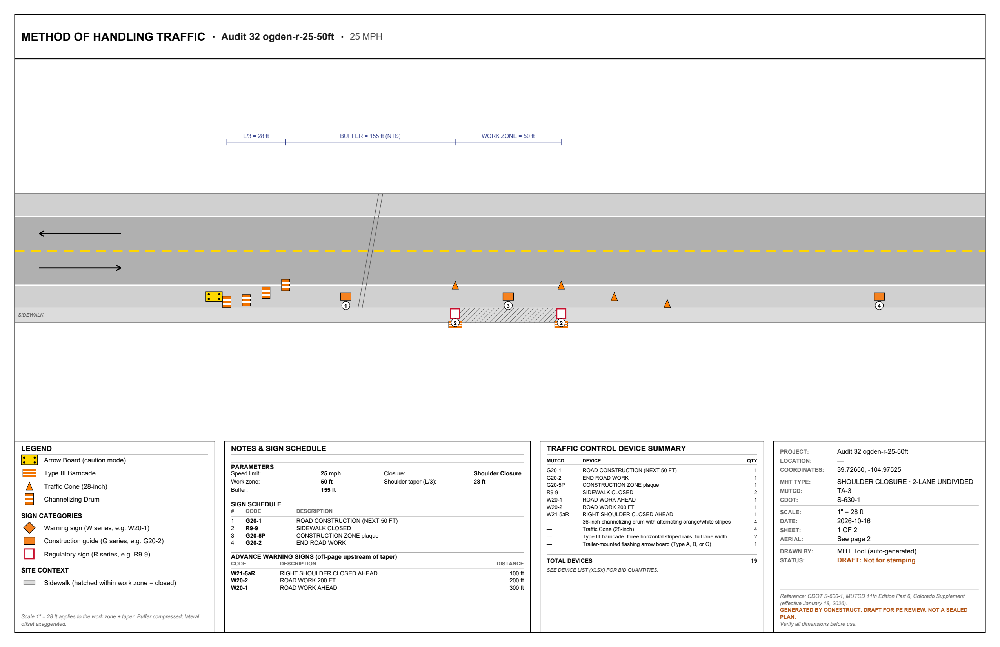

| Check | Result | Oracle | Plan | Source | Note |
|---|---|---|---|---|---|
| C1 taper | PASS | L/3 ≥ 28 ft (W=8 ft, S=25) | page 1 label 28, page 1 notes 28, audit 28, crew sheet 28 | MUTCD Table 6B-4 and 6B-3, p. 775 (O1, O2) |  |
| C2 advance sign spacing | PASS | urban_low: A 100, B 100, C 100 ft (minimum) | gaps 100, 100, 100 (signs at 100, 200, 300 ft) | MUTCD Table 6B-1, p. 773; S-630-1 Sheet 4 (O3) |  |
| C4 buffer | PASS | ≥ 155 ft at 25 mph | page 1 label 155, page 1 notes 155, audit 155, crew sheet 155, page 2 155 | MUTCD Table 6B-2, p. 775; S-630-1 Note 24, Sheet 14 (O5) |  |
| C5 device spacing | **FLAG** | taper ≤ 25 ft, tangent (buffer + work area) ≤ 50 ft | taper 9 ft ≤ 25; tangent 50 ft ≤ 50 from station 0 to 50; the 155 ft buffer (stations 50–205) has no channelizing devices: a 155 ft gap > 2S = 50 ft; downstream taper 50 ft (50–100) | MUTCD §6K.01 ¶04, p. 815; S-630-1 Note 18; §6B.08 ¶12, p. 776 (O6, O7) |  |
| C6a shoulder sign legend | PASS | W21-5aR only | W21-5aR | MUTCD §6H.22 ¶02, p. 807 (O8) |  |
| C6b arrow board mode | PASS | caution mode only | caution mode stated | MUTCD §6N.06 ¶09, p. 845; TA-4 Note 8, p. 866; S-630-1 Note 26 (O10) |  |
| C7 signs by side | PASS | right side (own direction, TA-3 figure) | right side; audit Note 8: Required: False. Signs placed: 0 left, 8 right. | S-630-1 Note 8; MUTCD TA-3 Note 1, p. 864; §6N.06 ¶03, p. 845; #243 R54 (O9) |  |
| C8 device counts agree | PASS | same quantity of every device on every surface | 19 devices, 11 types, equal on 5 surfaces | Rule 10 / P2 one voice per fact |  |
| C8b drawn signs vs summary | PASS | every sign in the summary is drawn or listed off-page | match | Rule 10 | drawn counts read from page-1 schedule markers; cones and drums are vector glyphs and are not counted here |
| C9a assumed shoulder width shown | **FLAG** | page 1 states the 8 ft shoulder width the taper uses (no input exists) | page 1 never states the shoulder width | Rule 10; MUTCD TA-3 Note 8, p. 864 (O11) | the taper L = W·S… uses W; the audit discloses it only for one-way streets |
| C9b jurisdiction math | INFO | jurisdiction rules applied, or the plan says CDOT's are used | Denver; page 1 cites CDOT S-630-1 | Rule 10 | the engine always computes with CDOT values (src/api/schemas.py:1519) |
| C9c edition (#265) | INFO | Denver's record pins MUTCD 2009 R2 (PT-116.1) | plan cites MUTCD 11th Edition | data/jurisdictions/denver.json; ruling d | tracked in #265 |
| C9d CDOT edition link (#265) | **FLAG** | S-630-1 July 01, 2026, 26 sheets | audit links S-630-01%20(19-Page%20Set).pdf | S-630-1 2026; CLAUDE.md staleness note; ruling d | edition finding: goes to #265 |
| C10 notes match drawing | PASS | every value in NOTES equals its drawn label; every summary sign is in the schedule or off-page list | match | Rule 10 |  |
| C11 containment | PASS | 0/0/0 | 0/0/0 | tests/test_pdf_containment.py measure |  |
| C12c sidewalk | PASS | closure shown (TA-28) or limits stated | scan found a sidewalk; plan closes it (R9-9 / pedestrian notes) | MUTCD TA-28 Note 1, p. 914; §6N.04 ¶06, p. 843 (O15) |  |
| C13 ≥8 ft shoulder closed | PASS | ≥1 advance warning sign and channelizing devices on a shoulder taper | 3 advance signs, 4 taper devices (W=8 ft) | MUTCD §6N.06 ¶02, p. 845; TA-3 Note 8 (O11) |  |

